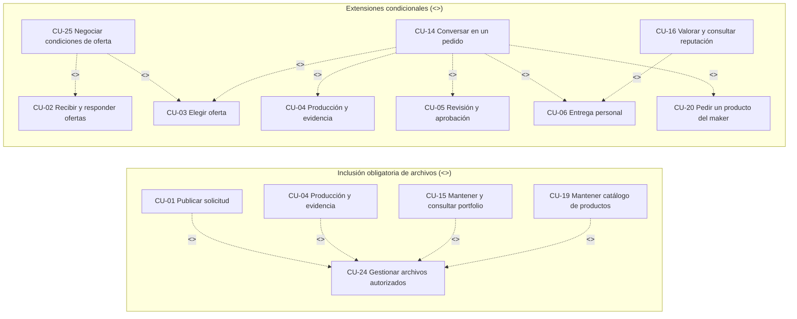

# Casos de uso y aceptación

El catálogo conserva CU-01 a CU-13 y amplía la cobertura hasta CU-25. Cada especificación utiliza la plantilla de la materia y se mantiene en un documento propio, con actores, referencias, precondiciones, postcondiciones y flujos numerados.

## Diagrama de casos de uso

[Abrir SVG](/3daltoque-docs/documentos/56672ecacb3e-casos-de-uso.svg) · [Fuente editable](/3daltoque-docs/documentos/c14d6068439c-casos-de-uso.puml)

### Relaciones `<<include>>` y `<<extend>>` del modelo

| Relación UML | Caso de uso base | Caso de uso relacionado | Semántica en el dominio de 3DAltoque |
| --- | --- | --- | --- |
| `<<include>>` | [CU-01 Publicar solicitud](/3daltoque-docs/analisis/casos/cu-01-publicar-solicitud/), [CU-04 Producción y evidencia](/3daltoque-docs/analisis/casos/cu-04-produccion-y-evidencia/), [CU-15 Portfolio](/3daltoque-docs/analisis/casos/cu-15-mantener-y-consultar-portfolio/), [CU-19 Catálogo](/3daltoque-docs/analisis/casos/cu-19-mantener-catalogo-de-productos/) | [CU-24 Gestionar archivos autorizados](/3daltoque-docs/analisis/casos/cu-24-gestionar-archivos-autorizados/) | Toda carga de archivo `.STL` o medio visual exige validar tipo, tamaño, integridad y permisos mediante `CU-24`. |
| `<<extend>>` | [CU-02 Recibir y responder ofertas](/3daltoque-docs/analisis/casos/cu-02-recibir-y-responder-ofertas/), [CU-03 Elegir oferta](/3daltoque-docs/analisis/casos/cu-03-elegir-oferta/) | [CU-25 Negociar condiciones de una oferta](/3daltoque-docs/analisis/casos/cu-25-negociar-condiciones-de-una-oferta/) | Opcionalmente, antes de aceptar una versión, cliente y maker pueden proponer ajustes que publican una nueva `VersionOferta`. |
| `<<extend>>` | [CU-03](/3daltoque-docs/analisis/casos/cu-03-elegir-oferta/), [CU-04](/3daltoque-docs/analisis/casos/cu-04-produccion-y-evidencia/), [CU-05](/3daltoque-docs/analisis/casos/cu-05-revision-y-aprobacion/), [CU-06](/3daltoque-docs/analisis/casos/cu-06-entrega-personal/), [CU-20](/3daltoque-docs/analisis/casos/cu-20-pedir-un-producto-del-maker/) | [CU-14 Conversar en un pedido](/3daltoque-docs/analisis/casos/cu-14-conversar-en-un-pedido/) | Una vez confirmado el pedido, las partes pueden intercambiar mensajes y adjuntos contextuales en cualquier etapa operativa. |
| `<<extend>>` | [CU-06 Entrega personal](/3daltoque-docs/analisis/casos/cu-06-entrega-personal/) | [CU-16 Valorar y consultar reputación](/3daltoque-docs/analisis/casos/cu-16-valorar-y-consultar-reputacion/) | Una vez confirmada la recepción de la pieza en `CU-06`, se habilita la valoración bidireccional del pedido completado. |

## Índice de especificaciones

| ID | Caso de uso | Actores | Funcionalidades |
| --- | --- | --- | --- |
| CU-01 | [Publicar solicitud](/3daltoque-docs/analisis/casos/cu-01-publicar-solicitud/) | Cliente, Sistema | F05, F06, F07, F08, F23 |
| CU-02 | [Recibir y responder ofertas](/3daltoque-docs/analisis/casos/cu-02-recibir-y-responder-ofertas/) | Maker, Sistema | F08, F09 |
| CU-03 | [Elegir oferta](/3daltoque-docs/analisis/casos/cu-03-elegir-oferta/) | Cliente, Sistema | F09, F10, F13 |
| CU-04 | [Producción y evidencia](/3daltoque-docs/analisis/casos/cu-04-produccion-y-evidencia/) | Maker, Cliente, Sistema | F12, F15, F23 |
| CU-05 | [Revisión y aprobación](/3daltoque-docs/analisis/casos/cu-05-revision-y-aprobacion/) | Cliente, Maker, Sistema | F22, F12, F14 |
| CU-06 | [Entrega personal](/3daltoque-docs/analisis/casos/cu-06-entrega-personal/) | Cliente, Maker, Sistema | F16, F17 |
| CU-07 | [Administración operativa](/3daltoque-docs/analisis/casos/cu-07-administracion-operativa/) | Administración, Sistema | F20 |
| CU-08 | [Consultar membresía](/3daltoque-docs/analisis/casos/cu-08-consultar-membresia/) | Maker, Sistema | F11 |
| CU-09 | [Habilitar perfil e iniciar prueba](/3daltoque-docs/analisis/casos/cu-09-habilitar-perfil-e-iniciar-prueba/) | Maker, Sistema | F03, F11 |
| CU-10 | [Asignar beneficio fundador](/3daltoque-docs/analisis/casos/cu-10-asignar-beneficio-fundador/) | Administración, Sistema | F11, F20 |
| CU-11 | [Pagar o renovar abono](/3daltoque-docs/analisis/casos/cu-11-pagar-o-renovar-abono/) | Maker, Mercado Pago, Sistema | F11 |
| CU-12 | [Gestionar plan y promociones](/3daltoque-docs/analisis/casos/cu-12-gestionar-plan-y-promociones/) | Administración, Sistema | F11, F20 |
| CU-13 | [Registrarse y acceder](/3daltoque-docs/analisis/casos/cu-13-registrarse-y-acceder/) | Cliente, Maker, Administración, Sistema | F01 |
| CU-14 | [Conversar en un pedido](/3daltoque-docs/analisis/casos/cu-14-conversar-en-un-pedido/) | Cliente, Maker, Sistema | F13 |
| CU-15 | [Mantener y consultar portfolio](/3daltoque-docs/analisis/casos/cu-15-mantener-y-consultar-portfolio/) | Maker, Visitante, Administración, Sistema | F04 |
| CU-16 | [Valorar y consultar reputación](/3daltoque-docs/analisis/casos/cu-16-valorar-y-consultar-reputacion/) | Cliente, Maker, Administración, Sistema | F18 |
| CU-17 | [Consultar historial de pedidos](/3daltoque-docs/analisis/casos/cu-17-consultar-historial-de-pedidos/) | Cliente, Maker, Sistema | F19 |
| CU-18 | [Consultar reporte de actividad](/3daltoque-docs/analisis/casos/cu-18-consultar-reporte-de-actividad/) | Administración, Sistema | F21 |
| CU-19 | [Mantener catálogo de productos](/3daltoque-docs/analisis/casos/cu-19-mantener-catalogo-de-productos/) | Maker, Visitante, Administración, Sistema | F25 |
| CU-20 | [Pedir un producto del maker](/3daltoque-docs/analisis/casos/cu-20-pedir-un-producto-del-maker/) | Cliente, Sistema | F25, F10, F12, F13 |
| CU-21 | [Gestionar capacidades del maker](/3daltoque-docs/analisis/casos/cu-21-gestionar-capacidades-del-maker/) | Maker, Sistema | F03 |
| CU-22 | [Gestionar perfil de cliente](/3daltoque-docs/analisis/casos/cu-22-gestionar-perfil-de-cliente/) | Cliente, Sistema | F02 |
| CU-23 | [Recibir y consultar notificaciones](/3daltoque-docs/analisis/casos/cu-23-recibir-y-consultar-notificaciones/) | Cliente, Maker, Sistema | F14 |
| CU-24 | [Gestionar archivos autorizados](/3daltoque-docs/analisis/casos/cu-24-gestionar-archivos-autorizados/) | Cliente, Maker, Sistema | F23 |
| CU-25 | [Negociar condiciones de una oferta](/3daltoque-docs/analisis/casos/cu-25-negociar-condiciones-de-una-oferta/) | Cliente, Maker, Sistema | F09 |

## CU-01 Publicar solicitud

Solicitud versionada y enviada a un grupo compatible; estimación calculada o indisponibilidad informada.

[Especificación completa](/3daltoque-docs/analisis/casos/cu-01-publicar-solicitud/).

## CU-02 Recibir y responder ofertas

Oferta versionada presentada o rechazo registrado.

[Especificación completa](/3daltoque-docs/analisis/casos/cu-02-recibir-y-responder-ofertas/).

## CU-03 Elegir oferta

Un pedido confirmado con condiciones conservadas y conversación habilitada.

[Especificación completa](/3daltoque-docs/analisis/casos/cu-03-elegir-oferta/).

## CU-04 Producción y evidencia

Avance conservado y revisión con evidencia presentada al cliente.

[Especificación completa](/3daltoque-docs/analisis/casos/cu-04-produccion-y-evidencia/).

## CU-05 Revisión y aprobación

Decisión expresa sobre la revisión; la aprobación habilita coordinar la entrega.

[Especificación completa](/3daltoque-docs/analisis/casos/cu-05-revision-y-aprobacion/).

## CU-06 Entrega personal

Punto y horario acordados; recepción del cliente registrada y pedido completado.

[Especificación completa](/3daltoque-docs/analisis/casos/cu-06-entrega-personal/).

## CU-07 Administración operativa

Intervención autorizada y auditada o consulta de soporte conservada.

[Especificación completa](/3daltoque-docs/analisis/casos/cu-07-administracion-operativa/).

## CU-08 Consultar membresía

Estado, condiciones e intervalos de acceso visibles.

[Especificación completa](/3daltoque-docs/analisis/casos/cu-08-consultar-membresia/).

## CU-09 Habilitar perfil e iniciar prueba

Perfil habilitado y único beneficio inicial conservado.

[Especificación completa](/3daltoque-docs/analisis/casos/cu-09-habilitar-perfil-e-iniciar-prueba/).

## CU-10 Asignar beneficio fundador

Asignación fundadora conservada con cupo, autor y versión.

[Especificación completa](/3daltoque-docs/analisis/casos/cu-10-asignar-beneficio-fundador/).

## CU-11 Pagar o renovar abono

Compra y resultado conservados; un pago verificado concede un único período.

[Especificación completa](/3daltoque-docs/analisis/casos/cu-11-pagar-o-renovar-abono/).

## CU-12 Gestionar plan y promociones

Nueva configuración válida y auditada para operaciones futuras.

[Especificación completa](/3daltoque-docs/analisis/casos/cu-12-gestionar-plan-y-promociones/).

## CU-13 Registrarse y acceder

Identidad y perfiles autorizados; sesión vigente o cierre confirmado.

[Especificación completa](/3daltoque-docs/analisis/casos/cu-13-registrarse-y-acceder/).

## CU-14 Conversar en un pedido

Mensaje persistido o resultado recuperable; historial disponible.

[Especificación completa](/3daltoque-docs/analisis/casos/cu-14-conversar-en-un-pedido/).

## CU-15 Mantener y consultar portfolio

Trabajo publicado, actualizado o retirado; medios públicos autorizados.

[Especificación completa](/3daltoque-docs/analisis/casos/cu-15-mantener-y-consultar-portfolio/).

## CU-16 Valorar y consultar reputación

Valoración conservada y agregado público coherente.

[Especificación completa](/3daltoque-docs/analisis/casos/cu-16-valorar-y-consultar-reputacion/).

## CU-17 Consultar historial de pedidos

Listado filtrado y detalle histórico autorizado.

[Especificación completa](/3daltoque-docs/analisis/casos/cu-17-consultar-historial-de-pedidos/).

## CU-18 Consultar reporte de actividad

Indicadores con definición, filtros, fecha y fuentes identificadas.

[Especificación completa](/3daltoque-docs/analisis/casos/cu-18-consultar-reporte-de-actividad/).

## CU-19 Mantener catálogo de productos

Producto versionado publicado, pausado o retirado; pedidos históricos intactos.

[Especificación completa](/3daltoque-docs/analisis/casos/cu-19-mantener-catalogo-de-productos/).

## CU-20 Pedir un producto del maker

Pedido directo confirmado con condiciones publicadas conservadas y conversación habilitada.

[Especificación completa](/3daltoque-docs/analisis/casos/cu-20-pedir-un-producto-del-maker/).

## CU-21 Gestionar capacidades del maker

Perfil, impresoras y capacidades actualizados y versionados donde corresponda.

[Especificación completa](/3daltoque-docs/analisis/casos/cu-21-gestionar-capacidades-del-maker/).

## CU-22 Gestionar perfil de cliente

Contacto y ubicación autorizados actualizados; referencias históricas conservadas.

[Especificación completa](/3daltoque-docs/analisis/casos/cu-22-gestionar-perfil-de-cliente/).

## CU-23 Recibir y consultar notificaciones

Aviso deduplicado y bandeja propia con estado leído conservado.

[Especificación completa](/3daltoque-docs/analisis/casos/cu-23-recibir-y-consultar-notificaciones/).

## CU-24 Gestionar archivos autorizados

Archivo habilitado, consultado o retirado conforme a permisos y conservación.

[Especificación completa](/3daltoque-docs/analisis/casos/cu-24-gestionar-archivos-autorizados/).

## CU-25 Negociar condiciones de una oferta

Propuesta respondida; una aceptación del maker publica una nueva versión para decisión del cliente.

[Especificación completa](/3daltoque-docs/analisis/casos/cu-25-negociar-condiciones-de-una-oferta/).

## Aceptación y trazabilidad

Los escenarios se relacionan con los 68 RF y con los [casos de prueba](/3daltoque-docs/analisis/pruebas-y-trazabilidad/). La conversación de pedido se desarrolla en CU-14 y la confirmación directa de productos en CU-20.
