# Clases de diseño y colaboraciones

El diseño organiza los casos de uso en servicios de aplicación del monolito FastAPI. Los puertos aíslan persistencia, mapas, archivos, notificaciones y el cobro del abono. Las guardas de negocio permanecen en el backend y las operaciones sensibles coordinan sus cambios mediante una unidad de trabajo.

## Diagrama de clases

[Abrir SVG](/3daltoque-docs/documentos/57e576c9dff0-clases-diseno.svg) · [Fuente Mermaid](/3daltoque-docs/documentos/4fad4154f542-clases-diseno.mmd).

```mermaid
%%{init: {"theme":"base","themeVariables":{"primaryColor":"#E4F5FA","primaryTextColor":"#082345","primaryBorderColor":"#00BFE5","lineColor":"#315574","secondaryColor":"#F5F8FC","tertiaryColor":"#FFFFFF","fontFamily":"Manrope, sans-serif"},"flowchart":{"htmlLabels":false},"class":{"htmlLabels":false}}}%%
classDiagram
  direction LR
  class PerfilMakerService {
    +consultar_perfil(maker_id)
    +guardar_capacidades(command)
    +habilitar_perfil(command)
  }
  class CatalogoService {
    +guardar_producto(command)
    +publicar_producto(command)
    +confirmar_pedido_producto(command)
  }
  class PortfolioService {
    +publicar_trabajo(command)
    +retirar_trabajo(command)
  }
  class SolicitudService {
    +guardar_borrador(command)
    +enviar_solicitud(command)
    +consultar_estimacion(query)
  }
  class OfertaService {
    +publicar_oferta(command)
    +resolver_contraoferta(command)
    +aceptar_oferta(command)
  }
  class PedidoService {
    +consultar_pedido(query)
    +registrar_transicion(command)
  }
  class ConversacionService {
    +consultar_bandeja(query)
    +consultar_mensajes(query)
    +enviar_mensaje(command)
  }
  class RevisionService {
    +presentar_evidencia(command)
    +registrar_decision(command)
  }
  class EntregaService {
    +proponer_encuentro(command)
    +aceptar_encuentro(command)
    +confirmar_recepcion(command)
  }
  class ReputacionService {
    +publicar_valoracion(command)
    +consultar_resumen(query)
    +moderar_valoracion(command)
  }
  class MembresiaService {
    +consultar_acceso(query)
    +crear_compra(command)
    +verificar_pago(command)
    +conceder_periodo(command)
  }
  class ArchivoService {
    +autorizar_transferencia(command)
    +finalizar_archivo(command)
    +obtener_acceso(query)
  }
  class NotificacionService {
    +procesar_evento(command)
    +consultar_bandeja(query)
    +marcar_leida(command)
  }
  class ReporteQueries {
    +consultar_historial(query)
    +consultar_actividad(query)
  }
  class UnitOfWorkPort {
    <<interface>>
    +ejecutar_transaccion(operation)
  }
  class PerfilRepositoryPort {
    <<interface>>
    +consultar_propietario(id)
    +guardar_version(recurso)
  }
  class CatalogoRepositoryPort {
    <<interface>>
    +consultar_version(id, numero)
    +guardar_publicacion(producto)
  }
  class PedidoRepositoryPort {
    <<interface>>
    +aceptar_una_vez(command)
    +consultar_autorizado(query)
  }
  class ConversacionRepositoryPort {
    <<interface>>
    +obtener_por_pedido(id)
    +guardar_mensaje_una_vez(command)
  }
  class RevisionRepositoryPort {
    <<interface>>
    +registrar_revision(command)
    +registrar_decision(command)
  }
  class MembresiaRepositoryPort {
    <<interface>>
    +consultar_periodos(maker)
    +conceder_una_vez(compra)
  }
  class PaymentGatewayPort {
    <<interface>>
    +crear_checkout(compra)
    +verificar_notificacion(headers, body)
    +consultar_resultado(referencia)
  }
  class StoragePort {
    <<interface>>
    +autorizar_transferencia(meta)
    +consultar_integridad(archivo)
    +emitir_acceso(archivo)
  }
  class MapasPort {
    <<interface>>
    +resolver_referencia(query)
  }
  class NotificacionesPort {
    <<interface>>
    +enviar_aviso(evento)
  }
  class ReporteReadPort {
    <<interface>>
    +agregar_actividad(query)
  }
  PerfilMakerService --> PerfilRepositoryPort
  PerfilMakerService --> MembresiaRepositoryPort
  PerfilMakerService --> UnitOfWorkPort
  CatalogoService --> CatalogoRepositoryPort
  CatalogoService --> PedidoRepositoryPort
  CatalogoService --> MembresiaRepositoryPort
  CatalogoService --> ConversacionRepositoryPort
  CatalogoService --> UnitOfWorkPort
  PortfolioService --> PerfilRepositoryPort
  PortfolioService --> StoragePort
  SolicitudService --> PerfilRepositoryPort
  SolicitudService --> MapasPort
  SolicitudService --> StoragePort
  SolicitudService --> UnitOfWorkPort
  OfertaService --> PedidoRepositoryPort
  OfertaService --> MembresiaRepositoryPort
  OfertaService --> UnitOfWorkPort
  PedidoService --> PedidoRepositoryPort
  PedidoService --> UnitOfWorkPort
  ConversacionService --> ConversacionRepositoryPort
  ConversacionService --> StoragePort
  ConversacionService --> UnitOfWorkPort
  RevisionService --> RevisionRepositoryPort
  RevisionService --> StoragePort
  RevisionService --> UnitOfWorkPort
  EntregaService --> PedidoRepositoryPort
  EntregaService --> RevisionRepositoryPort
  EntregaService --> MapasPort
  EntregaService --> UnitOfWorkPort
  ReputacionService --> PedidoRepositoryPort
  ReputacionService --> PerfilRepositoryPort
  ReputacionService --> UnitOfWorkPort
  MembresiaService --> MembresiaRepositoryPort
  MembresiaService --> PaymentGatewayPort
  MembresiaService --> UnitOfWorkPort
  ArchivoService --> StoragePort
  ArchivoService --> PerfilRepositoryPort
  NotificacionService --> NotificacionesPort
  NotificacionService --> UnitOfWorkPort
  ReporteQueries --> ReporteReadPort
  class FastAPIAdapter
  class PersistenciaPostgresAdapter
  class MercadoPagoCheckoutProAdapter
  class PagoSimuladoAdapter
  FastAPIAdapter --> CatalogoService
  FastAPIAdapter --> ConversacionService
  MercadoPagoCheckoutProAdapter ..|> PaymentGatewayPort
  PagoSimuladoAdapter ..|> PaymentGatewayPort
  PersistenciaPostgresAdapter ..|> PedidoRepositoryPort
  PersistenciaPostgresAdapter ..|> ConversacionRepositoryPort
```

Fuente editable

## Responsabilidades y operaciones

| Clase | Operaciones | Puertos |
| --- | --- | --- |
| PerfilMakerService | `consultar_perfil(maker_id)`, `guardar_capacidades(command)`, `habilitar_perfil(command)` | PerfilRepositoryPort, MembresiaRepositoryPort, UnitOfWorkPort |
| CatalogoService | `guardar_producto(command)`, `publicar_producto(command)`, `confirmar_pedido_producto(command)` | CatalogoRepositoryPort, PedidoRepositoryPort, MembresiaRepositoryPort, ConversacionRepositoryPort, UnitOfWorkPort |
| PortfolioService | `publicar_trabajo(command)`, `retirar_trabajo(command)` | PerfilRepositoryPort, StoragePort |
| SolicitudService | `guardar_borrador(command)`, `enviar_solicitud(command)`, `consultar_estimacion(query)` | PerfilRepositoryPort, MapasPort, StoragePort, UnitOfWorkPort |
| OfertaService | `publicar_oferta(command)`, `resolver_contraoferta(command)`, `aceptar_oferta(command)` | PedidoRepositoryPort, MembresiaRepositoryPort, UnitOfWorkPort |
| PedidoService | `consultar_pedido(query)`, `registrar_transicion(command)` | PedidoRepositoryPort, UnitOfWorkPort |
| ConversacionService | `consultar_bandeja(query)`, `consultar_mensajes(query)`, `enviar_mensaje(command)` | ConversacionRepositoryPort, StoragePort, UnitOfWorkPort |
| RevisionService | `presentar_evidencia(command)`, `registrar_decision(command)` | RevisionRepositoryPort, StoragePort, UnitOfWorkPort |
| EntregaService | `proponer_encuentro(command)`, `aceptar_encuentro(command)`, `confirmar_recepcion(command)` | PedidoRepositoryPort, RevisionRepositoryPort, MapasPort, UnitOfWorkPort |
| ReputacionService | `publicar_valoracion(command)`, `consultar_resumen(query)`, `moderar_valoracion(command)` | PedidoRepositoryPort, PerfilRepositoryPort, UnitOfWorkPort |
| MembresiaService | `consultar_acceso(query)`, `crear_compra(command)`, `verificar_pago(command)`, `conceder_periodo(command)` | MembresiaRepositoryPort, PaymentGatewayPort, UnitOfWorkPort |
| ArchivoService | `autorizar_transferencia(command)`, `finalizar_archivo(command)`, `obtener_acceso(query)` | StoragePort, PerfilRepositoryPort |
| NotificacionService | `procesar_evento(command)`, `consultar_bandeja(query)`, `marcar_leida(command)` | NotificacionesPort, UnitOfWorkPort |
| ReporteQueries | `consultar_historial(query)`, `consultar_actividad(query)` | ReporteReadPort |

## Colaboraciones críticas

| Recorrido | Colaboración y frontera de consistencia |
| --- | --- |
| Aceptar oferta | OfertaService valida la versión y vigencia; PedidoRepositoryPort conserva pedido y condiciones; ConversacionRepositoryPort habilita la conversación dentro de UnitOfWorkPort. |
| Pedido de catálogo | CatalogoService recupera primero la intención repetida, valida versión/precio/cantidad y acceso del maker y materializa el acuerdo en la misma frontera. |
| Enviar mensaje | ConversacionService autoriza participante del pedido, valida contenido y conserva mensaje y evento una vez antes de responder. |
| Aprobar resultado | RevisionService comprueba cliente y revisión vigente; conserva decisión y habilita coordinación sin usar el silencio como aprobación. |
| Confirmar recepción | EntregaService comprueba cliente, acuerdo y revisión, conserva recepción y completa pedido de forma idempotente. |
| Cobrar abono | MembresiaService usa PaymentGatewayPort para verificar el proveedor y concede un período mediante la unidad de trabajo; el retorno del navegador presenta el estado recuperado. |
| Reputación | ReputacionService valida pedido completado y contraparte, conserva criterios y recalcula únicamente las valoraciones publicadas. |
| Reportes | ReporteQueries usa proyecciones de lectura y aplica permisos, filtros y definiciones de cada indicador. |

## Tipos de dominio

Los servicios intercambian comandos y consultas tipados, referencias UUID, versiones, cursores y resultados. Los importes utilizan un valor dinero con importe decimal y moneda; los períodos conservan inicio y fin y las cantidades son enteros positivos. La elección de clases o funciones concretas en Python mantiene estos contratos y responsabilidades.

## Adaptadores

FastAPI recibe las operaciones descritas en [API y eventos](/3daltoque-docs/diseno/api-eventos/). La persistencia PostgreSQL implementa las claves y reglas del [modelo lógico](/3daltoque-docs/modelado/modelo-logico/). Los adaptadores externos siguen [el plan de integraciones](/3daltoque-docs/diseno/integraciones/).

## Trazabilidad

Los servicios cubren las funcionalidades F01 a F25. La [matriz de cobertura](/3daltoque-docs/specs/02-matriz-de-cobertura/) relaciona requisitos, casos de uso, tablas y pruebas.
