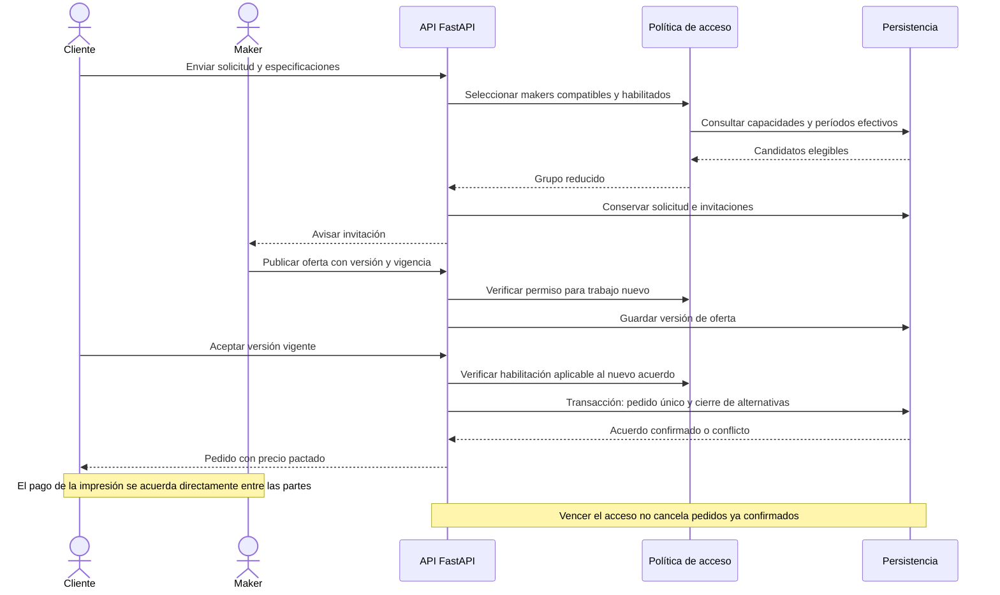
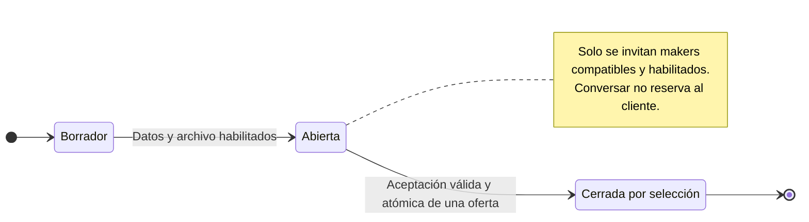
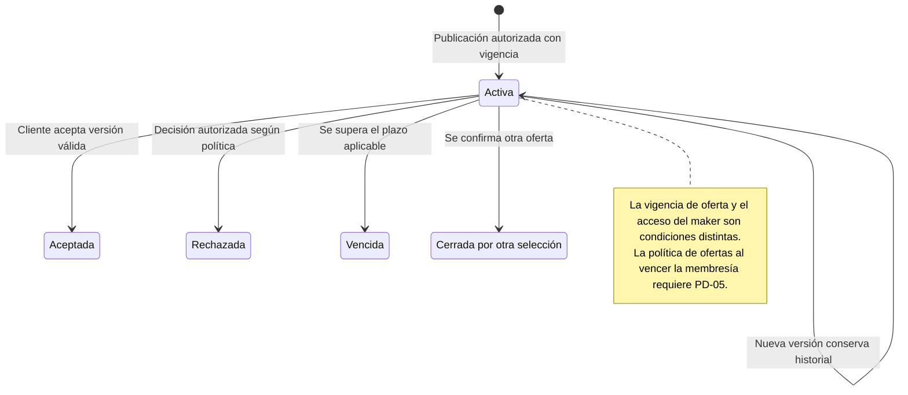
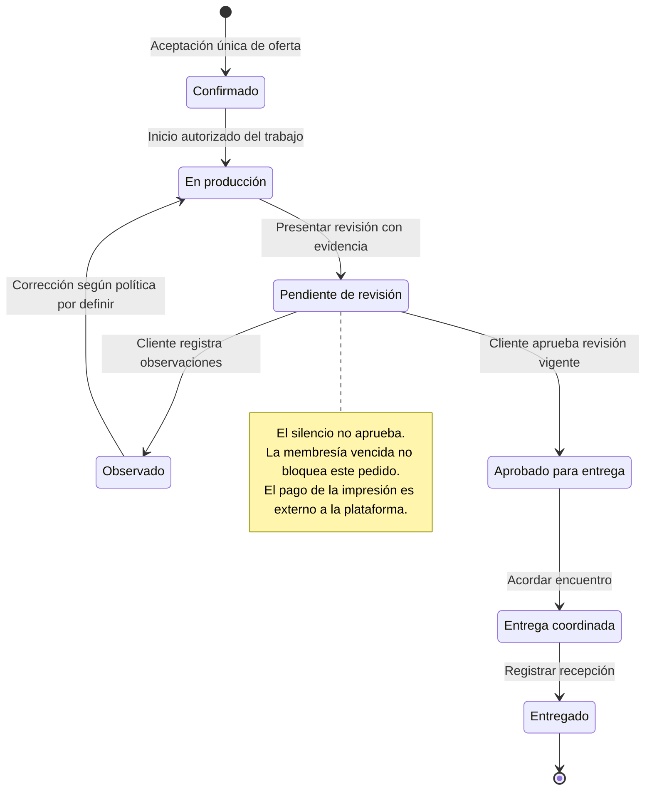
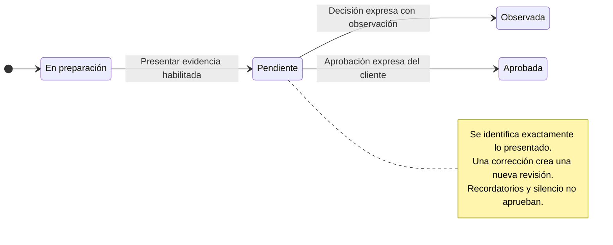
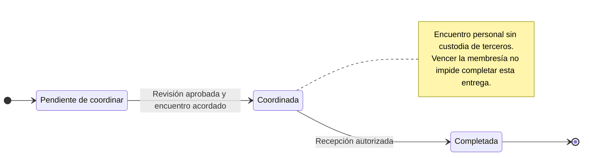
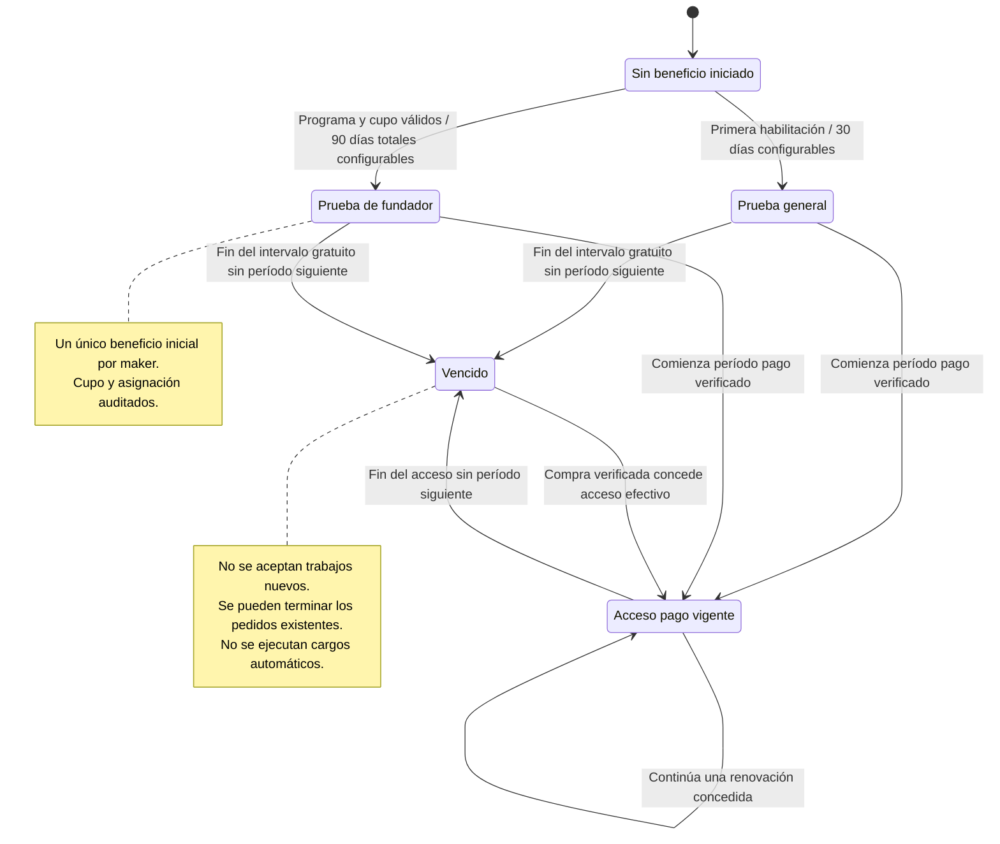
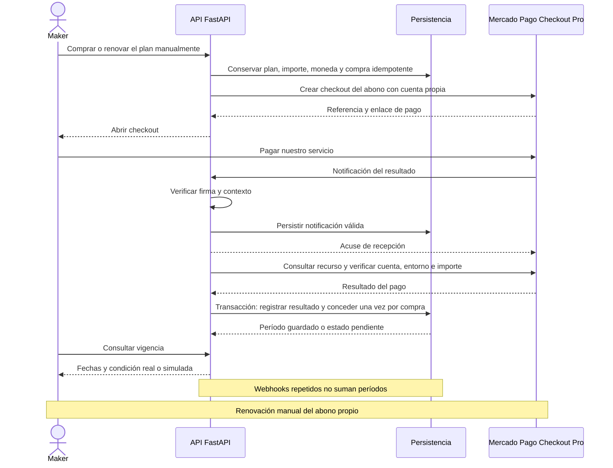
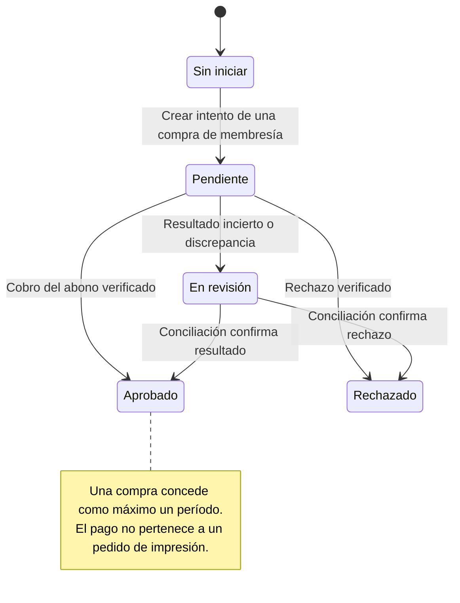

# Flujos y estados del producto

Actualización: 14 de octubre de 2026. Diagramas de diseño propuesto; no evidencias de ejecución.

## Solicitud, ofertas y aceptación

[Abrir SVG](/3daltoque-docs/documentos/97d5eef655ae-secuencia-cotizacion.svg) · [Fuente editable](/3daltoque-docs/documentos/3fcf0ef2e392-secuencia-cotizacion.mmd)

Fuente editable

## Solicitud

[Abrir SVG](/3daltoque-docs/documentos/5a3710605866-estados-solicitud.svg) · [Fuente editable](/3daltoque-docs/documentos/1441f04a2334-estados-solicitud.mmd)

Fuente editable

## Oferta

[Abrir SVG](/3daltoque-docs/documentos/a8692614b574-estados-oferta.svg) · [Fuente editable](/3daltoque-docs/documentos/b1d5026866f3-estados-oferta.mmd)

Fuente editable

## Producción del pedido

[Abrir SVG](/3daltoque-docs/documentos/e9d99ad5c424-estados-pedido.svg) · [Fuente editable](/3daltoque-docs/documentos/51c245f91b6b-estados-pedido.mmd)

Fuente editable

## Revisión del resultado

[Abrir SVG](/3daltoque-docs/documentos/d72adef0e9f0-estados-revision.svg) · [Fuente editable](/3daltoque-docs/documentos/bf6af2ee5236-estados-revision.mmd)

Fuente editable

## Entrega y recepción

[Abrir SVG](/3daltoque-docs/documentos/1c6a0d8124ee-estados-entrega.svg) · [Fuente editable](/3daltoque-docs/documentos/e91a1c54d94b-estados-entrega.mmd)

Fuente editable

## Membresía del maker

[Abrir SVG](/3daltoque-docs/documentos/f2ba7a368209-estados-membresia.svg) · [Fuente editable](/3daltoque-docs/documentos/8f909307fb54-estados-membresia.mmd)

Fuente editable

## Compra y renovación del abono

[Abrir SVG](/3daltoque-docs/documentos/5b550fb39979-secuencia-pago.svg) · [Fuente editable](/3daltoque-docs/documentos/2d10cc2b1ebd-secuencia-pago.mmd)

Fuente editable

## Pago del abono

[Abrir SVG](/3daltoque-docs/documentos/c748c25e7e54-estados-pago.svg) · [Fuente editable](/3daltoque-docs/documentos/564f67e434cc-estados-pago.mmd)

Fuente editable

## Reglas comunes

La expiración de acceso no cancela pedidos existentes. La aprobación del resultado siempre es expresa; el silencio no autoriza entregar. El retorno de Checkout Pro no confirma un pago. El pago de la impresión es externo al procesamiento de 3DAltoque y no debe confundirse con el estado del abono. Las políticas abiertas se cierran antes de implementar transiciones dependientes de ellas.
