# Flujos y estados del producto

Actualización: 25 de octubre de 2026. Las guardas corresponden a RF, CU y [ADR-003](/3daltoque-docs/decisiones/catalogo-y-cobertura/).

## Solicitud, ofertas y aceptación

[Abrir SVG](/3daltoque-docs/documentos/97d5eef655ae-secuencia-cotizacion.svg) · [Fuente editable](/3daltoque-docs/documentos/3fcf0ef2e392-secuencia-cotizacion.mmd)

Fuente editable

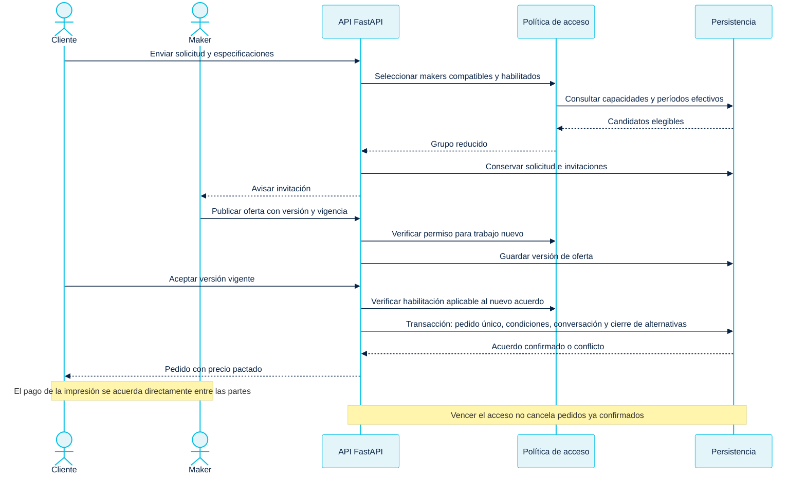

## Solicitud

[Abrir SVG](/3daltoque-docs/documentos/5a3710605866-estados-solicitud.svg) · [Fuente editable](/3daltoque-docs/documentos/1441f04a2334-estados-solicitud.mmd)

Fuente editable

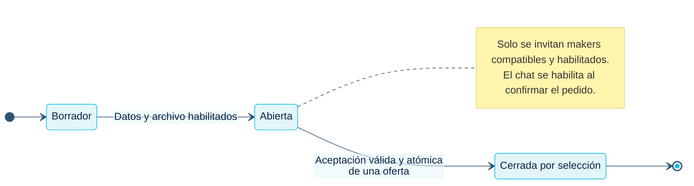

## Oferta

[Abrir SVG](/3daltoque-docs/documentos/a8692614b574-estados-oferta.svg) · [Fuente editable](/3daltoque-docs/documentos/b1d5026866f3-estados-oferta.mmd)

Fuente editable

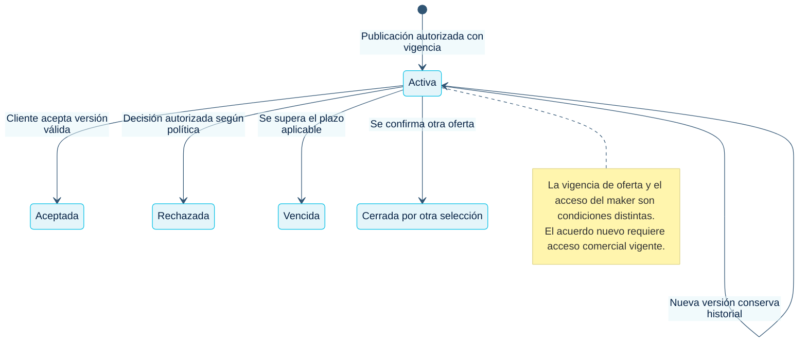

## Producción del pedido

[Abrir SVG](/3daltoque-docs/documentos/e9d99ad5c424-estados-pedido.svg) · [Fuente editable](/3daltoque-docs/documentos/51c245f91b6b-estados-pedido.mmd)

Fuente editable

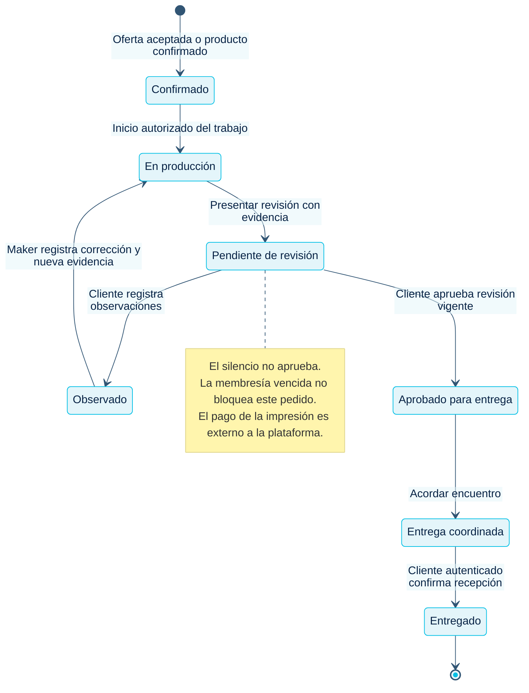

## Revisión del resultado

[Abrir SVG](/3daltoque-docs/documentos/d72adef0e9f0-estados-revision.svg) · [Fuente editable](/3daltoque-docs/documentos/bf6af2ee5236-estados-revision.mmd)

Fuente editable

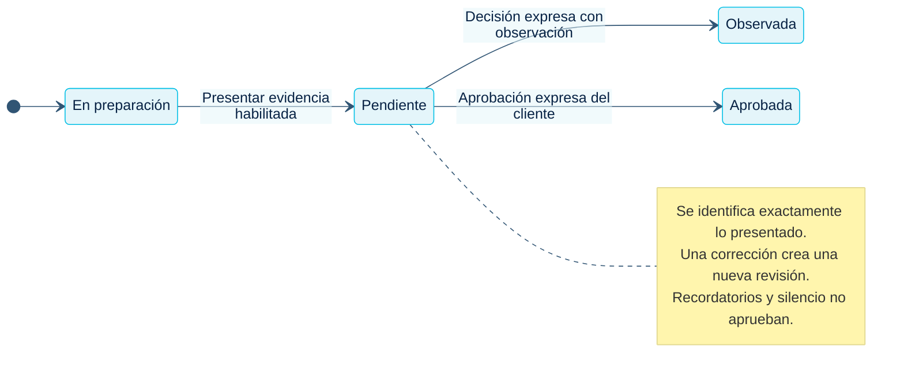

## Entrega y recepción

[Abrir SVG](/3daltoque-docs/documentos/1c6a0d8124ee-estados-entrega.svg) · [Fuente editable](/3daltoque-docs/documentos/e91a1c54d94b-estados-entrega.mmd)

Fuente editable

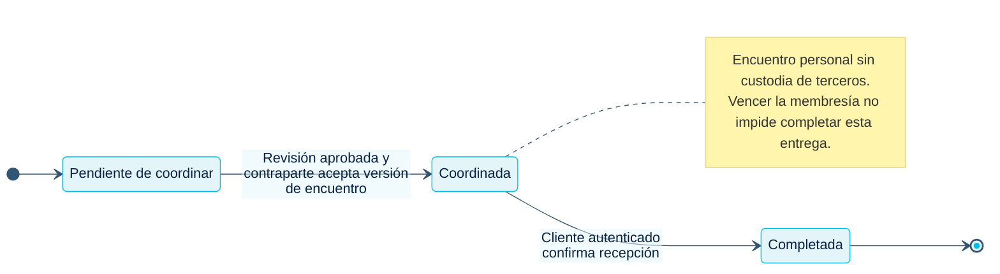

## Membresía del maker

[Abrir SVG](/3daltoque-docs/documentos/f2ba7a368209-estados-membresia.svg) · [Fuente editable](/3daltoque-docs/documentos/8f909307fb54-estados-membresia.mmd)

Fuente editable

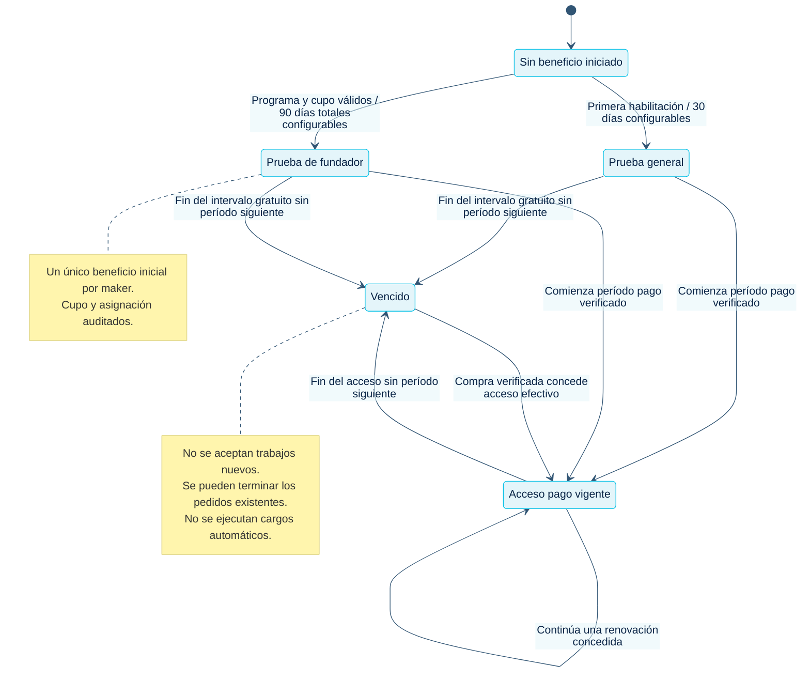

## Compra y renovación del abono

[Abrir SVG](/3daltoque-docs/documentos/5b550fb39979-secuencia-pago.svg) · [Fuente editable](/3daltoque-docs/documentos/2d10cc2b1ebd-secuencia-pago.mmd)

Fuente editable

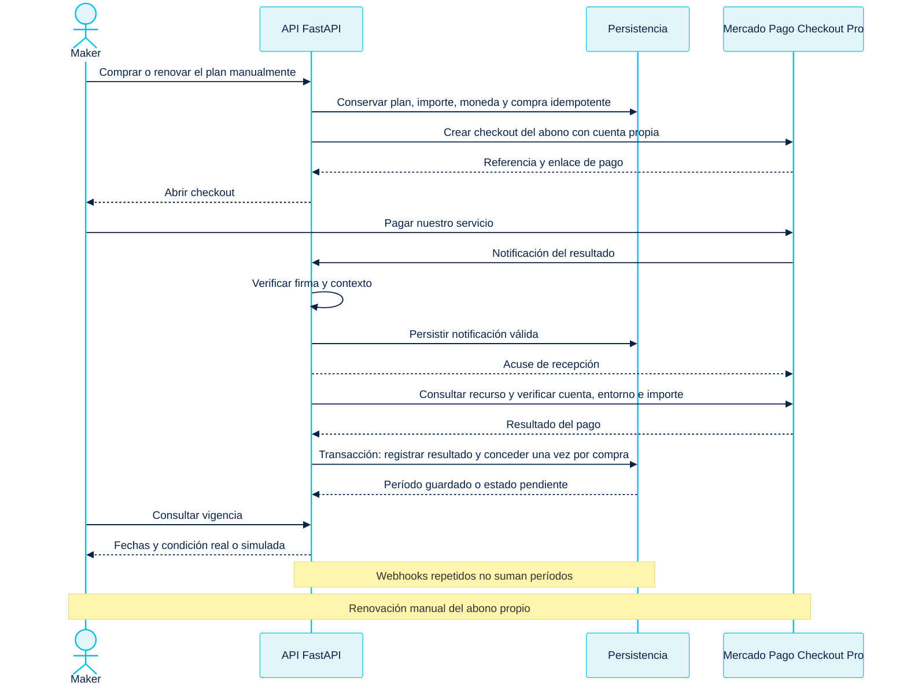

## Pago del abono

[Abrir SVG](/3daltoque-docs/documentos/c748c25e7e54-estados-pago.svg) · [Fuente editable](/3daltoque-docs/documentos/564f67e434cc-estados-pago.mmd)

Fuente editable

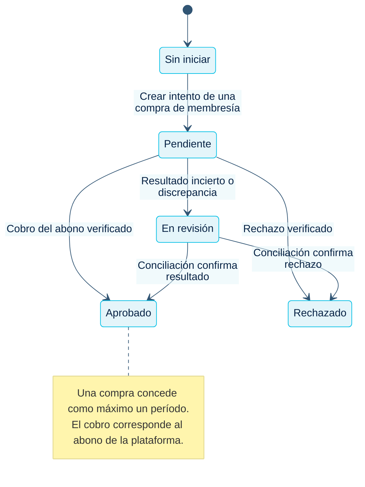

## Publicación de producto

[Abrir SVG](/3daltoque-docs/documentos/f11a1eaae9d7-estados-producto.svg) · [Fuente editable](/3daltoque-docs/documentos/c4a9b64f607e-estados-producto.mmd)

Fuente editable

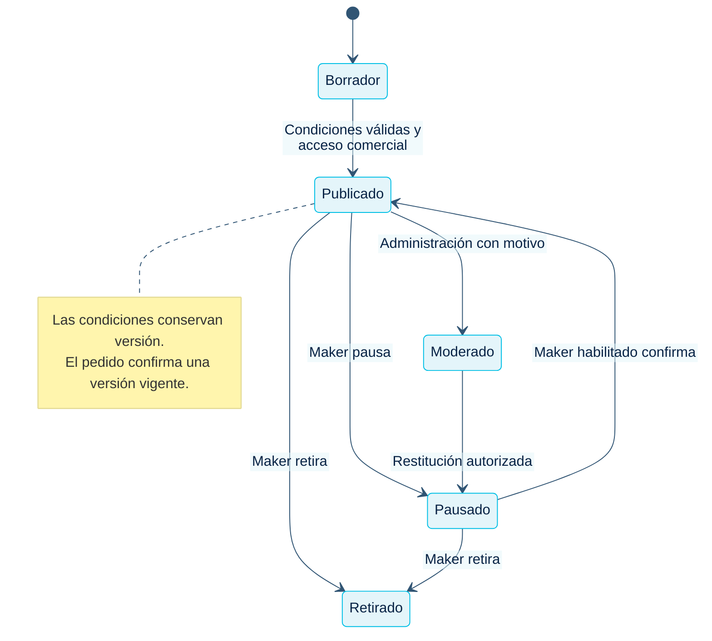

## Pedido directo de producto

[Abrir SVG](/3daltoque-docs/documentos/7652af2389d5-secuencia-producto.svg) · [Fuente editable](/3daltoque-docs/documentos/2625bc0c8924-secuencia-producto.mmd)

Fuente editable

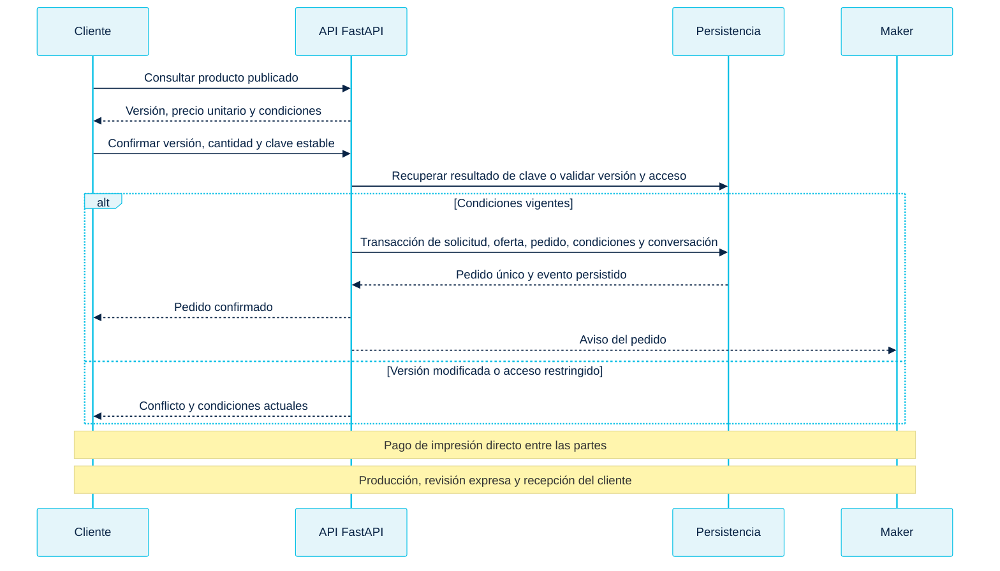

## Conversación del pedido

[Abrir SVG](/3daltoque-docs/documentos/4e5ada0a8489-secuencia-chat.svg) · [Fuente editable](/3daltoque-docs/documentos/df6ea54a560a-secuencia-chat.mmd)

Fuente editable

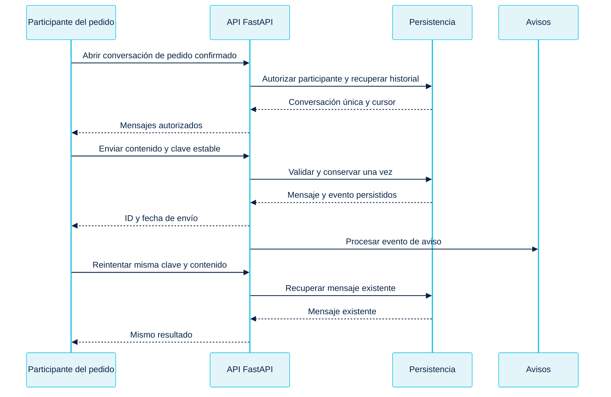

## Guardas compartidas

La aprobación de revisión identifica la evidencia exacta y requiere decisión expresa del cliente. La entrega conserva punto, horario y aceptación de ambas partes sobre la misma versión. La recepción se registra por el cliente autenticado. El pedido confirmado conserva la conversación y la operativa al vencer la membresía. El retorno del checkout consulta el estado persistido y la concesión depende de verificar el pago del abono.
