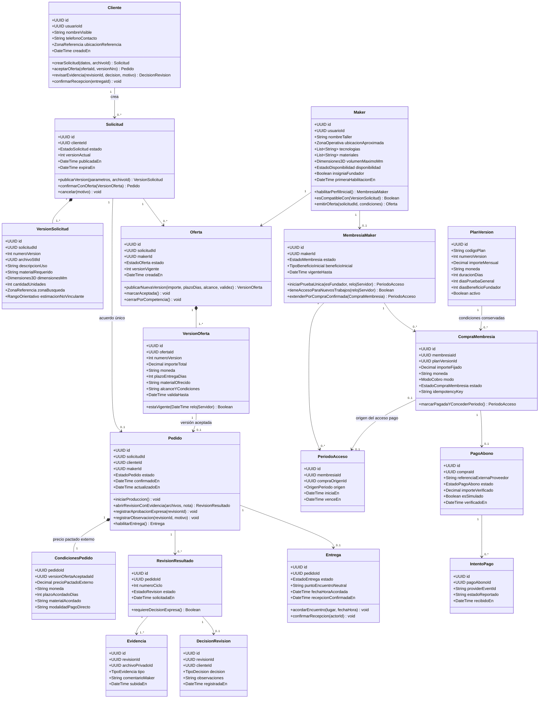

Versión: 2.0-borrador. Fecha: 25 de octubre de 2026.

Este documento reúne el **Entregable #7 (Diagrama de Clases de Dominio)** y el **Entregable #12 (Diagrama de Clases de Diseño, Operaciones y Colaboraciones)** de la planificación académica de **3DAltoque**.

---

## 1. Dominio — Diagrama de Clases de Dominio (Entregable #7)

El modelo de dominio de **3DAltoque** separa en dos subdominios desacoplados:
1. **Subdominio Operativo de Impresión (`Solicitud` → `Oferta` → `Pedido` → `RevisionResultado` → `Entrega`):** gestiona el acuerdo único entre `Cliente` y `Maker`, la evidencia fotográfica obligatoria, la aprobación expresa y la entrega personal en punto de encuentro neutral, donde el precio de la impresión se acuerda y abona por fuera de la plataforma (`CondicionesPedido`).
2. **Subdominio Comercial de Membresías (`MembresiaMaker` → `PlanVersion` → `CompraMembresia` → `PagoAbono` → `PeriodoAcceso`):** gestiona la vigencia del maker para recibir nuevas solicitudes y emitir ofertas (prueba gratuita única de `30 días`, beneficio `Makers Fundadores` de `90 días` totales no acumulables y renovación mensual manual mediante Mercado Pago Checkout Pro).

### 1.1 Vista gráfica y fuente editable

[Abrir SVG](/3daltoque-docs/documentos/3a38ed4d1833-dominio.svg) · [Fuente editable (`.mmd`)](/3daltoque-docs/documentos/6420bfd40263-dominio.mmd) · [Modelo comercial](/3daltoque-docs/proyecto/modelo-comercial/)

### 1.2 Especificación UML de Clases de Dominio con atributos y métodos de negocio

### 1.3 Diccionario de clases de dominio e invariantes principales

| Clase de Dominio | Responsabilidad en el negocio | Invariantes clave | Tablas principales en [Modelo Lógico](/3daltoque-docs/modelado/modelo-logico/) |
| --- | --- | --- | --- |
| `Cliente` | Actor que publica necesidades de impresión 3D, compara ofertas, revisa evidencia y recibe la pieza. | Debe poseer zona de referencia confirmada para publicar una solicitud (`RF-01.3`, `RF-09.1`). | `users`, `client_profiles`, `user_locations` |
| `Maker` | Actor con capacidades técnicas declaradas (`FDM`/`SLA`, materiales, volumen) y zona aproximada. | Nunca expone su domicilio exacto en vistas públicas; su elegibilidad para nuevos trabajos requiere `MembresiaMaker` vigente (`RF-01.2`, `RF-12.10`). | `users`, `maker_profiles`, `maker_printers`, `maker_capabilities` |
| `Solicitud` y `VersionSolicitud` | Representa el pedido de cotización del cliente junto con sus archivos `.STL`/referencias privadas y la estimación orientativa. | Una `Solicitud` puede generar a lo sumo **un** `Pedido` (`0..1`). La estimación orientativa nunca reemplaza la oferta del maker (`RF-02.5`). | `print_requests`, `request_versions`, `request_items`, `request_estimates` |
| `Oferta` y `VersionOferta` | Propuesta económica y técnica de un maker hacia una solicitud compatible. | Solo puede aceptarse la `VersionOferta` vigente y no expirada; al aceptarse una oferta, todas las demás ofertas de esa solicitud se cierran atómicamente (`RF-04.4`). | `offers`, `offer_versions`, `offer_status_history` |
| `Pedido` y `CondicionesPedido` | Acuerdo confirmado entre `Cliente` y `Maker` con snapshot inmutable de precio, plazo y material. | El pago del trabajo se acuerda por fuera (`CondicionesPedido`). El vencimiento posterior de la `MembresiaMaker` **no** bloquea un `Pedido` ya confirmado (`RF-12.10`). | `orders`, `order_snapshots`, `order_status_history` |
| `RevisionResultado`, `Evidencia` y `DecisionRevision` | Ciclo de control de calidad previo a la entrega: fotos/videos privados de la pieza terminada y decisión del cliente. | La aprobación debe ser **expresa** y vinculada a una `RevisionResultado` concreta; el silencio del cliente **jamás** aprueba automáticamente (`RF-06.3`, `RF-06.4`). | `evidence_reviews`, `delivery_evidences`, `review_decisions` |
| `Entrega` | Coordinación del encuentro personal en punto neutral y confirmación de recepción de la pieza. | Solo puede habilitarse cuando existe una `RevisionResultado` en estado `APROBADA` (`RF-06.6`, `RF-06.7`). | `deliveries`, `meeting_proposals`, `delivery_confirmations` |
| `MembresiaMaker`, `PlanVersion`, `CompraMembresia`, `PeriodoAcceso`, `PagoAbono`, `IntentoPago` | Gestión comercial del acceso mensual prepago del maker a la plataforma. | La primera habilitación otorga por única vez `30 días` generales o `90 días` totales si es `Maker Fundador` (nunca `30 + 90 = 120`). Cada `CompraMembresia` verificada servidor a servidor concede como máximo **un** `PeriodoAcceso` (`RF-12.1` a `RF-12.15`). | `maker_memberships`, `membership_plans`, `membership_plan_versions`, `membership_checkout_orders`, `membership_periods`, `membership_payments`, `payment_webhook_events` |

---

## 2. Datos y Arquitectura Relacionada

- **[Modelo lógico](/3daltoque-docs/modelado/modelo-logico/):** 50 tablas y 460 columnas normalizadas con tipos, claves primarias, claves foráneas y restricciones de unicidad.
- **[DER](/3daltoque-docs/modelado/datos/):** ocho vistas temáticas con relaciones entidad-relación.
- **[Arquitectura y componentes](/3daltoque-docs/diseno/arquitectura/):** monolito modular en FastAPI con separación hexagonal (puertos y adaptadores).

[Abrir SVG](/3daltoque-docs/documentos/44ac08b2bfc6-componentes.svg) · [Fuente editable](/3daltoque-docs/documentos/410048d78c61-componentes.mmd)

---

## 3. Clases de Diseño, Operaciones y Colaboraciones (Entregable #12)

Mientras que el Diagrama de Clases de Dominio expresa los conceptos del problema, el **Diagrama de Clases de Diseño** define las clases de software concretas de la arquitectura hexagonal en **FastAPI + Python**, sus **estereotipos (`<<controller>>`, `<<application service>>`, `<<domain aggregate>>`, `<<port>>`, `<<adapter>>`)**, las **firmas de sus operaciones** y las **relaciones de dependencia e inyección**.

### 3.1 Vista de Puertos y Adaptadores

[Abrir SVG](/3daltoque-docs/documentos/a44c2fd72ab2-diseno-hexagonal.svg) · [Fuente editable](/3daltoque-docs/documentos/1061d2163efb-diseno-hexagonal.mmd)

### 3.2 Diagrama UML de Clases de Diseño — Subsistema Operativo (Solicitudes, Matching, Ofertas, Pedidos, Revisión y Entrega)

```mermaid
classDiagram
  direction TB

  class SolicitudController {
    <<controller>>
    +crearSolicitud(req: CrearSolicitudDTO, user: AuthUser) SolicitudResponseDTO
    +obtenerMatches(solicitudId: UUID, user: AuthUser) List~MakerCandidatoDTO~
    +listarOfertas(solicitudId: UUID, user: AuthUser) List~OfertaResumenDTO~
  }

  class OfertaController {
    <<controller>>
    +emitirOferta(solicitudId: UUID, dto: EmitirOfertaDTO, user: AuthUser) OfertaResponseDTO
    +actualizarVersionOferta(ofertaId: UUID, dto: VersionOfertaDTO, user: AuthUser) OfertaResponseDTO
    +aceptarOferta(ofertaId: UUID, dto: AceptarOfertaDTO, user: AuthUser) PedidoResponseDTO
  }

  class PedidoEntregaController {
    <<controller>>
    +actualizarAvance(pedidoId: UUID, dto: AvanceDTO, user: AuthUser) PedidoResponseDTO
    +presentarEvidencia(pedidoId: UUID, dto: EvidenciaDTO, user: AuthUser) RevisionResponseDTO
    +revisarEvidencia(pedidoId: UUID, dto: DecisionRevisionDTO, user: AuthUser) PedidoResponseDTO
    +coordinarEntrega(pedidoId: UUID, dto: PropuestaEntregaDTO, user: AuthUser) EntregaResponseDTO
    +confirmarRecepcion(entregaId: UUID, user: AuthUser) EntregaResponseDTO
  }

  class PublicarSolicitudAppService {
    <<application service>>
    -uow: UnitOfWorkPort
    -storagePort: PrivateStoragePort
    -geoPort: GeolocationPort
    -matchingService: MatchingDomainService
    -notificationPort: NotificationPort
    +ejecutar(clienteId: UUID, comando: PublicarSolicitudCmd) Solicitud
  }

  class GestionarOfertaAppService {
    <<application service>>
    -uow: UnitOfWorkPort
    -accessGuard: MakerMembershipGuard
    -notificationPort: NotificationPort
    +emitirOferta(makerId: UUID, solicitudId: UUID, cmd: EmitirOfertaCmd) Oferta
    +publicarNuevaVersion(makerId: UUID, ofertaId: UUID, cmd: VersionOfertaCmd) VersionOferta
    +aceptarOfertaAtomica(clienteId: UUID, ofertaId: UUID, versionEsperada: Int) Pedido
  }

  class RevisionYEntregaAppService {
    <<application service>>
    -uow: UnitOfWorkPort
    -storagePort: PrivateStoragePort
    -notificationPort: NotificationPort
    -auditPort: AuditLogPort
    +subirEvidenciaYSolicitarRevision(makerId: UUID, pedidoId: UUID, cmd: SubirEvidenciaCmd) RevisionResultado
    +registrarDecisionExpresa(clienteId: UUID, revisionId: UUID, cmd: DecisionCmd) Pedido
    +recordarRevisionesPendientesSinAprobar(ahora: DateTime) Int
    +proponerOConfirmarEncuentro(actorId: UUID, pedidoId: UUID, cmd: EncuentroCmd) Entrega
    +registrarRecepcionFinal(clienteId: UUID, entregaId: UUID) Pedido
  }

  class MatchingDomainService {
    <<domain service>>
    +filtrarCandidatosElegibles(versionSolicitud: VersionSolicitud, radioKm: Float, relojServidor: DateTime) List~Maker~
    +calcularEstimacionOrientativa(dimensiones: Dimensiones3D, material: String, cantidad: Int) RangoOrientativo
  }

  class UnitOfWorkPort {
    <<interface>>
    +solicitudes: SolicitudRepositoryPort
    +ofertas: OfertaRepositoryPort
    +pedidos: PedidoRepositoryPort
    +membresias: MembresiaRepositoryPort
    +commit() void
    +rollback() void
  }

  class SolicitudRepositoryPort {
    <<interface>>
    +guardar(solicitud: Solicitud) void
    +obtenerPorId(id: UUID) Solicitud
    +obtenerConBloqueoParaAceptacion(id: UUID) Solicitud
  }

  class OfertaRepositoryPort {
    <<interface>>
    +guardar(oferta: Oferta) void
    +obtenerPorId(id: UUID) Oferta
    +cerrarOfertasCompetidoras(solicitudId: UUID, ofertaGanadoraId: UUID) Int
  }

  class PedidoRepositoryPort {
    <<interface>>
    +guardar(pedido: Pedido) void
    +obtenerPorId(id: UUID) Pedido
    +listarRevisionesPendientesVencidas(umbral: DateTime) List~RevisionResultado~
  }

  class PrivateStoragePort {
    <<interface>>
    +crearUrlCargaFirmada(meta: ArchivoMetaDTO) UploadIntentDTO
    +verificarObjetoSubido(archivoId: UUID) Boolean
    +crearUrlDescargaTemporal(archivoId: UUID, ttlSegundos: Int) String
    +retirarObjetoVencido(archivoId: UUID) void
  }

  class GeolocationPort {
    <<interface>>
    +geocodificarZonaAproximada(texto: String) ZonaReferencia
    +buscarMakersEnRadio(centro: Coordenada, radioKm: Float) List~UUID~
    +enmascararUbicacionPublica(ubicacionExacta: Coordenada) ZonaOperativa
  }

  class SqlAlchemyUnitOfWork {
    <<adapter>>
    -session: AsyncSession
    +commit() void
    +rollback() void
  }

  class S3CompatibleStorageAdapter {
    <<adapter>>
    -bucketPrivado: String
    +crearUrlCargaFirmada(meta: ArchivoMetaDTO) UploadIntentDTO
    +crearUrlDescargaTemporal(archivoId: UUID, ttlSegundos: Int) String
  }

  class PostGisGeolocationAdapter {
    <<adapter>>
    +buscarMakersEnRadio(centro: Coordenada, radioKm: Float) List~UUID~
    +enmascararUbicacionPublica(ubicacionExacta: Coordenada) ZonaOperativa
  }

  SolicitudController --> PublicarSolicitudAppService
  OfertaController --> GestionarOfertaAppService
  PedidoEntregaController --> RevisionYEntregaAppService

  PublicarSolicitudAppService --> UnitOfWorkPort
  PublicarSolicitudAppService --> PrivateStoragePort
  PublicarSolicitudAppService --> GeolocationPort
  PublicarSolicitudAppService --> MatchingDomainService

  GestionarOfertaAppService --> UnitOfWorkPort
  RevisionYEntregaAppService --> UnitOfWorkPort
  RevisionYEntregaAppService --> PrivateStoragePort

  UnitOfWorkPort *-- SolicitudRepositoryPort
  UnitOfWorkPort *-- OfertaRepositoryPort
  UnitOfWorkPort *-- PedidoRepositoryPort

  SqlAlchemyUnitOfWork ..|> UnitOfWorkPort
  S3CompatibleStorageAdapter ..|> PrivateStoragePort
  PostGisGeolocationAdapter ..|> GeolocationPort
```

---

### 3.3 Diagrama UML de Clases de Diseño — Subsistema Comercial de Membresías, Fundadores y Cobros (`ADR-002`)

```mermaid
classDiagram
  direction TB

  class MembresiaController {
    <<controller>>
    +consultarPlanVigente() PlanMembresiaDTO
    +consultarMiMembresia(user: AuthUser) EstadoMembresiaDTO
    +habilitarPerfilEIniciarPrueba(dto: HabilitarPerfilDTO, user: AuthUser) EstadoMembresiaDTO
    +crearOrdenCompraAbono(dto: CrearCompraDTO, user: AuthUser) CompraMembresiaDTO
    +iniciarCheckoutAbono(compraId: UUID, user: AuthUser) CheckoutRedirectDTO
  }

  class WebhookPagosController {
    <<controller>>
    +recibirWebhookMercadoPago(headers: Map, payload: Dict) WebhookAckDTO
  }

  class AdminMembresiaController {
    <<controller>>
    +actualizarPlanYPromociones(dto: ConfigurarPlanDTO, admin: AuthUser) PlanMembresiaDTO
    +asignarBeneficioFundador(makerId: UUID, dto: AsignarFundadorDTO, admin: AuthUser) BeneficioFundadorDTO
    +conciliarCompra(compraId: UUID, admin: AuthUser) CompraMembresiaDTO
  }

  class MakerMembershipGuard {
    <<domain/application guard>>
    -membresiaRepo: MembresiaRepositoryPort
    -clock: ServerClockPort
    +exigirAccesoParaTrabajoNuevo(makerId: UUID) void
    +permitirContinuidadPedidoExistente(makerId: UUID, pedidoId: UUID) Boolean
  }

  class HabilitacionYFundadoresAppService {
    <<application service>>
    -uow: UnitOfWorkPort
    -auditPort: AuditLogPort
    -clock: ServerClockPort
    +habilitarPerfilPrimeraVez(makerId: UUID, capacidades: CapacidadesCmd) MembresiaMaker
    +asignarCupoFundadorAtomico(adminId: UUID, makerId: UUID, motivo: String) PeriodoAcceso
  }

  class CobroAbonoAppService {
    <<application service>>
    -uow: UnitOfWorkPort
    -paymentPort: PaymentGatewayPort
    -notificationPort: NotificationPort
    -auditPort: AuditLogPort
    +crearCompraIdempotente(makerId: UUID, idempotencyKey: String) CompraMembresia
    +generarPreferenciaCheckout(compraId: UUID) CheckoutSessionDTO
    +procesarNotificacionVerificada(evento: WebhookEventCmd) PagoAbono
    +conciliarEstadoConProveedor(compraId: UUID) CompraMembresia
  }

  class PaymentGatewayPort {
    <<interface>>
    +crearPreferenciaAbono(compra: CompraMembresia) CheckoutPreferenceResult
    +verificarFirmaWebhook(headers: Map, rawBody: Bytes) Boolean
    +consultarPagoEnProveedor(providerPaymentId: String) ProviderPaymentStatus
  }

  class MembresiaRepositoryPort {
    <<interface>>
    +obtenerPorMakerIdConBloqueo(makerId: UUID) MembresiaMaker
    +obtenerCompraPorIdempotencyKey(makerId: UUID, key: String) CompraMembresia
    +registrarEventoWebhookIdempotente(providerEventId: String) Boolean
    +consumirCupoFundadorDisponible() Int
  }

  class MercadoPagoCheckoutProAdapter {
    <<adapter>>
    -platformAccessToken: SecretStr
    -webhookSecret: SecretStr
    +crearPreferenciaAbono(compra: CompraMembresia) CheckoutPreferenceResult
    +verificarFirmaWebhook(headers: Map, rawBody: Bytes) Boolean
    +consultarPagoEnProveedor(providerPaymentId: String) ProviderPaymentStatus
  }

  class SimulatedPaymentAdapter {
    <<adapter>>
    -allowedEnvironments: List~String~
    +crearPreferenciaAbono(compra: CompraMembresia) CheckoutPreferenceResult
    +simularResultadoDemo(compraId: UUID, resultado: String) ProviderPaymentStatus
  }

  MembresiaController --> HabilitacionYFundadoresAppService
  MembresiaController --> CobroAbonoAppService
  WebhookPagosController --> CobroAbonoAppService
  AdminMembresiaController --> HabilitacionYFundadoresAppService
  AdminMembresiaController --> CobroAbonoAppService

  CobroAbonoAppService --> PaymentGatewayPort
  CobroAbonoAppService --> MembresiaRepositoryPort
  HabilitacionYFundadoresAppService --> MembresiaRepositoryPort
  MakerMembershipGuard --> MembresiaRepositoryPort

  MercadoPagoCheckoutProAdapter ..|> PaymentGatewayPort
  SimulatedPaymentAdapter ..|> PaymentGatewayPort
```

---

### 3.4 Matriz de Colaboraciones entre Clases de Diseño por Caso de Uso (`CU-01` a `CU-13`)

| Caso de Uso | Controlador de Entrada | Servicio de Aplicación coordinador | Agregados / Entidades de Dominio | Puertos y Adaptadores invocados | Regla de Transacción / Concurrencia |
| --- | --- | --- | --- | --- | --- |
| **CU-01** Publicar solicitud | `SolicitudController` | `PublicarSolicitudAppService` | `Cliente`, `Solicitud`, `VersionSolicitud` | `PrivateStoragePort` (`S3CompatibleStorageAdapter`), `GeolocationPort` (`PostGisGeolocationAdapter`), `MatchingDomainService` | Valida que el archivo privado esté confirmado antes de insertar `Solicitud` + `VersionSolicitud` y disparar eventos de matching en outbox. |
| **CU-02** Recibir y responder ofertas | `OfertaController` | `GestionarOfertaAppService` | `Maker`, `Oferta`, `VersionOferta` | `MakerMembershipGuard`, `OfertaRepositoryPort`, `NotificationPort` | Verifica con el reloj del servidor (`ServerClockPort`) que la `MembresiaMaker` esté en `TRIAL` o `ACTIVE` vigente antes de permitir ofertar. |
| **CU-03** Elegir oferta | `OfertaController` | `GestionarOfertaAppService.aceptarOfertaAtomica()` | `Solicitud`, `Oferta`, `VersionOferta`, `Pedido`, `CondicionesPedido` | `UnitOfWorkPort` (`SqlAlchemyUnitOfWork`), `SolicitudRepositoryPort`, `OfertaRepositoryPort`, `PedidoRepositoryPort` | Bloqueo pesimista `SELECT ... FOR UPDATE` sobre `print_requests` + restricción `UNIQUE(request_id)` en `orders`: confirma 1 oferta y cierra todas las competidoras en una sola transacción ACID. |
| **CU-04** Producción y evidencia | `PedidoEntregaController` | `RevisionYEntregaAppService` | `Pedido`, `RevisionResultado`, `Evidencia` | `PrivateStoragePort`, `PedidoRepositoryPort`, `NotificationPort` | No exige membresía vigente porque el pedido ya fue confirmado (`RF-12.10`). Crea un nuevo ciclo de `RevisionResultado` con referencias privadas. |
| **CU-05** Revisión y aprobación | `PedidoEntregaController` | `RevisionYEntregaAppService` | `Pedido`, `RevisionResultado`, `DecisionRevision` | `PedidoRepositoryPort`, `NotificationPort`, `AuditLogPort` | Vincula la `DecisionRevision` al `revisionId` exacto; el job `recordarRevisionesPendientesSinAprobar()` emite avisos pero nunca cambia el estado a `APROBADA`. |
| **CU-06** Entrega personal | `PedidoEntregaController` | `RevisionYEntregaAppService` | `Pedido`, `Entrega` | `PedidoRepositoryPort`, `GeolocationPort`, `AuditLogPort` | Exige invariante `RevisionResultado.estado == APROBADA`; utiliza punto de encuentro neutral sin exponer la dirección privada del maker. |
| **CU-07** Administración operativa | `AdminController` | `ModeracionYSoporteAppService` | `CasoSoporte`, `AccionModeracion` | `AuditLogPort`, `PrivateStoragePort.retirarObjetoVencido()` | Toda intervención administrativa exige rol `ADMIN`, motivo estructurado y escritura en `audit_logs` dentro de la misma transacción. |
| **CU-08** Consultar membresía | `MembresiaController` | `CobroAbonoAppService` / `MakerMembershipGuard` | `MembresiaMaker`, `PeriodoAcceso`, `CompraMembresia` | `MembresiaRepositoryPort`, `ServerClockPort` | Calcula estado real contrastando `vigenteHasta` con la fecha/hora del servidor. |
| **CU-09** Habilitar perfil e iniciar prueba | `MembresiaController` | `HabilitacionYFundadoresAppService` | `Maker`, `MembresiaMaker`, `PeriodoAcceso` | `MembresiaRepositoryPort`, `GeolocationPort`, `AuditLogPort` | Si `primeraHabilitacionEn IS NULL`, concede por única vez `30 días` generales (o `90 días` si ya posee marca de `Maker Fundador`). Ediciones posteriores no reinician la prueba. |
| **CU-10** Asignar beneficio fundador | `AdminMembresiaController` | `HabilitacionYFundadoresAppService.asignarCupoFundadorAtomico()` | `MembresiaMaker`, `PeriodoAcceso` | `MembresiaRepositoryPort`, `AuditLogPort` | Consume atómicamente 1 unidad del cupo de fundadores configurado, reemplaza los 30 días por 90 días totales (no acumulables) y audita la asignación. |
| **CU-11** Pagar o renovar abono | `MembresiaController`, `WebhookPagosController` | `CobroAbonoAppService` | `CompraMembresia`, `PagoAbono`, `IntentoPago`, `PeriodoAcceso` | `PaymentGatewayPort` (`MercadoPagoCheckoutProAdapter` / `SimulatedPaymentAdapter`), `MembresiaRepositoryPort` | El retorno del navegador no concede acceso. El webhook persiste `providerEventId`, consulta el pago en Mercado Pago servidor a servidor y concede a lo sumo **un** `PeriodoAcceso` por `CompraMembresia`. |
| **CU-12** Gestionar plan y promociones | `AdminMembresiaController` | `CobroAbonoAppService` | `PlanVersion`, `CompraMembresia` | `MembresiaRepositoryPort`, `AuditLogPort` | Crea una nueva `PlanVersion` para futuras compras sin alterar el importe ni el vencimiento de los `PeriodoAcceso` ya otorgados. |
| **CU-13** Registrarse y acceder | `AuthController` | `IdentidadAppService` | `Usuario`, `Cliente`, `Maker` | `UserRepositoryPort`, `PasswordHasherPort`, `JwtTokenPort` | Registra aceptación versionada de términos y aplica *rate limiting* y hash seguro (`Argon2`/`bcrypt`) sobre credenciales. |
