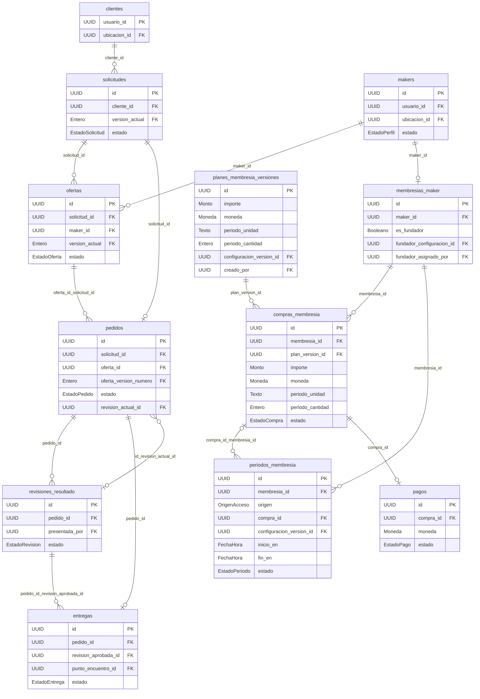
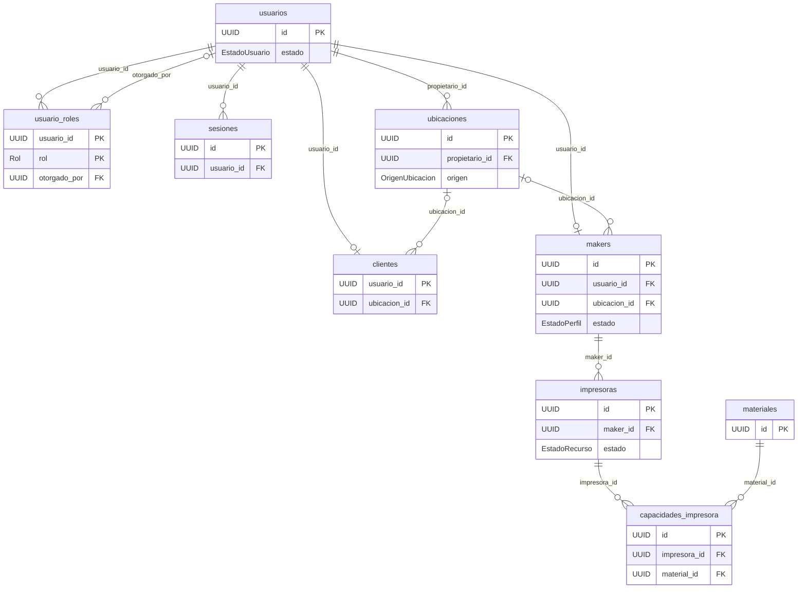
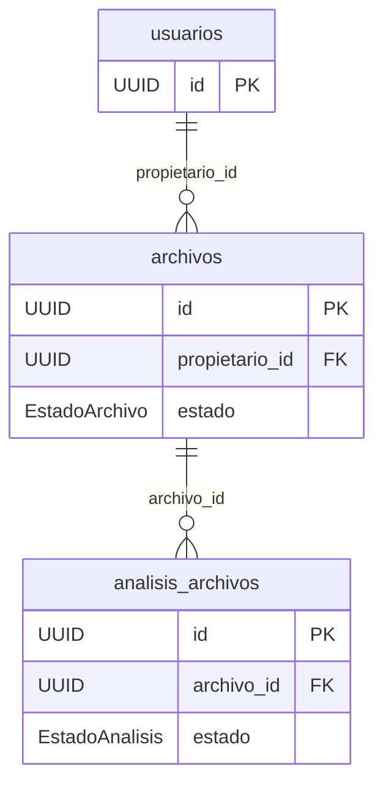
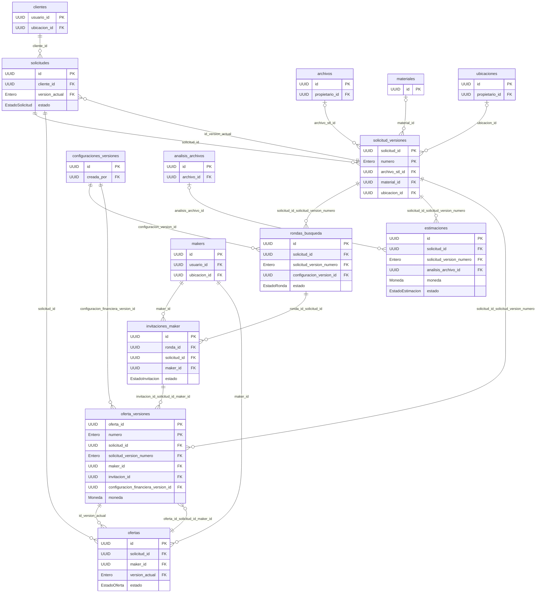
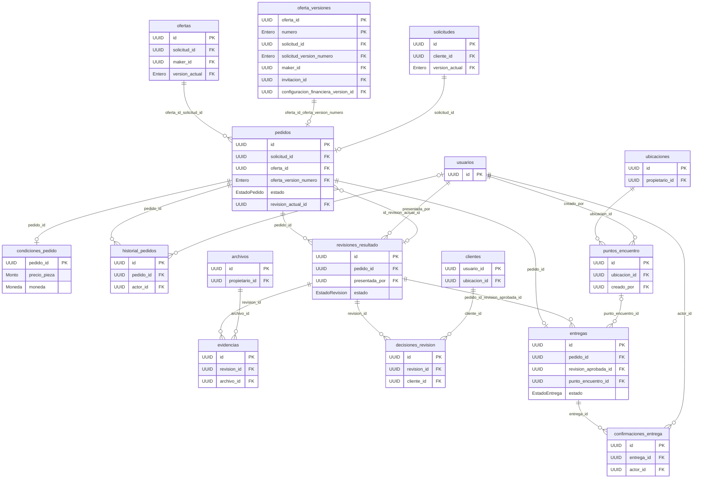
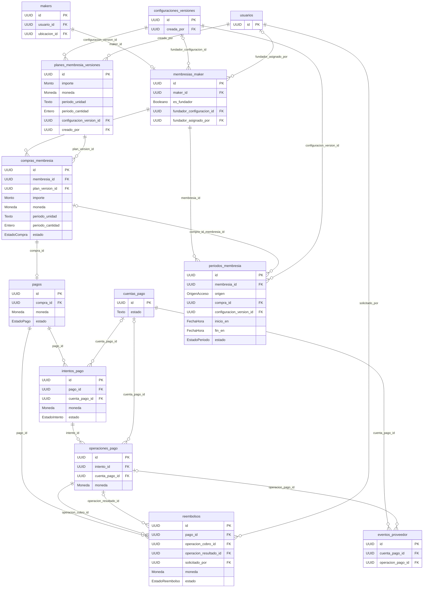
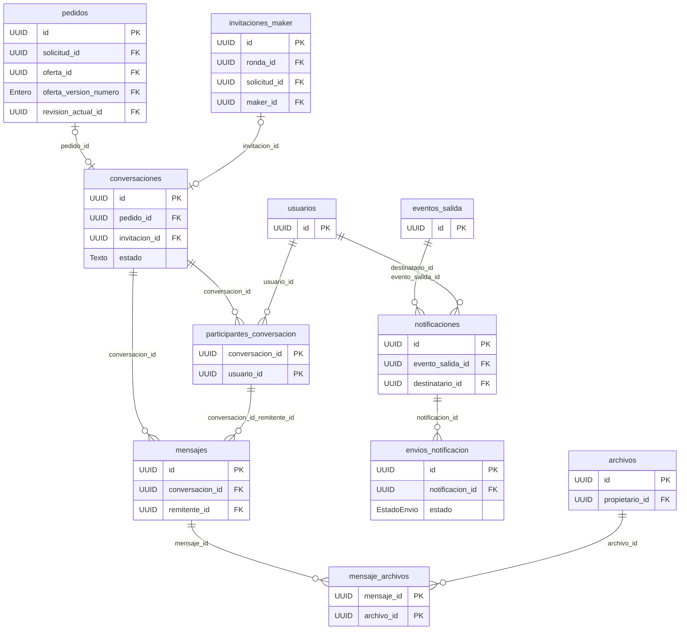
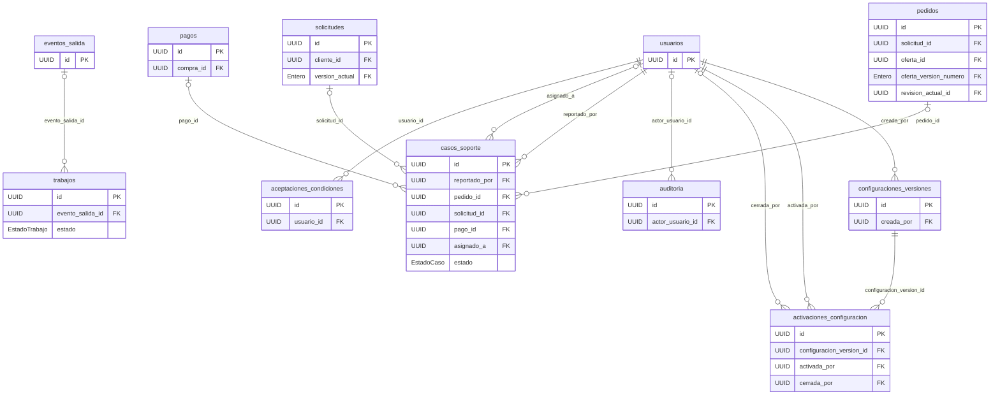

# Diagrama entidad-relación

Versión 2.0-borrador, 14 de octubre de 2026. Ocho vistas del [modelo lógico](/3daltoque-docs/modelado/modelo-logico/): 50 tablas, 460 columnas. Las vistas muestran claves y atributos seleccionados para ser legibles; el diccionario es la especificación completa. Las entidades repetidas conectan las vistas y representan las mismas tablas del modelo lógico.

La venta del abono pertenece al maker y a la plataforma. No existe relación pedido → pago del abono. [Modelo comercial](/3daltoque-docs/proyecto/modelo-comercial/).

## Pedidos de impresión y membresías: circuitos separados

[Abrir imagen](/3daltoque-docs/documentos/b603b79b1a48-der-general.svg) · [Fuente Mermaid](/3daltoque-docs/documentos/20d7c914f94a-der-general.mmd).

Fuente editable

## Identidad, ubicaciones y capacidades

[Abrir imagen](/3daltoque-docs/documentos/ccaa2a178084-der-identidad.svg) · [Fuente Mermaid](/3daltoque-docs/documentos/c9a8a7b5f5d5-der-identidad.mmd).

Fuente editable

## Archivos y análisis

[Abrir imagen](/3daltoque-docs/documentos/66377b824f4a-der-archivos.svg) · [Fuente Mermaid](/3daltoque-docs/documentos/86c73d05e0e9-der-archivos.mmd).

Fuente editable

## Solicitudes, búsqueda y ofertas

[Abrir imagen](/3daltoque-docs/documentos/57c3386e5db7-der-cotizaciones.svg) · [Fuente Mermaid](/3daltoque-docs/documentos/a77b05bb3349-der-cotizaciones.mmd).

Fuente editable

## Pedidos, revisión y entrega

[Abrir imagen](/3daltoque-docs/documentos/6a68fff74395-der-pedidos.svg) · [Fuente Mermaid](/3daltoque-docs/documentos/78e4f83529b8-der-pedidos.mmd).

Fuente editable

## Membresías y cobros del abono

[Abrir imagen](/3daltoque-docs/documentos/5950f8bd018c-der-pagos.svg) · [Fuente Mermaid](/3daltoque-docs/documentos/3dc6180a8ed6-der-pagos.mmd).

Fuente editable

## Conversaciones y notificaciones

[Abrir imagen](/3daltoque-docs/documentos/e596445273e8-der-comunicacion.svg) · [Fuente Mermaid](/3daltoque-docs/documentos/94b9740f694c-der-comunicacion.mmd).

Fuente editable

## Configuración, operación y auditoría

[Abrir imagen](/3daltoque-docs/documentos/4b5695cb3462-der-operacion.svg) · [Fuente Mermaid](/3daltoque-docs/documentos/e618405f9449-der-operacion.mmd).

Fuente editable

