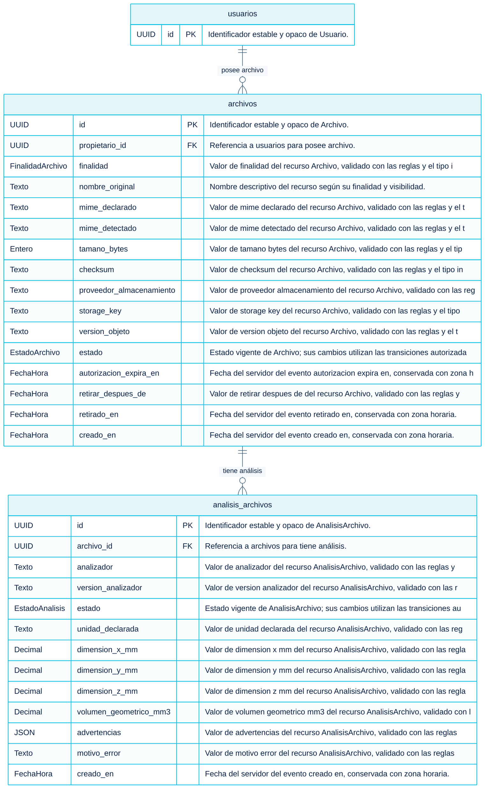
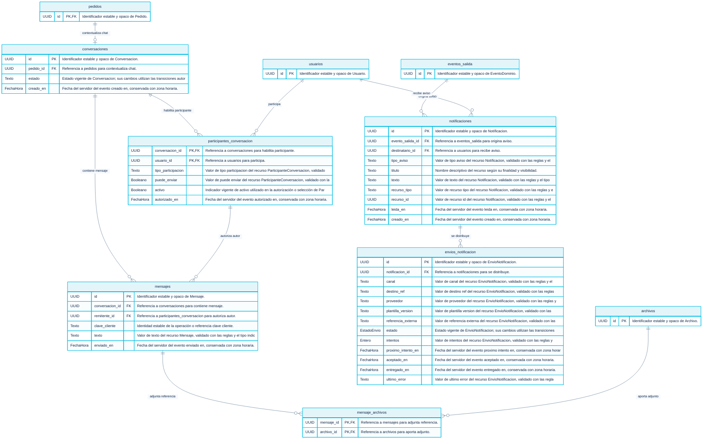
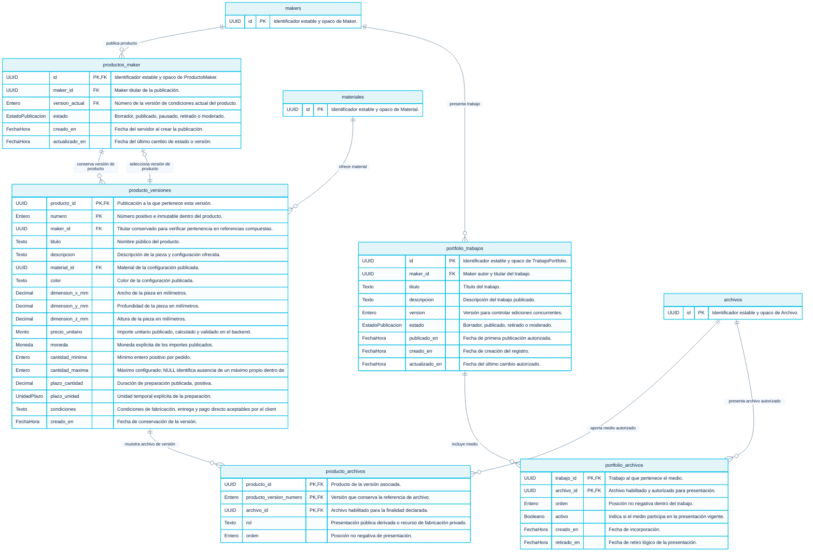
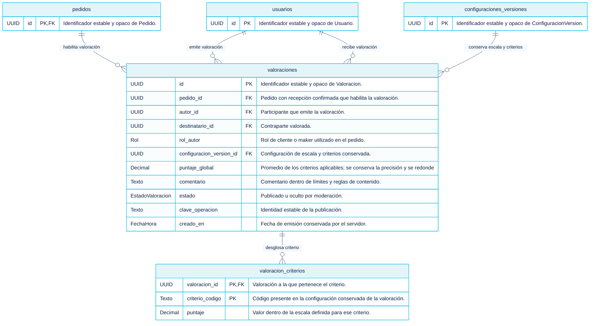

# Diagrama entidad-relación

El modelo se organiza en diez vistas para recorrer perfiles, catálogo, negociación, pedidos, comunicación, reputación, membresías y operación. El [diccionario lógico](/3daltoque-docs/modelado/modelo-logico/) desarrolla 58 tablas y 548 columnas.

## Recorridos del modelo

La solicitud personalizada llega a makers compatibles y conserva ofertas versionadas. El producto publicado genera directamente un pedido con sus condiciones. Ambos recorridos comparten producción, conversación, revisión y entrega. El cobro de membresías conserva su propia compra y períodos de acceso.

## Vista general de perfiles, catálogo, pedidos y membresías

[Abrir imagen](/3daltoque-docs/documentos/b603b79b1a48-der-general.svg) · [Fuente Mermaid](/3daltoque-docs/documentos/20d7c914f94a-der-general.mmd).

```mermaid
%%{init: {"theme":"base","themeVariables":{"primaryColor":"#E4F5FA","primaryTextColor":"#082345","primaryBorderColor":"#00BFE5","lineColor":"#315574","secondaryColor":"#F5F8FC","tertiaryColor":"#FFFFFF","fontFamily":"Manrope, sans-serif"},"flowchart":{"htmlLabels":false},"class":{"htmlLabels":false}}}%%
erDiagram
  direction TB
  clientes {
    UUID usuario_id PK, FK "Referencia a usuarios para tiene perfil cliente."
    UUID ubicacion_id FK "Referencia a ubicaciones para ubica cliente."
  }
  makers {
    UUID id PK "Identificador estable y opaco de Maker."
    UUID usuario_id FK "Referencia a usuarios para tiene perfil maker."
    UUID ubicacion_id FK "Referencia a ubicaciones para ubica maker."
    EstadoPerfil estado "Estado vigente de Maker; sus cambios utilizan las transiciones autorizadas."
  }
  productos_maker {
    UUID id PK, FK "Identificador estable y opaco de ProductoMaker."
    UUID maker_id FK "Maker titular de la publicación."
    Entero version_actual FK "Número de la versión de condiciones actual del producto."
    EstadoPublicacion estado "Borrador, publicado, pausado, retirado o moderado."
  }
  producto_versiones {
    UUID producto_id PK, FK "Publicación a la que pertenece esta versión."
    Entero numero PK "Número positivo e inmutable dentro del producto."
    UUID maker_id FK "Titular conservado para verificar pertenencia en referencias compuestas."
    UUID material_id FK "Material de la configuración publicada."
  }
  portfolio_trabajos {
    UUID id PK "Identificador estable y opaco de TrabajoPortfolio."
    UUID maker_id FK "Maker autor y titular del trabajo."
    EstadoPublicacion estado "Borrador, publicado, retirado o moderado."
  }
  solicitudes {
    UUID id PK, FK "Identificador estable y opaco de Solicitud."
    UUID cliente_id FK "Referencia a clientes para crea solicitud."
    Entero version_actual FK "Referencia a solicitud_versiones para selecciona versión actual."
    EstadoSolicitud estado "Estado vigente de Solicitud; sus cambios utilizan las transiciones autoriza"
  }
  ofertas {
    UUID id PK, FK "Identificador estable y opaco de Oferta."
    UUID solicitud_id FK "Referencia a solicitudes para recibe oferta."
    UUID maker_id FK "Referencia a makers para presenta oferta."
    Entero version_actual FK "Referencia a oferta_versiones para selecciona versión actual."
    EstadoOferta estado "Estado vigente de Oferta; sus cambios utilizan las transiciones autorizadas"
  }
  pedidos {
    UUID id PK, FK "Identificador estable y opaco de Pedido."
    UUID solicitud_id FK "Referencia a ofertas para contrata oferta."
    UUID oferta_id FK "Referencia a ofertas para contrata oferta."
    Entero oferta_version_numero FK "Referencia a oferta_versiones para acepta versión."
    EstadoPedido estado "Estado vigente de Pedido; sus cambios utilizan las transiciones autorizadas"
    UUID revision_actual_id FK "Referencia a revisiones_resultado para presenta revisión actual."
    UUID cliente_id FK "Cliente titular, validado contra la solicitud."
  }
  revisiones_resultado {
    UUID id PK "Identificador estable y opaco de RevisionResultado."
    UUID pedido_id FK "Referencia a pedidos para tiene revisión."
    UUID presentada_por FK "Referencia a usuarios para presenta resultado."
    EstadoRevision estado "Estado vigente de RevisionResultado; sus cambios utilizan las transiciones "
  }
  entregas {
    UUID id PK "Identificador estable y opaco de Entrega."
    UUID pedido_id FK "Referencia a pedidos para coordina entrega."
    UUID revision_aprobada_id FK "Referencia a revisiones_resultado para sustenta entrega."
    UUID punto_encuentro_id FK "Referencia a puntos_encuentro para acuerda lugar."
    EstadoEntrega estado "Estado vigente de Entrega; sus cambios utilizan las transiciones autorizada"
    UUID propuesta_por FK "Participante que propone punto y horario."
    UUID aceptada_por FK "Contraparte que acepta esa versión de la propuesta."
  }
  conversaciones {
    UUID id PK "Identificador estable y opaco de Conversacion."
    UUID pedido_id FK "Referencia a pedidos para contextualiza chat."
    Texto estado "Estado vigente de Conversacion; sus cambios utilizan las transiciones autor"
  }
  mensajes {
    UUID id PK "Identificador estable y opaco de Mensaje."
    UUID conversacion_id FK "Referencia a conversaciones para contiene mensaje."
    UUID remitente_id FK "Referencia a participantes_conversacion para autoriza autor."
  }
  valoraciones {
    UUID id PK "Identificador estable y opaco de Valoracion."
    UUID pedido_id FK "Pedido con recepción confirmada que habilita la valoración."
    UUID autor_id FK "Participante que emite la valoración."
    UUID destinatario_id FK "Contraparte valorada."
    UUID configuracion_version_id FK "Configuración de escala y criterios conservada."
    EstadoValoracion estado "Publicado u oculto por moderación."
  }
  membresias_maker {
    UUID id PK "Identificador estable y opaco de membresias_maker."
    UUID maker_id FK "Referencia a makers para tiene membresía."
    UUID fundador_configuracion_id FK "Referencia a configuraciones_versiones para registra programa."
    UUID fundador_asignado_por FK "Referencia a usuarios para asigna beneficio."
  }
  planes_membresia_versiones {
    UUID id PK "Identificador estable y opaco de planes_membresia_versiones."
    UUID configuracion_version_id FK "Referencia a configuraciones_versiones para aplica configuración."
    UUID creado_por FK "Referencia a usuarios para publica versión."
  }
  compras_membresia {
    UUID id PK "Identificador estable y opaco de compras_membresia."
    UUID membresia_id FK "Referencia a membresias_maker para registra compra."
    UUID plan_version_id FK "Referencia a planes_membresia_versiones para conserva plan."
    EstadoCompra estado "Estado vigente de compras_membresia; sus cambios utilizan las transiciones "
  }
  periodos_membresia {
    UUID id PK "Identificador estable y opaco de periodos_membresia."
    UUID membresia_id FK "Referencia a membresias_maker para concede acceso."
    UUID compra_id FK "Referencia a compras_membresia para origina período."
    UUID configuracion_version_id FK "Referencia a configuraciones_versiones para conserva condiciones."
    EstadoPeriodo estado "Estado vigente de periodos_membresia; sus cambios utilizan las transiciones"
  }
  pagos {
    UUID id PK "Identificador estable y opaco de Pago."
    UUID compra_id FK "Referencia a compras_membresia para tiene obligación de abono."
    EstadoPago estado "Estado vigente de Pago; sus cambios utilizan las transiciones autorizadas."
  }
  usuarios {
    UUID id PK "Identificador estable y opaco de Usuario."
    EstadoUsuario estado "Estado vigente de Usuario; sus cambios utilizan las transiciones autorizada"
  }
  ubicaciones {
    UUID id PK "Identificador estable y opaco de Ubicacion."
    UUID propietario_id FK "Referencia a usuarios para registra ubicación."
  }
  materiales {
    UUID id PK "Identificador estable y opaco de Material."
  }
  solicitud_versiones {
    UUID solicitud_id PK, FK "Referencia a solicitudes para conserva versión."
    Entero numero PK "Número positivo de versión dentro del recurso."
    UUID archivo_stl_id FK "Referencia a archivos para aporta STL."
    UUID material_id FK "Referencia a materiales para requiere material."
    UUID ubicacion_id FK "Referencia a ubicaciones para orienta búsqueda."
    UUID producto_id FK "Producto elegido para una solicitud de catálogo."
    Entero producto_version_numero FK "Versión publicada del producto elegida por el cliente."
  }
  oferta_versiones {
    UUID oferta_id PK, FK "Referencia a ofertas para conserva versión."
    Entero numero PK "Número positivo de versión dentro del recurso."
    UUID solicitud_id FK "Referencia a ofertas para conserva versión."
    Entero solicitud_version_numero FK "Referencia a solicitud_versiones para cotiza especificación."
    UUID maker_id FK "Referencia a ofertas para conserva versión."
    UUID invitacion_id FK "Referencia a invitaciones_maker para autoriza cotización."
    UUID configuracion_contratacion_version_id FK "Versión de las condiciones de contratación conservadas con la oferta."
    UUID producto_id FK "Publicación de la oferta de catálogo."
    Entero producto_version_numero FK "Versión de condiciones del catálogo."
  }
  puntos_encuentro {
    UUID id PK "Identificador estable y opaco de PuntoEncuentro."
    UUID ubicacion_id FK "Referencia a ubicaciones para localiza encuentro."
    UUID creado_por FK "Referencia a usuarios para propone punto."
  }
  participantes_conversacion {
    UUID conversacion_id PK, FK "Referencia a conversaciones para habilita participante."
    UUID usuario_id PK, FK "Referencia a usuarios para participa."
  }
  configuraciones_versiones {
    UUID id PK "Identificador estable y opaco de ConfiguracionVersion."
    UUID creada_por FK "Referencia a usuarios para versiona configuración."
  }
  usuarios ||--o| clientes : "tiene perfil cliente"
  ubicaciones o|--o{ clientes : "ubica cliente"
  usuarios ||--o| makers : "tiene perfil maker"
  ubicaciones o|--o{ makers : "ubica maker"
  makers ||--o{ productos_maker : "publica producto"
  producto_versiones ||--o| productos_maker : "selecciona versión de producto"
  productos_maker ||--o{ producto_versiones : "conserva versión de producto"
  materiales ||--o{ producto_versiones : "ofrece material"
  makers ||--o{ portfolio_trabajos : "presenta trabajo"
  clientes ||--o{ solicitudes : "crea solicitud"
  solicitud_versiones ||--o| solicitudes : "selecciona versión actual"
  solicitudes ||--o{ ofertas : "recibe oferta"
  makers ||--o{ ofertas : "presenta oferta"
  oferta_versiones ||--o| ofertas : "selecciona versión actual"
  ofertas ||--o| pedidos : "contrata oferta"
  oferta_versiones ||--o| pedidos : "acepta versión"
  solicitudes ||--o| pedidos : "confirma pedido"
  revisiones_resultado o|--o| pedidos : "presenta revisión actual"
  solicitudes ||--o| pedidos : "conserva titular del pedido"
  pedidos ||--o{ revisiones_resultado : "tiene revisión"
  usuarios ||--o{ revisiones_resultado : "presenta resultado"
  pedidos ||--o| entregas : "coordina entrega"
  revisiones_resultado ||--o| entregas : "sustenta entrega"
  puntos_encuentro o|--o{ entregas : "acuerda lugar"
  usuarios o|--o{ entregas : "propone encuentro"
  usuarios o|--o{ entregas : "acepta encuentro"
  pedidos ||--o| conversaciones : "contextualiza chat"
  conversaciones ||--o{ mensajes : "contiene mensaje"
  participantes_conversacion ||--o{ mensajes : "autoriza autor"
  pedidos ||--o{ valoraciones : "habilita valoración"
  usuarios ||--o{ valoraciones : "emite valoración"
  usuarios ||--o{ valoraciones : "recibe valoración"
  configuraciones_versiones ||--o{ valoraciones : "conserva escala y criterios"
  makers ||--o| membresias_maker : "tiene membresía"
  configuraciones_versiones o|--o{ membresias_maker : "registra programa"
  usuarios o|--o{ membresias_maker : "asigna beneficio"
  configuraciones_versiones ||--o{ planes_membresia_versiones : "aplica configuración"
  usuarios ||--o{ planes_membresia_versiones : "publica versión"
  membresias_maker ||--o{ compras_membresia : "registra compra"
  planes_membresia_versiones ||--o{ compras_membresia : "conserva plan"
  membresias_maker ||--o{ periodos_membresia : "concede acceso"
  compras_membresia o|--o| periodos_membresia : "origina período"
  configuraciones_versiones ||--o{ periodos_membresia : "conserva condiciones"
  compras_membresia ||--o| pagos : "tiene obligación de abono"
```

Fuente editable

## Identidad, ubicaciones y capacidades

[Abrir imagen](/3daltoque-docs/documentos/ccaa2a178084-der-identidad.svg) · [Fuente Mermaid](/3daltoque-docs/documentos/c9a8a7b5f5d5-der-identidad.mmd).

```mermaid
%%{init: {"theme":"base","themeVariables":{"primaryColor":"#E4F5FA","primaryTextColor":"#082345","primaryBorderColor":"#00BFE5","lineColor":"#315574","secondaryColor":"#F5F8FC","tertiaryColor":"#FFFFFF","fontFamily":"Manrope, sans-serif"},"flowchart":{"htmlLabels":false},"class":{"htmlLabels":false}}}%%
erDiagram
  direction TB
  usuarios {
    UUID id PK "Identificador estable y opaco de Usuario."
    Texto email "Valor de email del recurso Usuario, validado con las reglas y el tipo indic"
    Texto email_normalizado "Valor de email normalizado del recurso Usuario, validado con las reglas y e"
    Texto password_hash "Valor de password hash del recurso Usuario, validado con las reglas y el ti"
    Texto nombre "Nombre descriptivo del recurso según su finalidad y visibilidad."
    Texto apellido "Valor de apellido del recurso Usuario, validado con las reglas y el tipo in"
    Texto telefono "Valor de telefono del recurso Usuario, validado con las reglas y el tipo in"
    EstadoUsuario estado "Estado vigente de Usuario; sus cambios utilizan las transiciones autorizada"
    FechaHora creado_en "Fecha del servidor del evento creado en, conservada con zona horaria."
    FechaHora actualizado_en "Fecha del servidor del evento actualizado en, conservada con zona horaria."
  }
  usuario_roles {
    UUID usuario_id PK, FK "Referencia a usuarios para posee rol."
    Rol rol PK "Valor de rol del recurso RolUsuario, validado con las reglas y el tipo indi"
    UUID otorgado_por FK "Referencia a usuarios para autoriza."
    FechaHora otorgado_en "Fecha del servidor del evento otorgado en, conservada con zona horaria."
    FechaHora revocado_en "Fecha del servidor del evento revocado en, conservada con zona horaria."
  }
  clientes {
    UUID usuario_id PK, FK "Referencia a usuarios para tiene perfil cliente."
    UUID ubicacion_id FK "Referencia a ubicaciones para ubica cliente."
    Booleano perfil_completo "Valor de perfil completo del recurso PerfilCliente, validado con las reglas"
    FechaHora creado_en "Fecha del servidor del evento creado en, conservada con zona horaria."
  }
  makers {
    UUID id PK "Identificador estable y opaco de Maker."
    UUID usuario_id FK "Referencia a usuarios para tiene perfil maker."
    UUID ubicacion_id FK "Referencia a ubicaciones para ubica maker."
    Texto nombre_publico "Nombre descriptivo del recurso según su finalidad y visibilidad."
    Texto descripcion "Texto de descripcion del recurso, sujeto a sus permisos y límites."
    Booleano disponible "Indicador vigente de disponible utilizado en la autorización o selección de"
    EstadoPerfil estado "Estado vigente de Maker; sus cambios utilizan las transiciones autorizadas."
    JSON horario_disponibilidad "Valor de horario disponibilidad del recurso Maker, validado con las reglas "
    FechaHora creado_en "Fecha del servidor del evento creado en, conservada con zona horaria."
  }
  sesiones {
    UUID id PK "Identificador estable y opaco de Sesion."
    UUID usuario_id FK "Referencia a usuarios para inicia sesión."
    Texto token_renovacion_hash "Valor de token renovacion hash del recurso Sesion, validado con las reglas "
    FechaHora expira_en "Fecha del servidor del evento expira en, conservada con zona horaria."
    FechaHora revocada_en "Fecha del servidor del evento revocada en, conservada con zona horaria."
    Texto cliente_tipo "Valor de cliente tipo del recurso Sesion, validado con las reglas y el tipo"
    FechaHora creado_en "Fecha del servidor del evento creado en, conservada con zona horaria."
  }
  ubicaciones {
    UUID id PK "Identificador estable y opaco de Ubicacion."
    UUID propietario_id FK "Referencia a usuarios para registra ubicación."
    Coordenada latitud "Valor de latitud del recurso Ubicacion, validado con las reglas y el tipo i"
    Coordenada longitud "Valor de longitud del recurso Ubicacion, validado con las reglas y el tipo "
    Texto zona_publica "Valor de zona publica del recurso Ubicacion, validado con las reglas y el t"
    Texto precision_publica "Valor de precision publica del recurso Ubicacion, validado con las reglas y"
    OrigenUbicacion origen "Valor de origen del recurso Ubicacion, validado con las reglas y el tipo in"
    Texto proveedor "Valor de proveedor del recurso Ubicacion, validado con las reglas y el tipo"
    Texto referencia_externa "Valor de referencia externa del recurso Ubicacion, validado con las reglas "
    FechaHora confirmada_en "Fecha del servidor del evento confirmada en, conservada con zona horaria."
    FechaHora valida_hasta "Valor de valida hasta del recurso Ubicacion, validado con las reglas y el t"
    FechaHora creado_en "Fecha del servidor del evento creado en, conservada con zona horaria."
  }
  impresoras {
    UUID id PK "Identificador estable y opaco de Impresora."
    UUID maker_id FK "Referencia a makers para declara impresora."
    Texto nombre "Nombre descriptivo del recurso según su finalidad y visibilidad."
    Texto tecnologia "Valor de tecnologia del recurso Impresora, validado con las reglas y el tip"
    Decimal dimension_x_mm "Valor de dimension x mm del recurso Impresora, validado con las reglas y el"
    Decimal dimension_y_mm "Valor de dimension y mm del recurso Impresora, validado con las reglas y el"
    Decimal dimension_z_mm "Valor de dimension z mm del recurso Impresora, validado con las reglas y el"
    EstadoRecurso estado "Estado vigente de Impresora; sus cambios utilizan las transiciones autoriza"
    FechaHora creado_en "Fecha del servidor del evento creado en, conservada con zona horaria."
  }
  materiales {
    UUID id PK "Identificador estable y opaco de Material."
    Texto codigo "Valor de codigo del recurso Material, validado con las reglas y el tipo ind"
    Texto nombre "Nombre descriptivo del recurso según su finalidad y visibilidad."
    Texto descripcion "Texto de descripcion del recurso, sujeto a sus permisos y límites."
    Booleano activo "Indicador vigente de activo utilizado en la autorización o selección de Mat"
  }
  capacidades_impresora {
    UUID id PK "Identificador estable y opaco de CapacidadImpresora."
    UUID impresora_id FK "Referencia a impresoras para admite capacidad."
    UUID material_id FK "Referencia a materiales para usa material."
    Texto color "Valor de color del recurso CapacidadImpresora, validado con las reglas y el"
    Booleano disponible "Indicador vigente de disponible utilizado en la autorización o selección de"
    Texto observaciones "Texto de observaciones del recurso, sujeto a sus permisos y límites."
  }
  usuarios ||--o{ usuario_roles : "posee rol"
  usuarios o|--o{ usuario_roles : "autoriza"
  usuarios ||--o| clientes : "tiene perfil cliente"
  ubicaciones o|--o{ clientes : "ubica cliente"
  usuarios ||--o| makers : "tiene perfil maker"
  ubicaciones o|--o{ makers : "ubica maker"
  usuarios ||--o{ sesiones : "inicia sesión"
  usuarios ||--o{ ubicaciones : "registra ubicación"
  makers ||--o{ impresoras : "declara impresora"
  impresoras ||--o{ capacidades_impresora : "admite capacidad"
  materiales ||--o{ capacidades_impresora : "usa material"
```

Fuente editable

## Archivos y análisis

[Abrir imagen](/3daltoque-docs/documentos/66377b824f4a-der-archivos.svg) · [Fuente Mermaid](/3daltoque-docs/documentos/86c73d05e0e9-der-archivos.mmd).

Fuente editable

## Solicitudes, búsqueda y ofertas

[Abrir imagen](/3daltoque-docs/documentos/57c3386e5db7-der-cotizaciones.svg) · [Fuente Mermaid](/3daltoque-docs/documentos/a77b05bb3349-der-cotizaciones.mmd).

```mermaid
%%{init: {"theme":"base","themeVariables":{"primaryColor":"#E4F5FA","primaryTextColor":"#082345","primaryBorderColor":"#00BFE5","lineColor":"#315574","secondaryColor":"#F5F8FC","tertiaryColor":"#FFFFFF","fontFamily":"Manrope, sans-serif"},"flowchart":{"htmlLabels":false},"class":{"htmlLabels":false}}}%%
erDiagram
  direction TB
  solicitudes {
    UUID id PK, FK "Identificador estable y opaco de Solicitud."
    UUID cliente_id FK "Referencia a clientes para crea solicitud."
    Entero version_actual FK "Referencia a solicitud_versiones para selecciona versión actual."
    EstadoSolicitud estado "Estado vigente de Solicitud; sus cambios utilizan las transiciones autoriza"
    FechaHora expira_en "Fecha del servidor del evento expira en, conservada con zona horaria."
    FechaHora creado_en "Fecha del servidor del evento creado en, conservada con zona horaria."
    TipoSolicitud tipo "Personalizada o catálogo; determina archivo, búsqueda y origen del acuerdo."
  }
  solicitud_versiones {
    UUID solicitud_id PK, FK "Referencia a solicitudes para conserva versión."
    Entero numero PK "Número positivo de versión dentro del recurso."
    UUID archivo_stl_id FK "Referencia a archivos para aporta STL."
    UUID material_id FK "Referencia a materiales para requiere material."
    UUID ubicacion_id FK "Referencia a ubicaciones para orienta búsqueda."
    Texto titulo "Nombre descriptivo del recurso según su finalidad y visibilidad."
    Texto descripcion "Texto de descripcion del recurso, sujeto a sus permisos y límites."
    Texto color "Valor de color del recurso VersionSolicitud, validado con las reglas y el t"
    Entero cantidad "Cantidad validada según el contexto y las reglas de solicitud_versiones."
    Texto unidad_declarada "Valor de unidad declarada del recurso VersionSolicitud, validado con las re"
    Texto urgencia "Valor de urgencia del recurso VersionSolicitud, validado con las reglas y e"
    Monto presupuesto_referencia "Valor de presupuesto referencia del recurso VersionSolicitud, validado con "
    Moneda moneda_referencia "Valor de moneda referencia del recurso VersionSolicitud, validado con las r"
    FechaHora publicada_en "Fecha del servidor del evento publicada en, conservada con zona horaria."
    FechaHora creado_en "Fecha del servidor del evento creado en, conservada con zona horaria."
    UUID producto_id FK "Producto elegido para una solicitud de catálogo."
    Entero producto_version_numero FK "Versión publicada del producto elegida por el cliente."
  }
  rondas_busqueda {
    UUID id PK "Identificador estable y opaco de RondaBusqueda."
    UUID solicitud_id FK "Referencia a solicitud_versiones para busca para versión."
    Entero solicitud_version_numero FK "Referencia a solicitud_versiones para busca para versión."
    Entero numero "Número positivo de versión dentro del recurso."
    UUID configuracion_version_id FK "Referencia a configuraciones_versiones para fija reglas búsqueda."
    Decimal radio_metros "Valor de radio metros del recurso RondaBusqueda, validado con las reglas y "
    Entero limite_makers "Valor de limite makers del recurso RondaBusqueda, validado con las reglas y"
    JSON criterios_orden "Valor de criterios orden del recurso RondaBusqueda, validado con las reglas"
    EstadoRonda estado "Estado vigente de RondaBusqueda; sus cambios utilizan las transiciones auto"
    FechaHora creado_en "Fecha del servidor del evento creado en, conservada con zona horaria."
  }
  invitaciones_maker {
    UUID id PK "Identificador estable y opaco de InvitacionMaker."
    UUID ronda_id FK "Referencia a rondas_busqueda para invita destinatario."
    UUID solicitud_id FK "Referencia a rondas_busqueda para invita destinatario."
    UUID maker_id FK "Referencia a makers para recibe invitación."
    EstadoInvitacion estado "Estado vigente de InvitacionMaker; sus cambios utilizan las transiciones au"
    Decimal distancia_metros "Valor de distancia metros del recurso InvitacionMaker, validado con las reg"
    FechaHora respondida_en "Fecha del servidor del evento respondida en, conservada con zona horaria."
    Texto motivo_rechazo "Valor de motivo rechazo del recurso InvitacionMaker, validado con las regla"
    FechaHora creado_en "Fecha del servidor del evento creado en, conservada con zona horaria."
  }
  estimaciones {
    UUID id PK "Identificador estable y opaco de Estimacion."
    UUID solicitud_id FK "Referencia a solicitud_versiones para estima referencia."
    Entero solicitud_version_numero FK "Referencia a solicitud_versiones para estima referencia."
    UUID analisis_archivo_id FK "Referencia a analisis_archivos para aporta medidas."
    Texto metodo "Valor de metodo del recurso Estimacion, validado con las reglas y el tipo i"
    Texto version_metodo "Valor de version metodo del recurso Estimacion, validado con las reglas y e"
    JSON parametros "Valor de parametros del recurso Estimacion, validado con las reglas y el ti"
    Monto monto_desde "Importe decimal conservado con su moneda y el contexto de estimaciones."
    Monto monto_hasta "Importe decimal conservado con su moneda y el contexto de estimaciones."
    Moneda moneda "Código explícito de la moneda del importe conservado."
    EstadoEstimacion estado "Estado vigente de Estimacion; sus cambios utilizan las transiciones autoriz"
    JSON advertencias "Valor de advertencias del recurso Estimacion, validado con las reglas y el "
    FechaHora creado_en "Fecha del servidor del evento creado en, conservada con zona horaria."
  }
  ofertas {
    UUID id PK, FK "Identificador estable y opaco de Oferta."
    UUID solicitud_id FK "Referencia a solicitudes para recibe oferta."
    UUID maker_id FK "Referencia a makers para presenta oferta."
    Entero version_actual FK "Referencia a oferta_versiones para selecciona versión actual."
    EstadoOferta estado "Estado vigente de Oferta; sus cambios utilizan las transiciones autorizadas"
    FechaHora creado_en "Fecha del servidor del evento creado en, conservada con zona horaria."
  }
  oferta_versiones {
    UUID oferta_id PK, FK "Referencia a ofertas para conserva versión."
    Entero numero PK "Número positivo de versión dentro del recurso."
    UUID solicitud_id FK "Referencia a ofertas para conserva versión."
    Entero solicitud_version_numero FK "Referencia a solicitud_versiones para cotiza especificación."
    UUID maker_id FK "Referencia a ofertas para conserva versión."
    UUID invitacion_id FK "Referencia a invitaciones_maker para autoriza cotización."
    UUID configuracion_contratacion_version_id FK "Versión de las condiciones de contratación conservadas con la oferta."
    Monto precio "Importe decimal conservado con su moneda y el contexto de oferta_versiones."
    Moneda moneda "Código explícito de la moneda del importe conservado."
    Decimal plazo_cantidad "Cantidad validada según el contexto y las reglas de oferta_versiones."
    UnidadPlazo plazo_unidad "Valor de plazo unidad del recurso VersionOferta, validado con las reglas y "
    FechaHora vence_en "Fecha del servidor del evento vence en, conservada con zona horaria."
    Texto condiciones "Valor de condiciones del recurso VersionOferta, validado con las reglas y e"
    Texto observaciones "Texto de observaciones del recurso, sujeto a sus permisos y límites."
    FechaHora creado_en "Fecha del servidor del evento creado en, conservada con zona horaria."
    OrigenOferta origen "Cotización de solicitud o condiciones de producto de catálogo."
    UUID producto_id FK "Publicación de la oferta de catálogo."
    Entero producto_version_numero FK "Versión de condiciones del catálogo."
    Monto precio_unitario_catalogo "Importe unitario conservado para el producto."
    Entero cantidad_catalogo "Cantidad de producto confirmada; positiva cuando el origen es catálogo."
  }
  propuestas_cambio_oferta {
    UUID id PK "Identificador estable y opaco de PropuestaCambioOferta."
    UUID oferta_id FK "Oferta afectada."
    Entero version_origen FK "Versión que el cliente consultó al proponer el cambio."
    UUID cliente_id FK "Cliente propietario de la solicitud."
    Monto precio_total_propuesto "Importe total propuesto por el cliente."
    Moneda moneda "Moneda explícita de la propuesta."
    Decimal plazo_cantidad "Plazo positivo propuesto."
    UnidadPlazo plazo_unidad "Unidad explícita del plazo."
    Texto observacion "Descripción del cambio solicitado."
    EstadoPropuesta estado "Pendiente, aceptada, rechazada, cancelada u obsoleta."
    Entero version_resultante FK "Nueva versión del maker si la propuesta se acepta."
    UUID resuelta_por FK "Usuario maker que responde la propuesta."
    FechaHora creada_en "Fecha de la propuesta."
    FechaHora resuelta_en "Fecha de la resolución."
  }
  clientes {
    UUID usuario_id PK, FK "Referencia a usuarios para tiene perfil cliente."
  }
  archivos {
    UUID id PK "Identificador estable y opaco de Archivo."
  }
  materiales {
    UUID id PK "Identificador estable y opaco de Material."
  }
  ubicaciones {
    UUID id PK "Identificador estable y opaco de Ubicacion."
  }
  producto_versiones {
    UUID producto_id PK, FK "Publicación a la que pertenece esta versión."
    Entero numero PK "Número positivo e inmutable dentro del producto."
    UUID maker_id FK "Titular conservado para verificar pertenencia en referencias compuestas."
  }
  configuraciones_versiones {
    UUID id PK "Identificador estable y opaco de ConfiguracionVersion."
  }
  makers {
    UUID id PK "Identificador estable y opaco de Maker."
  }
  analisis_archivos {
    UUID id PK "Identificador estable y opaco de AnalisisArchivo."
  }
  usuarios {
    UUID id PK "Identificador estable y opaco de Usuario."
  }
  clientes ||--o{ solicitudes : "crea solicitud"
  solicitud_versiones ||--o| solicitudes : "selecciona versión actual"
  solicitudes ||--o{ solicitud_versiones : "conserva versión"
  archivos o|--o{ solicitud_versiones : "aporta STL"
  materiales o|--o{ solicitud_versiones : "requiere material"
  ubicaciones o|--o{ solicitud_versiones : "orienta búsqueda"
  producto_versiones o|--o{ solicitud_versiones : "elige versión de producto"
  solicitud_versiones ||--o{ rondas_busqueda : "busca para versión"
  configuraciones_versiones ||--o{ rondas_busqueda : "fija reglas búsqueda"
  rondas_busqueda ||--o{ invitaciones_maker : "invita destinatario"
  makers ||--o{ invitaciones_maker : "recibe invitación"
  solicitud_versiones ||--o{ estimaciones : "estima referencia"
  analisis_archivos o|--o{ estimaciones : "aporta medidas"
  solicitudes ||--o{ ofertas : "recibe oferta"
  makers ||--o{ ofertas : "presenta oferta"
  oferta_versiones ||--o| ofertas : "selecciona versión actual"
  ofertas ||--o{ oferta_versiones : "conserva versión"
  solicitud_versiones ||--o{ oferta_versiones : "cotiza especificación"
  invitaciones_maker o|--o{ oferta_versiones : "autoriza cotización"
  configuraciones_versiones ||--o{ oferta_versiones : "presenta política"
  producto_versiones o|--o{ oferta_versiones : "conserva condiciones del producto"
  oferta_versiones ||--o{ propuestas_cambio_oferta : "propone cambio de versión"
  clientes ||--o{ propuestas_cambio_oferta : "propone cambio"
  oferta_versiones o|--o| propuestas_cambio_oferta : "genera versión resultante"
  usuarios o|--o{ propuestas_cambio_oferta : "resuelve propuesta"
```

Fuente editable

## Pedidos, revisión y entrega

[Abrir imagen](/3daltoque-docs/documentos/6a68fff74395-der-pedidos.svg) · [Fuente Mermaid](/3daltoque-docs/documentos/78e4f83529b8-der-pedidos.mmd).

```mermaid
%%{init: {"theme":"base","themeVariables":{"primaryColor":"#E4F5FA","primaryTextColor":"#082345","primaryBorderColor":"#00BFE5","lineColor":"#315574","secondaryColor":"#F5F8FC","tertiaryColor":"#FFFFFF","fontFamily":"Manrope, sans-serif"},"flowchart":{"htmlLabels":false},"class":{"htmlLabels":false}}}%%
erDiagram
  direction TB
  pedidos {
    UUID id PK, FK "Identificador estable y opaco de Pedido."
    UUID solicitud_id FK "Referencia a ofertas para contrata oferta."
    UUID oferta_id FK "Referencia a ofertas para contrata oferta."
    Entero oferta_version_numero FK "Referencia a oferta_versiones para acepta versión."
    EstadoPedido estado "Estado vigente de Pedido; sus cambios utilizan las transiciones autorizadas"
    UUID revision_actual_id FK "Referencia a revisiones_resultado para presenta revisión actual."
    Texto clave_aceptacion "Identidad estable de la operación o referencia clave aceptacion."
    FechaHora confirmado_en "Fecha del servidor del evento confirmado en, conservada con zona horaria."
    FechaHora entrega_estimada_en "Fecha del servidor del evento entrega estimada en, conservada con zona hora"
    UUID cliente_id FK "Cliente titular, validado contra la solicitud."
    Texto huella_aceptacion "Huella del contenido para resolver reintentos de una misma intención."
  }
  condiciones_pedido {
    UUID pedido_id PK, FK "Referencia a pedidos para fija condiciones."
    Monto precio_pieza "Importe decimal conservado con su moneda y el contexto de condiciones_pedid"
    Moneda moneda "Código explícito de la moneda del importe conservado."
    Monto total_cliente_acordado "Valor de total cliente acordado del recurso CondicionesEconomicas, validado"
    FechaHora fijadas_en "Fecha del servidor del evento fijadas en, conservada con zona horaria."
    UUID producto_id FK "Producto de origen cuando el pedido procede del catálogo."
    Entero producto_version_numero FK "Versión de producto aceptada."
    Entero cantidad_catalogo "Cantidad del producto aceptada."
    Monto precio_unitario_catalogo "Precio unitario aceptado del producto."
  }
  historial_pedidos {
    UUID id PK "Identificador estable y opaco de HistorialPedido."
    UUID pedido_id FK "Referencia a pedidos para registra transición."
    UUID actor_id FK "Referencia a usuarios para ejecuta transición."
    Texto origen_proceso "Valor de origen proceso del recurso HistorialPedido, validado con las regla"
    EstadoPedido estado_anterior "Valor de estado anterior del recurso HistorialPedido, validado con las regl"
    EstadoPedido estado_nuevo "Valor de estado nuevo del recurso HistorialPedido, validado con las reglas "
    Texto motivo "Texto de motivo del recurso, sujeto a sus permisos y límites."
    Texto clave_operacion "Identidad estable de la operación o referencia clave operacion."
    FechaHora ocurrido_en "Fecha del servidor del evento ocurrido en, conservada con zona horaria."
  }
  revisiones_resultado {
    UUID id PK "Identificador estable y opaco de RevisionResultado."
    UUID pedido_id FK "Referencia a pedidos para tiene revisión."
    Entero numero "Número positivo de versión dentro del recurso."
    UUID presentada_por FK "Referencia a usuarios para presenta resultado."
    EstadoRevision estado "Estado vigente de RevisionResultado; sus cambios utilizan las transiciones "
    Texto comentario_maker "Valor de comentario maker del recurso RevisionResultado, validado con las r"
    FechaHora presentada_en "Fecha del servidor del evento presentada en, conservada con zona horaria."
    FechaHora creado_en "Fecha del servidor del evento creado en, conservada con zona horaria."
  }
  evidencias {
    UUID id PK "Identificador estable y opaco de Evidencia."
    UUID revision_id FK "Referencia a revisiones_resultado para contiene evidencia."
    UUID archivo_id FK "Referencia a archivos para muestra objeto."
    Texto descripcion "Texto de descripcion del recurso, sujeto a sus permisos y límites."
    Entero orden "Valor de orden del recurso Evidencia, validado con las reglas y el tipo ind"
  }
  decisiones_revision {
    UUID id PK "Identificador estable y opaco de DecisionRevision."
    UUID revision_id FK "Referencia a revisiones_resultado para recibe decisión."
    UUID cliente_id FK "Referencia a clientes para revisa resultado."
    DecisionRevision decision "Valor de decision del recurso DecisionRevision, validado con las reglas y e"
    Texto observacion "Valor de observacion del recurso DecisionRevision, validado con las reglas "
    Texto clave_operacion "Identidad estable de la operación o referencia clave operacion."
    FechaHora decidida_en "Fecha del servidor del evento decidida en, conservada con zona horaria."
  }
  puntos_encuentro {
    UUID id PK "Identificador estable y opaco de PuntoEncuentro."
    UUID ubicacion_id FK "Referencia a ubicaciones para localiza encuentro."
    UUID creado_por FK "Referencia a usuarios para propone punto."
    Texto etiqueta "Valor de etiqueta del recurso PuntoEncuentro, validado con las reglas y el "
    Texto indicaciones "Valor de indicaciones del recurso PuntoEncuentro, validado con las reglas y"
    Booleano activo "Indicador vigente de activo utilizado en la autorización o selección de Pun"
    FechaHora creado_en "Fecha del servidor del evento creado en, conservada con zona horaria."
  }
  entregas {
    UUID id PK "Identificador estable y opaco de Entrega."
    UUID pedido_id FK "Referencia a pedidos para coordina entrega."
    UUID revision_aprobada_id FK "Referencia a revisiones_resultado para sustenta entrega."
    UUID punto_encuentro_id FK "Referencia a puntos_encuentro para acuerda lugar."
    EstadoEntrega estado "Estado vigente de Entrega; sus cambios utilizan las transiciones autorizada"
    FechaHora fecha_hora_acordada "Valor de fecha hora acordada del recurso Entrega, validado con las reglas y"
    FechaHora acordada_en "Fecha del servidor del evento acordada en, conservada con zona horaria."
    FechaHora completada_en "Fecha del servidor del evento completada en, conservada con zona horaria."
    Texto clave_operacion_cierre "Identidad estable de la operación o referencia clave operacion cierre."
    Entero version "Versión de la propuesta y acuerdo de encuentro."
    UUID propuesta_por FK "Participante que propone punto y horario."
    UUID aceptada_por FK "Contraparte que acepta esa versión de la propuesta."
  }
  confirmaciones_entrega {
    UUID id PK "Identificador estable y opaco de ConfirmacionRecepcion."
    UUID entrega_id FK "Referencia a entregas para registra recepción."
    UUID actor_id FK "Referencia a usuarios para confirma recepción."
    Texto mecanismo "Valor de mecanismo del recurso ConfirmacionRecepcion, validado con las regl"
    Texto verificacion_ref "Valor de verificacion ref del recurso ConfirmacionRecepcion, validado con l"
    Texto resultado "Valor de resultado del recurso ConfirmacionRecepcion, validado con las regl"
    Texto clave_operacion "Identidad estable de la operación o referencia clave operacion."
    FechaHora confirmada_en "Fecha del servidor del evento confirmada en, conservada con zona horaria."
  }
  ofertas {
    UUID id PK, FK "Identificador estable y opaco de Oferta."
    UUID solicitud_id FK "Referencia a solicitudes para recibe oferta."
  }
  oferta_versiones {
    UUID oferta_id PK, FK "Referencia a ofertas para conserva versión."
    Entero numero PK "Número positivo de versión dentro del recurso."
  }
  solicitudes {
    UUID id PK, FK "Identificador estable y opaco de Solicitud."
    UUID cliente_id FK "Referencia a clientes para crea solicitud."
  }
  producto_versiones {
    UUID producto_id PK, FK "Publicación a la que pertenece esta versión."
    Entero numero PK "Número positivo e inmutable dentro del producto."
  }
  usuarios {
    UUID id PK "Identificador estable y opaco de Usuario."
  }
  archivos {
    UUID id PK "Identificador estable y opaco de Archivo."
  }
  clientes {
    UUID usuario_id PK, FK "Referencia a usuarios para tiene perfil cliente."
  }
  ubicaciones {
    UUID id PK "Identificador estable y opaco de Ubicacion."
  }
  ofertas ||--o| pedidos : "contrata oferta"
  oferta_versiones ||--o| pedidos : "acepta versión"
  solicitudes ||--o| pedidos : "confirma pedido"
  revisiones_resultado o|--o| pedidos : "presenta revisión actual"
  solicitudes ||--o| pedidos : "conserva titular del pedido"
  pedidos ||--o| condiciones_pedido : "fija condiciones"
  producto_versiones o|--o{ condiciones_pedido : "preserva configuración publicada"
  pedidos ||--o{ historial_pedidos : "registra transición"
  usuarios o|--o{ historial_pedidos : "ejecuta transición"
  pedidos ||--o{ revisiones_resultado : "tiene revisión"
  usuarios ||--o{ revisiones_resultado : "presenta resultado"
  revisiones_resultado ||--o{ evidencias : "contiene evidencia"
  archivos ||--o{ evidencias : "muestra objeto"
  revisiones_resultado ||--o{ decisiones_revision : "recibe decisión"
  clientes ||--o{ decisiones_revision : "revisa resultado"
  ubicaciones ||--o{ puntos_encuentro : "localiza encuentro"
  usuarios ||--o{ puntos_encuentro : "propone punto"
  pedidos ||--o| entregas : "coordina entrega"
  revisiones_resultado ||--o| entregas : "sustenta entrega"
  puntos_encuentro o|--o{ entregas : "acuerda lugar"
  usuarios o|--o{ entregas : "propone encuentro"
  usuarios o|--o{ entregas : "acepta encuentro"
  entregas ||--o{ confirmaciones_entrega : "registra recepción"
  usuarios ||--o{ confirmaciones_entrega : "confirma recepción"
```

Fuente editable

## Membresías y cobros del abono

[Abrir imagen](/3daltoque-docs/documentos/5950f8bd018c-der-pagos.svg) · [Fuente Mermaid](/3daltoque-docs/documentos/3dc6180a8ed6-der-pagos.mmd).

```mermaid
%%{init: {"theme":"base","themeVariables":{"primaryColor":"#E4F5FA","primaryTextColor":"#082345","primaryBorderColor":"#00BFE5","lineColor":"#315574","secondaryColor":"#F5F8FC","tertiaryColor":"#FFFFFF","fontFamily":"Manrope, sans-serif"},"flowchart":{"htmlLabels":false},"class":{"htmlLabels":false}}}%%
erDiagram
  direction TB
  cuentas_pago {
    UUID id PK "Identificador estable y opaco de CuentaPago."
    Texto proveedor "Valor de proveedor del recurso CuentaPago, validado con las reglas y el tip"
    AmbienteProveedor ambiente_proveedor "Valor de ambiente proveedor del recurso CuentaPago, validado con las reglas"
    Texto cuenta_externa_id "Valor de cuenta externa id del recurso CuentaPago, validado con las reglas "
    Texto credenciales_ref "Valor de credenciales ref del recurso CuentaPago, validado con las reglas y"
    FechaHora creado_en "Fecha del servidor del evento creado en, conservada con zona horaria."
    Texto estado "Estado vigente de CuentaPago; sus cambios utilizan las transiciones autoriz"
  }
  pagos {
    UUID id PK "Identificador estable y opaco de Pago."
    UUID compra_id FK "Referencia a compras_membresia para tiene obligación de abono."
    ModoPago modo "Valor de modo del recurso Pago, validado con las reglas y el tipo indicados"
    Texto entorno_aplicacion "Valor de entorno aplicacion del recurso Pago, validado con las reglas y el "
    Moneda moneda "Código explícito de la moneda del importe conservado."
    Monto importe_debido "Importe decimal conservado con su moneda y el contexto de pagos."
    EstadoPago estado "Estado vigente de Pago; sus cambios utilizan las transiciones autorizadas."
    EstadoConciliacion conciliacion_estado "Valor de conciliacion estado del recurso Pago, validado con las reglas y el"
    FechaHora creado_en "Fecha del servidor del evento creado en, conservada con zona horaria."
    FechaHora actualizado_en "Fecha del servidor del evento actualizado en, conservada con zona horaria."
  }
  intentos_pago {
    UUID id PK "Identificador estable y opaco de IntentoPago."
    UUID pago_id FK "Referencia a pagos para incluye intento."
    UUID cuenta_pago_id FK "Referencia a cuentas_pago para utiliza cuenta."
    Texto proveedor "Valor de proveedor del recurso IntentoPago, validado con las reglas y el ti"
    AmbienteProveedor ambiente_proveedor "Valor de ambiente proveedor del recurso IntentoPago, validado con las regla"
    ModoPago modo "Valor de modo del recurso IntentoPago, validado con las reglas y el tipo in"
    Texto clave_operacion "Identidad estable de la operación o referencia clave operacion."
    Texto referencia_negocio "Valor de referencia negocio del recurso IntentoPago, validado con las regla"
    Texto referencia_checkout "Valor de referencia checkout del recurso IntentoPago, validado con las regl"
    Monto importe_solicitado "Importe decimal conservado con su moneda y el contexto de intentos_pago."
    Moneda moneda "Código explícito de la moneda del importe conservado."
    EstadoIntento estado "Estado vigente de IntentoPago; sus cambios utilizan las transiciones autori"
    Texto ultimo_error "Valor de ultimo error del recurso IntentoPago, validado con las reglas y el"
    FechaHora creado_en "Fecha del servidor del evento creado en, conservada con zona horaria."
    FechaHora actualizado_en "Fecha del servidor del evento actualizado en, conservada con zona horaria."
  }
  operaciones_pago {
    UUID id PK "Identificador estable y opaco de OperacionFinanciera."
    UUID intento_id FK "Referencia a intentos_pago para produce operación."
    UUID cuenta_pago_id FK "Referencia a cuentas_pago para contextualiza recurso."
    Texto proveedor "Valor de proveedor del recurso OperacionFinanciera, validado con las reglas"
    AmbienteProveedor ambiente_proveedor "Valor de ambiente proveedor del recurso OperacionFinanciera, validado con l"
    Texto tipo_recurso "Valor de tipo recurso del recurso OperacionFinanciera, validado con las reg"
    Texto recurso_externo_id "Valor de recurso externo id del recurso OperacionFinanciera, validado con l"
    TipoOperacion tipo_operacion "Valor de tipo operacion del recurso OperacionFinanciera, validado con las r"
    Texto estado_proveedor "Valor de estado proveedor del recurso OperacionFinanciera, validado con las"
    Texto estado_local "Valor de estado local del recurso OperacionFinanciera, validado con las reg"
    Monto importe_bruto "Importe decimal conservado con su moneda y el contexto de operaciones_pago."
    Moneda moneda "Código explícito de la moneda del importe conservado."
    Monto costo_proveedor_real "Valor de costo proveedor real del recurso OperacionFinanciera, validado con"
    FechaHora ocurrida_en "Fecha del servidor del evento ocurrida en, conservada con zona horaria."
    FechaHora verificada_en "Fecha del servidor del evento verificada en, conservada con zona horaria."
  }
  eventos_proveedor {
    UUID id PK "Identificador estable y opaco de EventoProveedor."
    UUID cuenta_pago_id FK "Referencia a cuentas_pago para recibe evento."
    Texto evento_externo_id "Valor de evento externo id del recurso EventoProveedor, validado con las re"
    Texto tipo_evento "Valor de tipo evento del recurso EventoProveedor, validado con las reglas y"
    Texto recurso_externo_id "Valor de recurso externo id del recurso EventoProveedor, validado con las r"
    UUID operacion_pago_id FK "Referencia a operaciones_pago para actualiza recurso."
    EstadoTrabajo estado_procesamiento "Valor de estado procesamiento del recurso EventoProveedor, validado con las"
    JSON payload_minimo "Valor de payload minimo del recurso EventoProveedor, validado con las regla"
    FechaHora recibido_en "Fecha del servidor del evento recibido en, conservada con zona horaria."
    FechaHora procesado_en "Fecha del servidor del evento procesado en, conservada con zona horaria."
    Texto error_procesamiento "Valor de error procesamiento del recurso EventoProveedor, validado con las "
  }
  reembolsos {
    UUID id PK "Identificador estable y opaco de Reembolso."
    UUID pago_id FK "Referencia a pagos para registra devolución."
    UUID operacion_cobro_id FK "Referencia a operaciones_pago para origina devolución."
    UUID operacion_resultado_id FK "Referencia a operaciones_pago para confirma resultado."
    UUID solicitado_por FK "Referencia a usuarios para solicita devolución."
    Monto monto "Importe decimal conservado con su moneda y el contexto de reembolsos."
    Moneda moneda "Código explícito de la moneda del importe conservado."
    Texto motivo "Texto de motivo del recurso, sujeto a sus permisos y límites."
    Texto clave_operacion "Identidad estable de la operación o referencia clave operacion."
    EstadoReembolso estado "Estado vigente de Reembolso; sus cambios utilizan las transiciones autoriza"
    FechaHora creado_en "Fecha del servidor del evento creado en, conservada con zona horaria."
  }
  planes_membresia_versiones {
    UUID id PK "Identificador estable y opaco de planes_membresia_versiones."
    Texto codigo_plan "Un único plan comercial en v1."
    Entero numero "Número positivo de versión dentro del recurso."
    Monto importe "Importe decimal conservado con su moneda y el contexto de planes_membresia_"
    Moneda moneda "Código explícito de la moneda del importe conservado."
    Texto periodo_unidad "Valor de periodo unidad del recurso planes_membresia_versiones, validado co"
    Entero periodo_cantidad "Cantidad validada según el contexto y las reglas de planes_membresia_versio"
    JSON condiciones "Valor de condiciones del recurso planes_membresia_versiones, validado con l"
    UUID configuracion_version_id FK "Referencia a configuraciones_versiones para aplica configuración."
    UUID creado_por FK "Referencia a usuarios para publica versión."
    FechaHora creado_en "Fecha del servidor del evento creado en, conservada con zona horaria."
  }
  membresias_maker {
    UUID id PK "Identificador estable y opaco de membresias_maker."
    UUID maker_id FK "Referencia a makers para tiene membresía."
    FechaHora habilitado_inicial_en "Fecha de la primera habilitación del maker para recibir solicitudes; inicia"
    Booleano es_fundador "Valor de es fundador del recurso membresias_maker, validado con las reglas "
    UUID fundador_configuracion_id FK "Referencia a configuraciones_versiones para registra programa."
    UUID fundador_asignado_por FK "Referencia a usuarios para asigna beneficio."
    FechaHora fundador_asignado_en "Fecha del servidor del evento fundador asignado en, conservada con zona hor"
    FechaHora creado_en "Fecha del servidor del evento creado en, conservada con zona horaria."
  }
  compras_membresia {
    UUID id PK "Identificador estable y opaco de compras_membresia."
    UUID membresia_id FK "Referencia a membresias_maker para registra compra."
    UUID plan_version_id FK "Referencia a planes_membresia_versiones para conserva plan."
    Monto importe "Importe decimal conservado con su moneda y el contexto de compras_membresia"
    Moneda moneda "Código explícito de la moneda del importe conservado."
    Texto periodo_unidad "Valor de periodo unidad del recurso compras_membresia, validado con las reg"
    Entero periodo_cantidad "Cantidad validada según el contexto y las reglas de compras_membresia."
    JSON condiciones_aceptadas "Valor de condiciones aceptadas del recurso compras_membresia, validado con "
    Texto clave_operacion "Identidad estable de la operación o referencia clave operacion."
    ModoPago modo "Valor de modo del recurso compras_membresia, validado con las reglas y el t"
    Texto entorno_aplicacion "Valor de entorno aplicacion del recurso compras_membresia, validado con las"
    EstadoCompra estado "Estado vigente de compras_membresia; sus cambios utilizan las transiciones "
    FechaHora creado_en "Fecha del servidor del evento creado en, conservada con zona horaria."
  }
  periodos_membresia {
    UUID id PK "Identificador estable y opaco de periodos_membresia."
    UUID membresia_id FK "Referencia a membresias_maker para concede acceso."
    OrigenAcceso origen "Valor de origen del recurso periodos_membresia, validado con las reglas y e"
    Texto clave_origen "Identidad estable de la operación o referencia clave origen."
    UUID compra_id FK "Referencia a compras_membresia para origina período."
    UUID configuracion_version_id FK "Referencia a configuraciones_versiones para conserva condiciones."
    FechaHora inicio_en "Fecha del servidor del evento inicio en, conservada con zona horaria."
    FechaHora fin_en "Fecha del servidor del evento fin en, conservada con zona horaria."
    ModoPago modo "Valor de modo del recurso periodos_membresia, validado con las reglas y el "
    Texto entorno_aplicacion "Valor de entorno aplicacion del recurso periodos_membresia, validado con la"
    EstadoPeriodo estado "Estado vigente de periodos_membresia; sus cambios utilizan las transiciones"
    FechaHora creado_en "Fecha del servidor del evento creado en, conservada con zona horaria."
  }
  usuarios {
    UUID id PK "Identificador estable y opaco de Usuario."
  }
  configuraciones_versiones {
    UUID id PK "Identificador estable y opaco de ConfiguracionVersion."
  }
  makers {
    UUID id PK "Identificador estable y opaco de Maker."
  }
  compras_membresia ||--o| pagos : "tiene obligación de abono"
  pagos ||--o{ intentos_pago : "incluye intento"
  cuentas_pago o|--o{ intentos_pago : "utiliza cuenta"
  intentos_pago ||--o{ operaciones_pago : "produce operación"
  cuentas_pago o|--o{ operaciones_pago : "contextualiza recurso"
  cuentas_pago ||--o{ eventos_proveedor : "recibe evento"
  operaciones_pago o|--o{ eventos_proveedor : "actualiza recurso"
  pagos ||--o{ reembolsos : "registra devolución"
  operaciones_pago ||--o{ reembolsos : "origina devolución"
  operaciones_pago o|--o{ reembolsos : "confirma resultado"
  usuarios ||--o{ reembolsos : "solicita devolución"
  configuraciones_versiones ||--o{ planes_membresia_versiones : "aplica configuración"
  usuarios ||--o{ planes_membresia_versiones : "publica versión"
  makers ||--o| membresias_maker : "tiene membresía"
  configuraciones_versiones o|--o{ membresias_maker : "registra programa"
  usuarios o|--o{ membresias_maker : "asigna beneficio"
  membresias_maker ||--o{ compras_membresia : "registra compra"
  planes_membresia_versiones ||--o{ compras_membresia : "conserva plan"
  membresias_maker ||--o{ periodos_membresia : "concede acceso"
  compras_membresia o|--o| periodos_membresia : "origina período"
  configuraciones_versiones ||--o{ periodos_membresia : "conserva condiciones"
```

Fuente editable

## Conversaciones y notificaciones

[Abrir imagen](/3daltoque-docs/documentos/e596445273e8-der-comunicacion.svg) · [Fuente Mermaid](/3daltoque-docs/documentos/94b9740f694c-der-comunicacion.mmd).

Fuente editable

## Configuración, operación y auditoría

[Abrir imagen](/3daltoque-docs/documentos/4b5695cb3462-der-operacion.svg) · [Fuente Mermaid](/3daltoque-docs/documentos/e618405f9449-der-operacion.mmd).

```mermaid
%%{init: {"theme":"base","themeVariables":{"primaryColor":"#E4F5FA","primaryTextColor":"#082345","primaryBorderColor":"#00BFE5","lineColor":"#315574","secondaryColor":"#F5F8FC","tertiaryColor":"#FFFFFF","fontFamily":"Manrope, sans-serif"},"flowchart":{"htmlLabels":false},"class":{"htmlLabels":false}}}%%
erDiagram
  direction TB
  configuraciones_versiones {
    UUID id PK "Identificador estable y opaco de ConfiguracionVersion."
    DominioConfig dominio "Valor de dominio del recurso ConfiguracionVersion, validado con las reglas "
    Entero numero "Número positivo de versión dentro del recurso."
    JSON valores "Valor de valores del recurso ConfiguracionVersion, validado con las reglas "
    UUID creada_por FK "Referencia a usuarios para versiona configuración."
    Texto motivo "Texto de motivo del recurso, sujeto a sus permisos y límites."
    FechaHora creado_en "Fecha del servidor del evento creado en, conservada con zona horaria."
  }
  activaciones_configuracion {
    UUID id PK "Identificador estable y opaco de ActivacionConfiguracion."
    UUID configuracion_version_id FK "Referencia a configuraciones_versiones para entra en vigencia."
    DominioConfig dominio "Valor de dominio del recurso ActivacionConfiguracion, validado con las regl"
    FechaHora vigente_desde "Valor de vigente desde del recurso ActivacionConfiguracion, validado con la"
    FechaHora vigente_hasta "Valor de vigente hasta del recurso ActivacionConfiguracion, validado con la"
    UUID activada_por FK "Referencia a usuarios para activa versión."
    UUID cerrada_por FK "Referencia a usuarios para cierra vigencia."
  }
  eventos_salida {
    UUID id PK "Identificador estable y opaco de EventoDominio."
    Texto tipo "Valor de tipo del recurso EventoDominio, validado con las reglas y el tipo "
    Entero version_contrato "Valor de version contrato del recurso EventoDominio, validado con las regla"
    Texto entidad_tipo "Valor de entidad tipo del recurso EventoDominio, validado con las reglas y "
    UUID entidad_id "Valor de entidad id del recurso EventoDominio, validado con las reglas y el"
    Texto version_entidad "Valor de version entidad del recurso EventoDominio, validado con las reglas"
    Texto correlacion_id "Valor de correlacion id del recurso EventoDominio, validado con las reglas "
    Texto clave_evento "Identidad estable de la operación o referencia clave evento."
    JSON payload_minimo "Valor de payload minimo del recurso EventoDominio, validado con las reglas "
    FechaHora ocurrido_en "Fecha del servidor del evento ocurrido en, conservada con zona horaria."
    EstadoTrabajo estado_publicacion "Valor de estado publicacion del recurso EventoDominio, validado con las reg"
  }
  trabajos {
    UUID id PK "Identificador estable y opaco de Trabajo."
    UUID evento_salida_id FK "Referencia a eventos_salida para programa trabajo."
    Texto tipo "Valor de tipo del recurso Trabajo, validado con las reglas y el tipo indica"
    Texto clave_deduplicacion "Identidad estable de la operación o referencia clave deduplicacion."
    JSON payload "Valor de payload del recurso Trabajo, validado con las reglas y el tipo ind"
    EstadoTrabajo estado "Estado vigente de Trabajo; sus cambios utilizan las transiciones autorizada"
    Entero intentos "Valor de intentos del recurso Trabajo, validado con las reglas y el tipo in"
    FechaHora proxima_ejecucion_en "Fecha del servidor del evento proxima ejecucion en, conservada con zona hor"
    FechaHora reservado_hasta "Valor de reservado hasta del recurso Trabajo, validado con las reglas y el "
    Texto reservado_por "Valor de reservado por del recurso Trabajo, validado con las reglas y el ti"
    Texto ultimo_error "Valor de ultimo error del recurso Trabajo, validado con las reglas y el tip"
    FechaHora creado_en "Fecha del servidor del evento creado en, conservada con zona horaria."
  }
  auditoria {
    UUID id PK "Identificador estable y opaco de RegistroAuditoria."
    UUID actor_usuario_id FK "Referencia a usuarios para audita acción."
    Texto origen_proceso "Valor de origen proceso del recurso RegistroAuditoria, validado con las reg"
    Texto entidad_tipo "Valor de entidad tipo del recurso RegistroAuditoria, validado con las regla"
    UUID entidad_id "Valor de entidad id del recurso RegistroAuditoria, validado con las reglas "
    Texto accion "Valor de accion del recurso RegistroAuditoria, validado con las reglas y el"
    Texto resultado "Valor de resultado del recurso RegistroAuditoria, validado con las reglas y"
    Texto motivo "Texto de motivo del recurso, sujeto a sus permisos y límites."
    Texto correlacion_id "Valor de correlacion id del recurso RegistroAuditoria, validado con las reg"
    JSON datos_pertinentes "Valor de datos pertinentes del recurso RegistroAuditoria, validado con las "
    FechaHora ocurrido_en "Fecha del servidor del evento ocurrido en, conservada con zona horaria."
  }
  casos_soporte {
    UUID id PK "Identificador estable y opaco de CasoSoporte."
    UUID reportado_por FK "Referencia a usuarios para reporta caso."
    UUID pedido_id FK "Referencia a pedidos para involucra pedido."
    UUID solicitud_id FK "Referencia a solicitudes para involucra solicitud."
    UUID pago_id FK "Referencia a pagos para involucra pago."
    UUID asignado_a FK "Referencia a usuarios para atiende caso."
    Texto tipo "Valor de tipo del recurso CasoSoporte, validado con las reglas y el tipo in"
    Texto descripcion "Texto de descripcion del recurso, sujeto a sus permisos y límites."
    EstadoCaso estado "Estado vigente de CasoSoporte; sus cambios utilizan las transiciones autori"
    Texto resolucion "Valor de resolucion del recurso CasoSoporte, validado con las reglas y el t"
    FechaHora creado_en "Fecha del servidor del evento creado en, conservada con zona horaria."
    FechaHora cerrado_en "Fecha del servidor del evento cerrado en, conservada con zona horaria."
  }
  aceptaciones_condiciones {
    UUID id PK "Identificador estable y opaco de AceptacionCondiciones."
    UUID usuario_id FK "Referencia a usuarios para acepta condiciones."
    Texto documento_tipo "Valor de documento tipo del recurso AceptacionCondiciones, validado con las"
    Texto documento_version "Valor de documento version del recurso AceptacionCondiciones, validado con "
    Texto documento_hash "Valor de documento hash del recurso AceptacionCondiciones, validado con las"
    Texto referencia_documento "Valor de referencia documento del recurso AceptacionCondiciones, validado c"
    Texto finalidad "Valor de finalidad del recurso AceptacionCondiciones, validado con las regl"
    FechaHora aceptada_en "Fecha del servidor del evento aceptada en, conservada con zona horaria."
  }
  usuarios {
    UUID id PK "Identificador estable y opaco de Usuario."
  }
  pedidos {
    UUID id PK, FK "Identificador estable y opaco de Pedido."
  }
  solicitudes {
    UUID id PK, FK "Identificador estable y opaco de Solicitud."
  }
  pagos {
    UUID id PK "Identificador estable y opaco de Pago."
  }
  usuarios ||--o{ configuraciones_versiones : "versiona configuración"
  configuraciones_versiones ||--o{ activaciones_configuracion : "entra en vigencia"
  usuarios ||--o{ activaciones_configuracion : "activa versión"
  usuarios o|--o{ activaciones_configuracion : "cierra vigencia"
  eventos_salida o|--o{ trabajos : "programa trabajo"
  usuarios o|--o{ auditoria : "audita acción"
  usuarios ||--o{ casos_soporte : "reporta caso"
  pedidos o|--o{ casos_soporte : "involucra pedido"
  solicitudes o|--o{ casos_soporte : "involucra solicitud"
  pagos o|--o{ casos_soporte : "involucra pago"
  usuarios o|--o{ casos_soporte : "atiende caso"
  usuarios ||--o{ aceptaciones_condiciones : "acepta condiciones"
```

Fuente editable

## Catálogo y portfolio del maker

[Abrir imagen](/3daltoque-docs/documentos/03e3afc1c8f3-der-catalogo.svg) · [Fuente Mermaid](/3daltoque-docs/documentos/a29f200bbecd-der-catalogo.mmd).

Fuente editable

## Reputación y criterios de valoración

[Abrir imagen](/3daltoque-docs/documentos/4c830bd6bed9-der-reputacion.svg) · [Fuente Mermaid](/3daltoque-docs/documentos/69a11ae1c1f0-der-reputacion.mmd).

Fuente editable

