# Diagramas del proyecto

Actualización: 14 de octubre de 2026. Fuentes editables y vistas SVG de los modelos del proyecto. Se insertan también en el documento al que corresponden.

## Documentos relacionados

- [Casos de uso y actores](/3daltoque-docs/analisis/casos-de-uso/#diagrama-de-casos-de-uso).
- [Clases de dominio y modelado](/3daltoque-docs/modelado/clases-y-arquitectura/#dominio).
- [Diagrama entidad-relación: ocho vistas](/3daltoque-docs/modelado/datos/).
- [Modelo lógico y diccionario de datos](/3daltoque-docs/modelado/modelo-logico/).
- [Arquitectura, componentes, puertos y adaptadores](/3daltoque-docs/diseno/arquitectura/).
- [Flujos, estados y secuencias](/3daltoque-docs/flujos/estados/).

## Análisis y dominio

Casos de uso

#### Casos de uso

[Abrir SVG](/3daltoque-docs/documentos/56672ecacb3e-casos-de-uso.svg) · [Fuente editable](/3daltoque-docs/documentos/c14d6068439c-casos-de-uso.puml)

Fuente editable

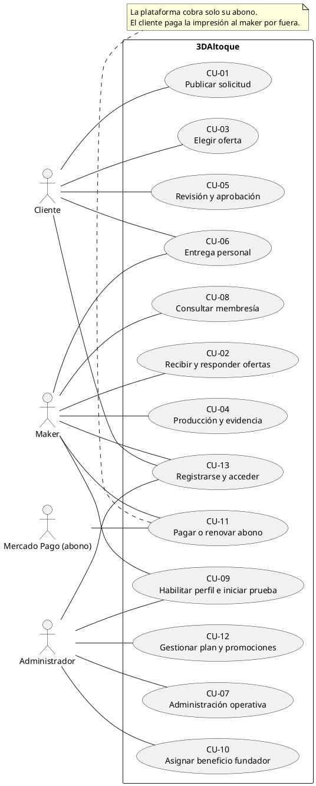

Clases de dominio

#### Clases de dominio

[Abrir SVG](/3daltoque-docs/documentos/3a38ed4d1833-dominio.svg) · [Fuente editable](/3daltoque-docs/documentos/6420bfd40263-dominio.mmd)

Fuente editable

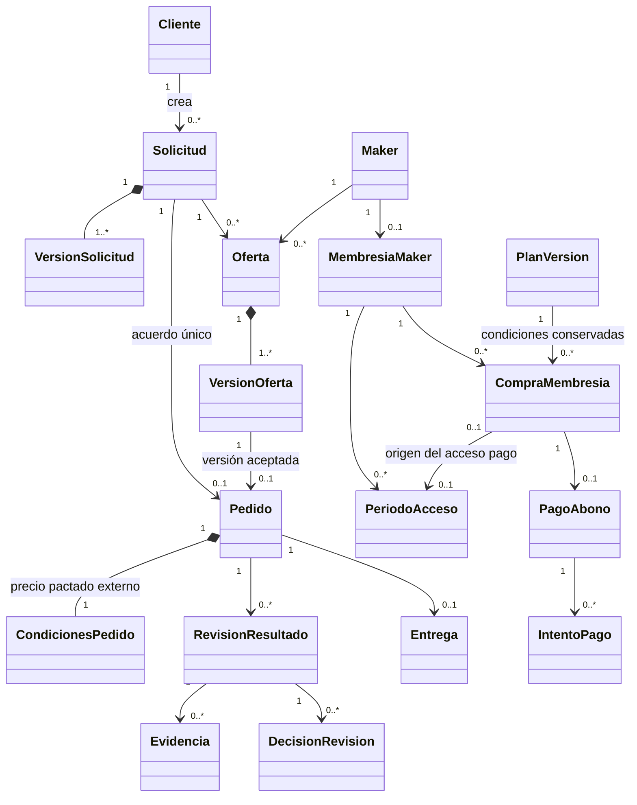

## Arquitectura y componentes

Puertos y adaptadores

#### Puertos y adaptadores

[Abrir SVG](/3daltoque-docs/documentos/a44c2fd72ab2-diseno-hexagonal.svg) · [Fuente editable](/3daltoque-docs/documentos/1061d2163efb-diseno-hexagonal.mmd)

Fuente editable

```mermaid
classDiagram
  class AceptarOfertaUseCase {
    +execute(command)
  }
  class ConsultarMembresiaUseCase {
    +execute(query)
  }
  class ComprarAbonoUseCase {
    +execute(command)
  }
  class ConcederAccesoUseCase {
    +execute(paymentResult)
  }
  class AprobarResultadoUseCase {
    +execute(command)
  }
  class OfertaRepositoryPort {
    <<interface>>
    +aceptarAtomico(oferta, version)
  }
  class MembresiaRepositoryPort {
    <<interface>>
    +consultarPeriodos(maker)
    +concederUnaVez(compra)
  }
  class PlanRepositoryPort {
    <<interface>>
    +obtenerVersionVigente()
  }
  class PaymentGatewayPort {
    <<interface>>
    +crearCheckout(compra)
    +consultarResultado(referencia)
    +verificarNotificacion(headers, body)
  }
  class RevisionRepositoryPort {
    <<interface>>
    +registrarDecision(revision, decision)
  }
  class MercadoPagoCheckoutProAdapter
  class PagoSimuladoAdapter
  class PersistenciaPostgresAdapter
  AceptarOfertaUseCase --> OfertaRepositoryPort
  AceptarOfertaUseCase --> MembresiaRepositoryPort
  ConsultarMembresiaUseCase --> MembresiaRepositoryPort
  ComprarAbonoUseCase --> PlanRepositoryPort
  ComprarAbonoUseCase --> PaymentGatewayPort
  ConcederAccesoUseCase --> PaymentGatewayPort
  ConcederAccesoUseCase --> MembresiaRepositoryPort
  AprobarResultadoUseCase --> RevisionRepositoryPort
  MercadoPagoCheckoutProAdapter ..|> PaymentGatewayPort
  PagoSimuladoAdapter ..|> PaymentGatewayPort
  PersistenciaPostgresAdapter ..|> MembresiaRepositoryPort
  PersistenciaPostgresAdapter ..|> OfertaRepositoryPort

```

Componentes lógicos

#### Componentes lógicos

[Abrir SVG](/3daltoque-docs/documentos/44ac08b2bfc6-componentes.svg) · [Fuente editable](/3daltoque-docs/documentos/410048d78c61-componentes.mmd)

Fuente editable

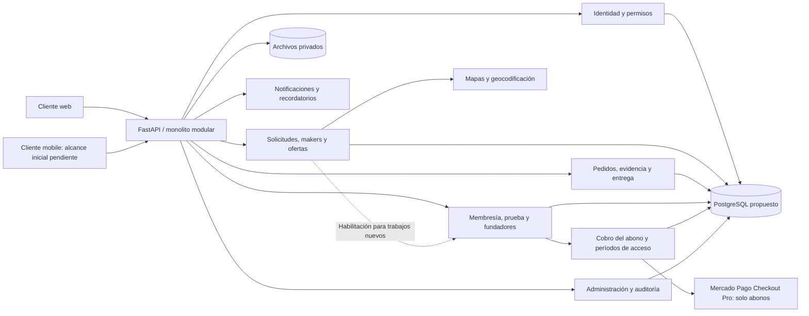

## Secuencias

Solicitudes y ofertas

#### Solicitudes y ofertas

[Abrir SVG](/3daltoque-docs/documentos/97d5eef655ae-secuencia-cotizacion.svg) · [Fuente editable](/3daltoque-docs/documentos/3fcf0ef2e392-secuencia-cotizacion.mmd)

Fuente editable

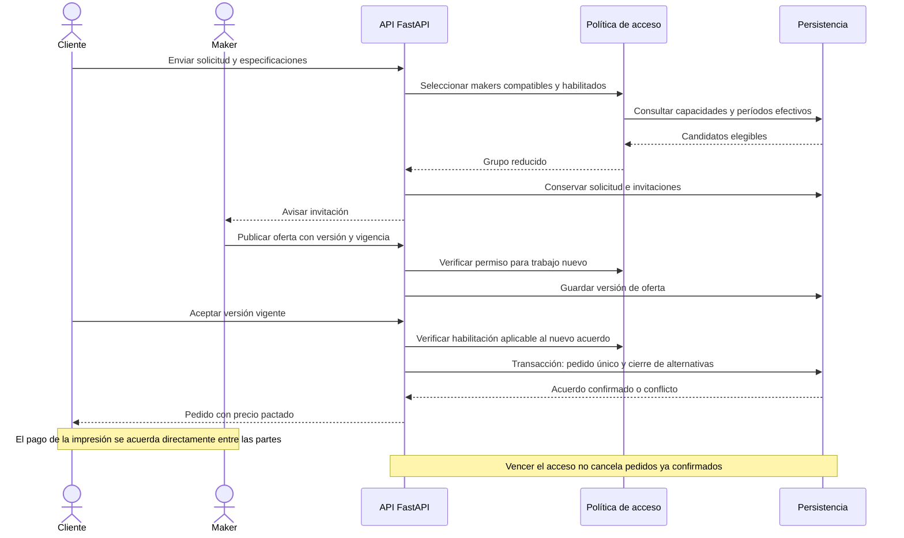

Compra del abono

#### Compra del abono

[Abrir SVG](/3daltoque-docs/documentos/5b550fb39979-secuencia-pago.svg) · [Fuente editable](/3daltoque-docs/documentos/2d10cc2b1ebd-secuencia-pago.mmd)

Fuente editable

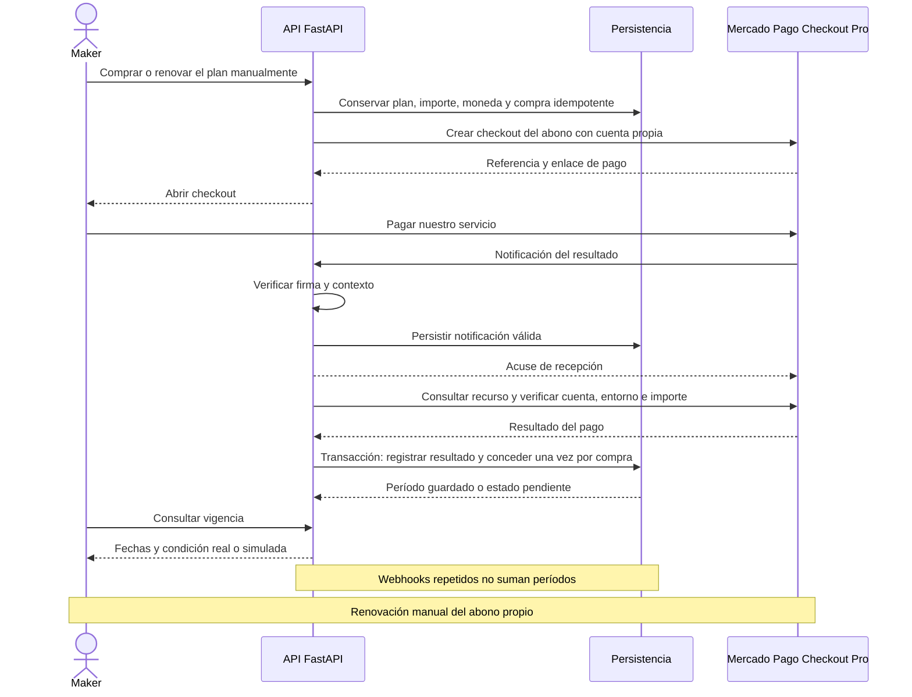

## Estados del producto

Estados de solicitud

#### Estados de solicitud

[Abrir SVG](/3daltoque-docs/documentos/5a3710605866-estados-solicitud.svg) · [Fuente editable](/3daltoque-docs/documentos/1441f04a2334-estados-solicitud.mmd)

Fuente editable

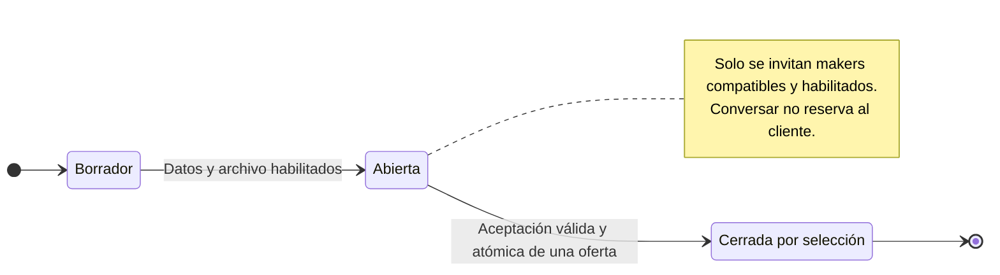

Estados de oferta

#### Estados de oferta

[Abrir SVG](/3daltoque-docs/documentos/a8692614b574-estados-oferta.svg) · [Fuente editable](/3daltoque-docs/documentos/b1d5026866f3-estados-oferta.mmd)

Fuente editable

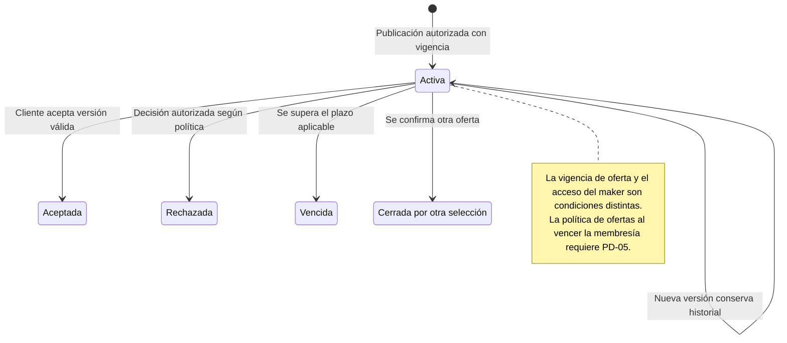

Estados del pedido

#### Estados del pedido

[Abrir SVG](/3daltoque-docs/documentos/e9d99ad5c424-estados-pedido.svg) · [Fuente editable](/3daltoque-docs/documentos/51c245f91b6b-estados-pedido.mmd)

Fuente editable

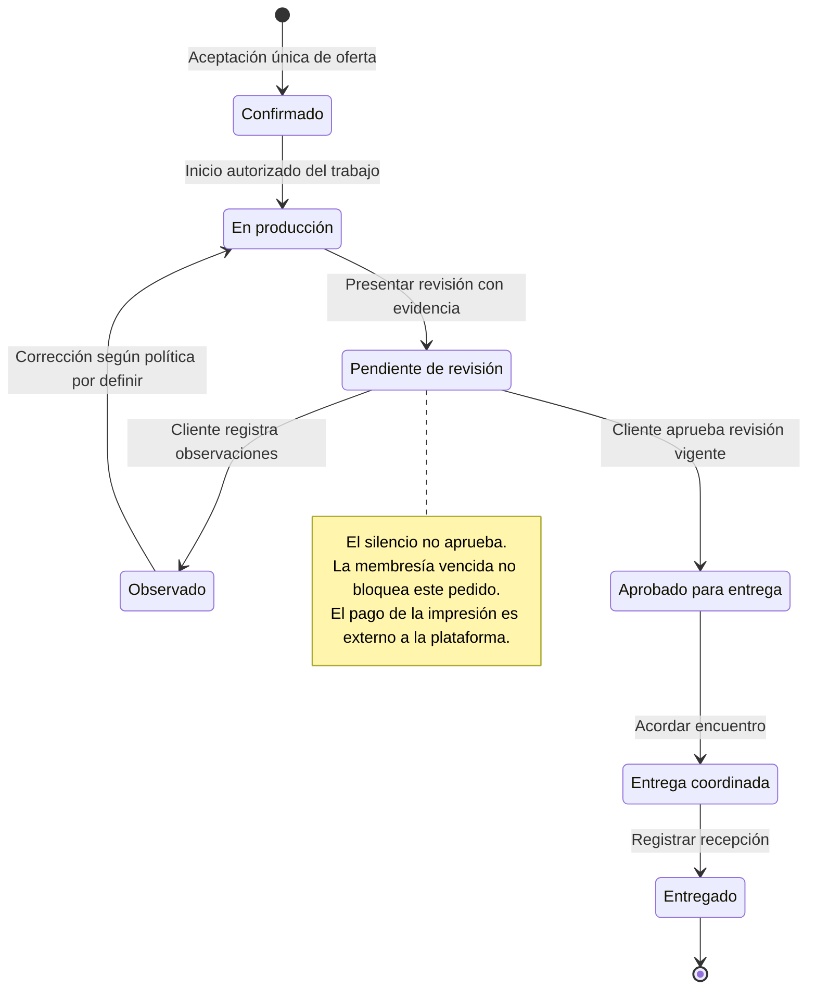

Estados de revisión

#### Estados de revisión

[Abrir SVG](/3daltoque-docs/documentos/d72adef0e9f0-estados-revision.svg) · [Fuente editable](/3daltoque-docs/documentos/bf6af2ee5236-estados-revision.mmd)

Fuente editable

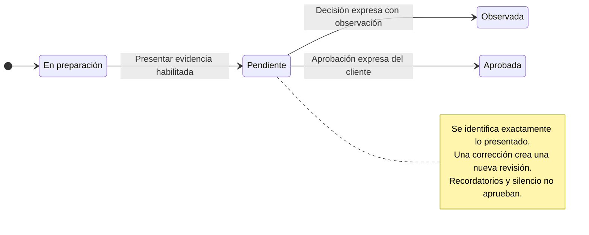

Estados de entrega

#### Estados de entrega

[Abrir SVG](/3daltoque-docs/documentos/1c6a0d8124ee-estados-entrega.svg) · [Fuente editable](/3daltoque-docs/documentos/e91a1c54d94b-estados-entrega.mmd)

Fuente editable

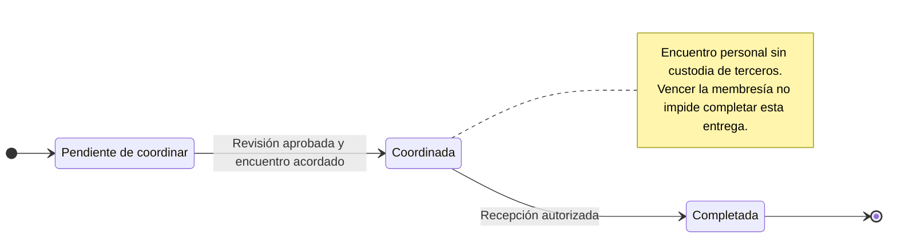

Vigencia de la membresía

#### Vigencia de la membresía

[Abrir SVG](/3daltoque-docs/documentos/f2ba7a368209-estados-membresia.svg) · [Fuente editable](/3daltoque-docs/documentos/8f909307fb54-estados-membresia.mmd)

Fuente editable

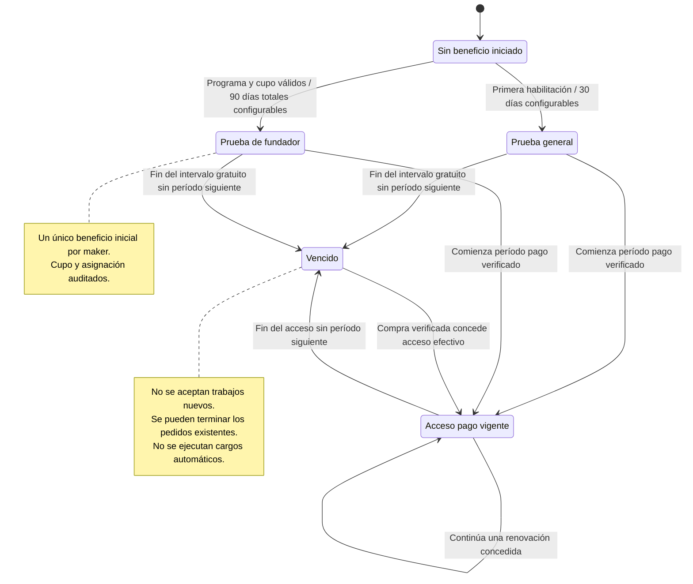

Estados del pago del abono

#### Estados del pago del abono

[Abrir SVG](/3daltoque-docs/documentos/c748c25e7e54-estados-pago.svg) · [Fuente editable](/3daltoque-docs/documentos/564f67e434cc-estados-pago.mmd)

Fuente editable

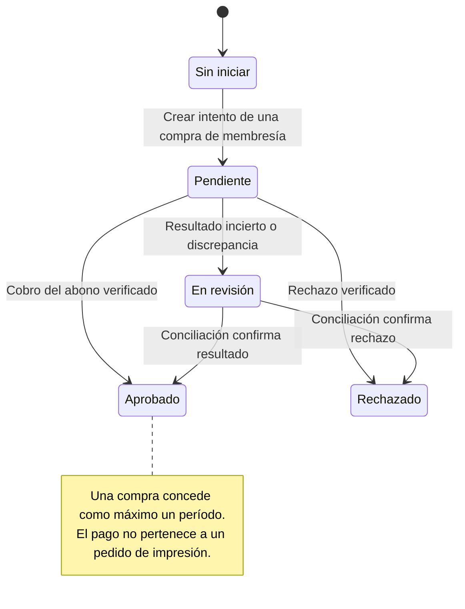

## Datos

[Ocho vistas DER con sus fuentes](/3daltoque-docs/modelado/datos/) y [diccionario](/3daltoque-docs/modelado/modelo-logico/). La compra de membresía no referencia al pedido de impresión; el acceso vencido no cancela el acuerdo de un trabajo aceptado.

## Diagramas en Figma

Referencias de reproducción en Figma

[Abrir el índice de diagramas](https://www.figma.com/design/PJTOrEKSxxiS2X4R4DImJn/3DAltoque?node-id=86-347).

La página organiza los 21 SVG existentes en análisis, arquitectura, datos, estados y secuencias. Cada lámina conserva su referencia de origen y una huella de fuente en el registro de importación.

| Grupo | Diagrama | Fuente SVG | Figma |
| --- | --- | --- | --- |
| Análisis | Casos de uso · CU-01 a CU-13 | [Fuente](/3daltoque-docs/documentos/56672ecacb3e-casos-de-uso.svg) | [Abrir](https://www.figma.com/design/PJTOrEKSxxiS2X4R4DImJn/3DAltoque?node-id=86-361) |
| Análisis | Clases de dominio | [Fuente](/3daltoque-docs/documentos/3a38ed4d1833-dominio.svg) | [Abrir](https://www.figma.com/design/PJTOrEKSxxiS2X4R4DImJn/3DAltoque?node-id=87-337) |
| Arquitectura | Arquitectura · componentes lógicos | [Fuente](/3daltoque-docs/documentos/44ac08b2bfc6-componentes.svg) | [Abrir](https://www.figma.com/design/PJTOrEKSxxiS2X4R4DImJn/3DAltoque?node-id=87-904) |
| Arquitectura | Arquitectura · puertos y adaptadores | [Fuente](/3daltoque-docs/documentos/a44c2fd72ab2-diseno-hexagonal.svg) | [Abrir](https://www.figma.com/design/PJTOrEKSxxiS2X4R4DImJn/3DAltoque?node-id=87-1040) |
| Datos | DER · vista general | [Fuente](/3daltoque-docs/documentos/b603b79b1a48-der-general.svg) | [Abrir](https://www.figma.com/design/PJTOrEKSxxiS2X4R4DImJn/3DAltoque?node-id=87-1281) |
| Datos | DER · identidad y capacidades | [Fuente](/3daltoque-docs/documentos/ccaa2a178084-der-identidad.svg) | [Abrir](https://www.figma.com/design/PJTOrEKSxxiS2X4R4DImJn/3DAltoque?node-id=87-2280) |
| Datos | DER · archivos y análisis | [Fuente](/3daltoque-docs/documentos/66377b824f4a-der-archivos.svg) | [Abrir](https://www.figma.com/design/PJTOrEKSxxiS2X4R4DImJn/3DAltoque?node-id=87-2772) |
| Datos | DER · solicitudes y ofertas | [Fuente](/3daltoque-docs/documentos/57c3386e5db7-der-cotizaciones.svg) | [Abrir](https://www.figma.com/design/PJTOrEKSxxiS2X4R4DImJn/3DAltoque?node-id=87-2926) |
| Datos | DER · pedido, revisión y entrega | [Fuente](/3daltoque-docs/documentos/6a68fff74395-der-pedidos.svg) | [Abrir](https://www.figma.com/design/PJTOrEKSxxiS2X4R4DImJn/3DAltoque?node-id=87-3875) |
| Datos | DER · membresías y pagos | [Fuente](/3daltoque-docs/documentos/5950f8bd018c-der-pagos.svg) | [Abrir](https://www.figma.com/design/PJTOrEKSxxiS2X4R4DImJn/3DAltoque?node-id=87-4888) |
| Datos | DER · conversaciones y notificaciones | [Fuente](/3daltoque-docs/documentos/e596445273e8-der-comunicacion.svg) | [Abrir](https://www.figma.com/design/PJTOrEKSxxiS2X4R4DImJn/3DAltoque?node-id=87-5908) |
| Datos | DER · operación y auditoría | [Fuente](/3daltoque-docs/documentos/4b5695cb3462-der-operacion.svg) | [Abrir](https://www.figma.com/design/PJTOrEKSxxiS2X4R4DImJn/3DAltoque?node-id=87-6513) |
| Estados | Estados · solicitud | [Fuente](/3daltoque-docs/documentos/5a3710605866-estados-solicitud.svg) | [Abrir](https://www.figma.com/design/PJTOrEKSxxiS2X4R4DImJn/3DAltoque?node-id=87-7146) |
| Estados | Estados · oferta | [Fuente](/3daltoque-docs/documentos/a8692614b574-estados-oferta.svg) | [Abrir](https://www.figma.com/design/PJTOrEKSxxiS2X4R4DImJn/3DAltoque?node-id=87-7214) |
| Estados | Estados · pedido | [Fuente](/3daltoque-docs/documentos/e9d99ad5c424-estados-pedido.svg) | [Abrir](https://www.figma.com/design/PJTOrEKSxxiS2X4R4DImJn/3DAltoque?node-id=87-7310) |
| Estados | Estados · revisión del resultado | [Fuente](/3daltoque-docs/documentos/d72adef0e9f0-estados-revision.svg) | [Abrir](https://www.figma.com/design/PJTOrEKSxxiS2X4R4DImJn/3DAltoque?node-id=87-7440) |
| Estados | Estados · entrega y recepción | [Fuente](/3daltoque-docs/documentos/1c6a0d8124ee-estados-entrega.svg) | [Abrir](https://www.figma.com/design/PJTOrEKSxxiS2X4R4DImJn/3DAltoque?node-id=87-7511) |
| Estados | Estados · membresía del maker | [Fuente](/3daltoque-docs/documentos/f2ba7a368209-estados-membresia.svg) | [Abrir](https://www.figma.com/design/PJTOrEKSxxiS2X4R4DImJn/3DAltoque?node-id=87-7580) |
| Estados | Estados · pago del abono | [Fuente](/3daltoque-docs/documentos/c748c25e7e54-estados-pago.svg) | [Abrir](https://www.figma.com/design/PJTOrEKSxxiS2X4R4DImJn/3DAltoque?node-id=87-7715) |
| Secuencias | Secuencia · solicitud, ofertas y aceptación | [Fuente](/3daltoque-docs/documentos/97d5eef655ae-secuencia-cotizacion.svg) | [Abrir](https://www.figma.com/design/PJTOrEKSxxiS2X4R4DImJn/3DAltoque?node-id=87-7808) |
| Secuencias | Secuencia · compra y renovación del abono | [Fuente](/3daltoque-docs/documentos/5b550fb39979-secuencia-pago.svg) | [Abrir](https://www.figma.com/design/PJTOrEKSxxiS2X4R4DImJn/3DAltoque?node-id=87-7915) |

### Modelo lógico

El [modelo lógico y diccionario](/3daltoque-docs/modelado/modelo-logico/) documenta 50 tablas y 460 columnas. El índice de Figma conserva esa referencia junto a las ocho vistas del DER.

### Clases de diseño

La vista de puertos y adaptadores conserva las responsabilidades y dependencias existentes. El checklist mantiene pendiente desarrollar las clases de diseño con sus operaciones y colaboraciones.

### Registro de la reproducción

[Correspondencia entre fuentes y nodos de Figma](/3daltoque-docs/documentos/7b1c6feb8bec-diagramas-docs-hidden-2026-10-23.json). La importación convierte las etiquetas HTML del SVG a texto compatible y utiliza Manrope en Figma. Los SVG y las fuentes Mermaid/PlantUML de docs-hidden conservan su contenido.

