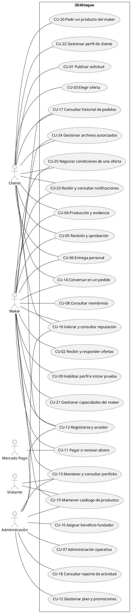
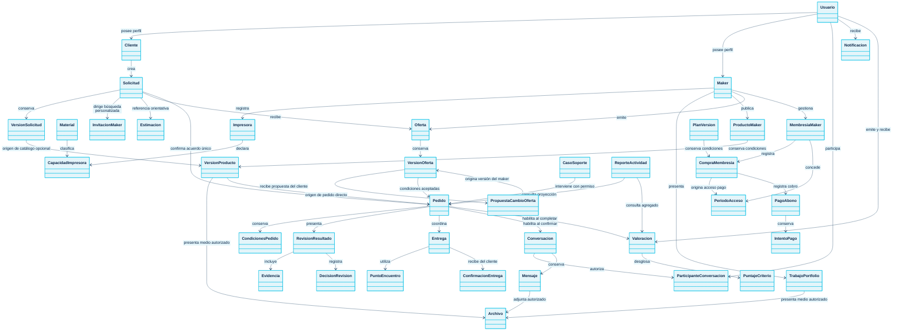
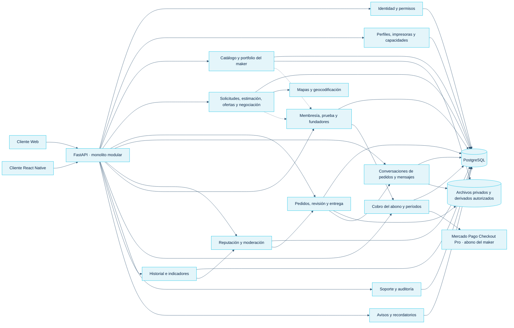

# Diagramas del proyecto

Actualización: 25 de octubre de 2026. Las imágenes y fuentes editables se insertan en el documento de su modelo.

| Modelo | Documento |
| --- | --- |
| Casos de uso | [25 CU y actores](/3daltoque-docs/analisis/casos-de-uso/#diagrama-de-casos-de-uso) |
| Dominio | [Clases, relaciones y cardinalidades](/3daltoque-docs/modelado/clases-y-arquitectura/#dominio) |
| Datos | [Diez vistas DER](/3daltoque-docs/modelado/datos/) y [diccionario lógico](/3daltoque-docs/modelado/modelo-logico/) |
| Clases de diseño | [Servicios, operaciones, puertos y colaboraciones](/3daltoque-docs/diseno/clases-de-diseno/) |
| Arquitectura | [Arquitectura y componentes](/3daltoque-docs/diseno/arquitectura/) |
| Estados y secuencias | [Solicitud, oferta, producto, pedido, revisión, entrega, chat y abono](/3daltoque-docs/flujos/estados/) |

## Casos de uso

[Abrir SVG](/3daltoque-docs/documentos/56672ecacb3e-casos-de-uso.svg) · [Fuente editable](/3daltoque-docs/documentos/c14d6068439c-casos-de-uso.puml)

Fuente editable

## Clases de dominio

[Abrir SVG](/3daltoque-docs/documentos/3a38ed4d1833-dominio.svg) · [Fuente editable](/3daltoque-docs/documentos/6420bfd40263-dominio.mmd)

Fuente editable

## Componentes

[Abrir SVG](/3daltoque-docs/documentos/44ac08b2bfc6-componentes.svg) · [Fuente editable](/3daltoque-docs/documentos/410048d78c61-componentes.mmd)

Fuente editable

## Clases de diseño

[Abrir SVG](/3daltoque-docs/documentos/57e576c9dff0-clases-diseno.svg) · [Fuente editable](/3daltoque-docs/documentos/4fad4154f542-clases-diseno.mmd)

```mermaid
%%{init: {"theme":"base","themeVariables":{"primaryColor":"#E4F5FA","primaryTextColor":"#082345","primaryBorderColor":"#00BFE5","lineColor":"#315574","secondaryColor":"#F5F8FC","tertiaryColor":"#FFFFFF","fontFamily":"Manrope, sans-serif"},"flowchart":{"htmlLabels":false},"class":{"htmlLabels":false}}}%%
classDiagram
  direction LR
  class PerfilMakerService {
    +consultar_perfil(maker_id)
    +guardar_capacidades(command)
    +habilitar_perfil(command)
  }
  class CatalogoService {
    +guardar_producto(command)
    +publicar_producto(command)
    +confirmar_pedido_producto(command)
  }
  class PortfolioService {
    +publicar_trabajo(command)
    +retirar_trabajo(command)
  }
  class SolicitudService {
    +guardar_borrador(command)
    +enviar_solicitud(command)
    +consultar_estimacion(query)
  }
  class OfertaService {
    +publicar_oferta(command)
    +resolver_contraoferta(command)
    +aceptar_oferta(command)
  }
  class PedidoService {
    +consultar_pedido(query)
    +registrar_transicion(command)
  }
  class ConversacionService {
    +consultar_bandeja(query)
    +consultar_mensajes(query)
    +enviar_mensaje(command)
  }
  class RevisionService {
    +presentar_evidencia(command)
    +registrar_decision(command)
  }
  class EntregaService {
    +proponer_encuentro(command)
    +aceptar_encuentro(command)
    +confirmar_recepcion(command)
  }
  class ReputacionService {
    +publicar_valoracion(command)
    +consultar_resumen(query)
    +moderar_valoracion(command)
  }
  class MembresiaService {
    +consultar_acceso(query)
    +crear_compra(command)
    +verificar_pago(command)
    +conceder_periodo(command)
  }
  class ArchivoService {
    +autorizar_transferencia(command)
    +finalizar_archivo(command)
    +obtener_acceso(query)
  }
  class NotificacionService {
    +procesar_evento(command)
    +consultar_bandeja(query)
    +marcar_leida(command)
  }
  class ReporteQueries {
    +consultar_historial(query)
    +consultar_actividad(query)
  }
  class UnitOfWorkPort {
    <<interface>>
    +ejecutar_transaccion(operation)
  }
  class PerfilRepositoryPort {
    <<interface>>
    +consultar_propietario(id)
    +guardar_version(recurso)
  }
  class CatalogoRepositoryPort {
    <<interface>>
    +consultar_version(id, numero)
    +guardar_publicacion(producto)
  }
  class PedidoRepositoryPort {
    <<interface>>
    +aceptar_una_vez(command)
    +consultar_autorizado(query)
  }
  class ConversacionRepositoryPort {
    <<interface>>
    +obtener_por_pedido(id)
    +guardar_mensaje_una_vez(command)
  }
  class RevisionRepositoryPort {
    <<interface>>
    +registrar_revision(command)
    +registrar_decision(command)
  }
  class MembresiaRepositoryPort {
    <<interface>>
    +consultar_periodos(maker)
    +conceder_una_vez(compra)
  }
  class PaymentGatewayPort {
    <<interface>>
    +crear_checkout(compra)
    +verificar_notificacion(headers, body)
    +consultar_resultado(referencia)
  }
  class StoragePort {
    <<interface>>
    +autorizar_transferencia(meta)
    +consultar_integridad(archivo)
    +emitir_acceso(archivo)
  }
  class MapasPort {
    <<interface>>
    +resolver_referencia(query)
  }
  class NotificacionesPort {
    <<interface>>
    +enviar_aviso(evento)
  }
  class ReporteReadPort {
    <<interface>>
    +agregar_actividad(query)
  }
  PerfilMakerService --> PerfilRepositoryPort
  PerfilMakerService --> MembresiaRepositoryPort
  PerfilMakerService --> UnitOfWorkPort
  CatalogoService --> CatalogoRepositoryPort
  CatalogoService --> PedidoRepositoryPort
  CatalogoService --> MembresiaRepositoryPort
  CatalogoService --> ConversacionRepositoryPort
  CatalogoService --> UnitOfWorkPort
  PortfolioService --> PerfilRepositoryPort
  PortfolioService --> StoragePort
  SolicitudService --> PerfilRepositoryPort
  SolicitudService --> MapasPort
  SolicitudService --> StoragePort
  SolicitudService --> UnitOfWorkPort
  OfertaService --> PedidoRepositoryPort
  OfertaService --> MembresiaRepositoryPort
  OfertaService --> UnitOfWorkPort
  PedidoService --> PedidoRepositoryPort
  PedidoService --> UnitOfWorkPort
  ConversacionService --> ConversacionRepositoryPort
  ConversacionService --> StoragePort
  ConversacionService --> UnitOfWorkPort
  RevisionService --> RevisionRepositoryPort
  RevisionService --> StoragePort
  RevisionService --> UnitOfWorkPort
  EntregaService --> PedidoRepositoryPort
  EntregaService --> RevisionRepositoryPort
  EntregaService --> MapasPort
  EntregaService --> UnitOfWorkPort
  ReputacionService --> PedidoRepositoryPort
  ReputacionService --> PerfilRepositoryPort
  ReputacionService --> UnitOfWorkPort
  MembresiaService --> MembresiaRepositoryPort
  MembresiaService --> PaymentGatewayPort
  MembresiaService --> UnitOfWorkPort
  ArchivoService --> StoragePort
  ArchivoService --> PerfilRepositoryPort
  NotificacionService --> NotificacionesPort
  NotificacionService --> UnitOfWorkPort
  ReporteQueries --> ReporteReadPort
  class FastAPIAdapter
  class PersistenciaPostgresAdapter
  class MercadoPagoCheckoutProAdapter
  class PagoSimuladoAdapter
  FastAPIAdapter --> CatalogoService
  FastAPIAdapter --> ConversacionService
  MercadoPagoCheckoutProAdapter ..|> PaymentGatewayPort
  PagoSimuladoAdapter ..|> PaymentGatewayPort
  PersistenciaPostgresAdapter ..|> PedidoRepositoryPort
  PersistenciaPostgresAdapter ..|> ConversacionRepositoryPort
```

Fuente editable

