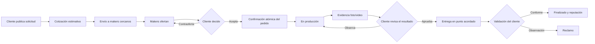

# 01) Alcance y producto

Actualización de alcance y redacción: 25 de octubre de 2026. El modelo comercial sigue [ADR-002](/3daltoque-docs/decisiones/modelo-comercial/). La versión anterior se conserva en los antecedentes del cambio comercial.

**Proyecto:** 3DAltoque
**Carrera:** Análisis de Sistemas — Trabajo Final de Carrera
**Equipo:** Lucas Bernardez · María del Rosario Cariaga · Lucas Ruiz
**Versión:** 2.2

---

## 1. Problema y propuesta

### 1.1 Problema detectado

Los antecedentes del cuatrimestre anterior describen búsquedas de servicios de impresión 3D mediante grupos de Facebook, Discord, Reddit, Instagram y contactos personales. El relevamiento inicial y el mapa de empatía aportan los problemas resumidos a continuación. Sus registros de campo y mediciones deben incorporarse desde los documentos iniciales del equipo, conservados en su archivo de antecedentes.

| Actor | Dolor principal | Evidencia relevada |
|---|---|---|
| **Cliente** (estudiantes, hobbistas, gente que repara cosas en su casa) | Dificultad para anticipar plazos y precios, comparar alternativas, coordinar la entrega y revisar el resultado, como hipótesis del relevamiento inicial. | Consultas de búsqueda de makers cercanos descritas en los antecedentes; falta adjuntar período, muestra y registro de observaciones. |
| **Maker** (dueño de una impresora doméstica o de taller) | Capacidad disponible, poca visibilidad y presupuesto publicitario limitado, como hipótesis a contrastar con makers. | Entrevistas mencionadas en los antecedentes; falta adjuntar instrumento, fecha y registro. |

### 1.2 Propuesta

**3DAltoque** conecta a personas que necesitan piezas impresas en 3D con **makers locales** que pueden fabricarlas con impresoras domésticas o de taller.

La propuesta base funciona como un **mercado de servicios de fabricación on-demand** (web y mobile) con **búsqueda por proximidad** y **comparación de ofertas**. La estimación inicial ofrece una **referencia orientativa**: cada maker puede responder con sus propias condiciones de precio y plazo.

### 1.3 Propuesta de valor diferencial

- **Cercanía:** matching geolocalizado con makers del barrio (plazo de entrega acordado para cada pieza).
- **Transparencia:** estimación orientativa con supuestos visibles más ofertas comparables con su vigencia.
- **Confianza:** evidencia visual antes de la entrega (fotos/video) y reputación bidireccional.
- **Seguridad:** entregas en **Nodos Amigos**, puntos de encuentro neutrales (cafeterías, kioscos) que evitan exponer domicilios particulares.
- **Economía local:** monetiza la capacidad ociosa de makers chicos.

### 1.4 Situación actual vs. situación esperada

| Situación actual | Con 3D al Toque |
|---|---|
| Búsqueda informal en redes y contactos | Búsqueda de makers compatibles por cercanía, material y reputación |
| Presupuestos manuales y lentos | Estimación orientativa con supuestos visibles más ofertas de varios makers |
| Comunicación dispersa (WhatsApp, DM) | Mensajería y notificaciones asociadas a cada pedido |
| Demoras de días o semanas y envíos costosos | Retiro presencial en un punto y plazo acordados |
| Sin garantía visual previa | Foto/video del producto terminado antes de la entrega |
| Retiro en domicilio de un desconocido | Entrega en Nodo Amigo (punto neutral) |

---

## 2. Objetivos de negocio confirmados

- Facilitar encontrar y comparar makers cercanos compatibles con la solicitud.
- Permitir cotización múltiple con negociación de precio y plazo por parte del maker.
- Confirmar el servicio cuando cliente y maker acuerdan condiciones vigentes.
- Incluir evidencias visuales previas a la entrega.
- Mantener trazabilidad de estado, mensajes y revisiones del cliente.
- Proteger datos personales mediante el uso de nodos de encuentro (protección de domicilios).
- Generar ingresos mediante una **membresía prepaga de 30 días para makers**, con renovación manual y costos de cobro, infraestructura y soporte contemplados en el precio.

### 2.1 Indicadores de éxito propuestos (MVP)

| Indicador | Qué mide |
|---|---|
| Tiempo hasta la primera oferta | Rapidez de respuesta de los makers |
| % de solicitudes con al menos una oferta | Cobertura y liquidez de la red de makers |
| % de solicitudes confirmadas | Conversión de solicitud a pedido |
| % de pedidos entregados sin reclamo | Calidad y cumplimiento |
| Reputación promedio de makers y clientes | Confianza en la plataforma |
| Makers activos por zona piloto | Densidad de la oferta |

> Los valores objetivo de cada indicador se definirán al planificar la etapa piloto.

---

## 3. Usuarios objetivo (Buyer Personas)

| Persona | Perfil | Necesidad clave |
|---|---|---|
| **Francesca, 22 años: estudiante de Arquitectura "last minute"** | FADU-UBA, vive en Belgrano, presupuesto ajustado, sin lugar para tener impresora. | Piezas para maquetas de un día para el otro, sin perder horas viajando. |
| **Marcos, 42 años: hobbista de nicho** | Administrativo, vive en Almagro; juegos de mesa y modelismo. Descarga STL de Thingiverse/Cults3D. | Piezas chicas con mucho detalle (resina, boquilla de 0.2 mm) y hablar directo con el maker. |
| **Jorge, 50 años: el "resolutivo" del hogar** | Jubilado técnico, vive en Villa Crespo, desconfía de la tecnología compleja. | Simplicidad: subir el STL, saber cuánto sale y dónde retirarlo cerca. |

**Zona piloto (zona 0):** CABA y Gran Buenos Aires.

---

## 4. Alcance del MVP inicial

### 4.1 En alcance (v1)

- Registro de clientes y makers.
- Publicación de solicitudes con parámetros de impresión (archivo STL, material, color, cantidad, urgencia, tamaño aproximado, **categoría de uso**: decorativo / mecánico / alta temperatura).
- Cotización estimativa inicial automática (orientativa, con supuestos visibles).
- Envío de la solicitud a un grupo de makers compatibles y cercanos.
- Gestión de ofertas (aceptar / rechazar / contraofertar), cada una con su vigencia.
- Confirmación atómica de una sola oferta vigente por solicitud.
- Comunicación básica (chat por pedido) y notificaciones de estado.
- Seguimiento de la producción y evidencia del producto terminado (fotos/video).
- Control de recepción con validación del cliente.
- Entregas por punto de encuentro (Nodo Amigo).
- Reputación bidireccional (cliente ↔ maker).
- Integración con **Mercado Pago Checkout Pro** para cobrar el abono del maker a favor de 3DAltoque.
- Configuración del plan, precio, moneda, prueba general y programa Makers Fundadores. Los valores iniciales son 30 días generales o 90 días totales para fundadores, con un único beneficio por maker.
- Cobro del abono con entorno de prueba y **modo simulado** identificado para demostraciones, conforme a RF-12.14.
- Panel de administración con moderación y reportes de actividad.

- Catálogo de productos de configuración y precio fijos del maker, con confirmación directa de pedido.
- Conversación habilitada desde el pedido confirmado.

### 4.2 Tabla de funcionalidades

| # | Funcionalidad | Descripción | Tipo | Aplica a |
|---|---|---|---|---|
| F01 | Registro e inicio de sesión | Alta de cuenta y login con selección de rol (cliente o maker). Autenticación según contrato compartido y PD-01. | ABM | Ambas |
| F02 | Gestión de perfil de cliente | Datos personales, ubicación, contacto e historial básico. | ABM | Ambas |
| F03 | Gestión de perfil de maker | Datos personales y comerciales, zona de trabajo, impresoras, materiales, disponibilidad horaria y descripción del servicio. | ABM | Ambas |
| F04 | Portfolio del maker | Carga de imágenes/videos de trabajos realizados. | ABM | Ambas |
| F05 | Alta de solicitud de impresión | Carga del STL y de los parámetros del pedido (material, color, cantidad, urgencia, tamaño, categoría de uso, observaciones). | Lógica de negocio | Ambas |
| F06 | Cotización estimativa inicial | Referencia orientativa con sus supuestos; el precio del acuerdo corresponde a la oferta aceptada. | Lógica de negocio | Ambas |
| F07 | Búsqueda de makers cercanos | Makers próximos por geolocalización, con filtros por disponibilidad, materiales y reputación. | Lógica de negocio | Ambas |
| F08 | Matching y envío a makers | Ordena y recomienda makers según cercanía, disponibilidad, reputación, materiales y tipo de pieza, y les envía la solicitud. | Lógica de negocio | Ambas |
| F09 | Gestión de ofertas | El maker oferta precio, plazo y vigencia; el cliente acepta, rechaza o contraoferta. | Lógica de negocio | Ambas |
| F10 | Confirmación de oferta | Aceptar una oferta vigente la confirma de forma atómica y cierra automáticamente el resto. | Lógica de negocio | Ambas |
| F11 | Membresía y abono | Plan prepago de 30 días, prueba configurable, Makers Fundadores y renovación manual mediante Checkout Pro. | Lógica de negocio | Ambas |
| F12 | Gestión de estados del pedido | Actualización y consulta del estado del pedido (ver §6). | Lógica de negocio | Ambas |
| F13 | Mensajería cliente–maker | Chat asociado a cada pedido (texto e imágenes de referencia). | Lógica de negocio | Ambas |
| F14 | Notificaciones | Avisos dentro de la app por mensajes, ofertas nuevas, cambios de estado y confirmaciones. | Lógica de negocio | Ambas |
| F15 | Evidencia previa a la entrega | El maker sube foto/video del producto terminado para que el cliente lo revise. | Lógica de negocio | Ambas |
| F16 | Entrega en Nodo Amigo | Selección y coordinación del punto de encuentro neutral. | Lógica de negocio | Ambas |
| F17 | Validación de recepción | El cliente confirma la recepción o abre una observación/reclamo. | Lógica de negocio | Ambas |
| F18 | Reputación bidireccional | El cliente califica al maker (calidad, cumplimiento, comunicación) y el maker al cliente (claridad, responsabilidad). | Lógica de negocio | Ambas |
| F19 | Historial de pedidos | Pedidos propios personalizados o de catálogo, condiciones pactadas, estados y calificaciones. | Reporte | Ambas |
| F20 | Panel de administración | Gestión de usuarios, makers, denuncias, reclamos, Nodos Amigos y parámetros del plan, las pruebas gratuitas y el cupo fundador. | ABM / Lógica de negocio | Web |
| F21 | Reporte de actividad | Métricas: usuarios registrados, makers activos, pedidos realizados y cancelados, calificación promedio. | Reporte | Web |
| F22 | Revisión y aprobación del resultado | Revisión y aprobación del resultado | Lógica de negocio | Ambas |
| F23 | Gestión de archivos privados | Gestión de archivos privados | Lógica de negocio | Ambas |
| F24 | API común y sincronización | API común y sincronización | Lógica de negocio | Ambas |
| F25 | Catálogo de productos del maker | Publicaciones versionadas, precio fijo y pedido directo con condiciones conservadas. | ABM / Lógica de negocio | Ambas |

### 4.3 Funcionalidades reservadas para etapas posteriores

| Funcionalidad | Motivo |
|---|---|
| Venta de archivos digitales, inventario de piezas ya fabricadas y carrito multivendedor | El catálogo vigente contrata fabricación de productos publicados por cada maker mediante pedido directo. |
| Logística propia para envíos (delivery) | La plataforma no tendrá repartidores ni administrará envíos puerta a puerta. |
| Seguimiento GPS en tránsito de cada paquete | La entrega se coordina en el Nodo Amigo; no hace falta rastreo en tiempo real. |
| Reparación automática avanzada de archivos STL | Se permite subir archivos, pero no se corrigen errores complejos del modelo. |
| Servicio propio de impresión 3D | La plataforma intermedia: no compra impresoras ni fabrica. |
| Reparación de impresoras 3D | Surgió como necesidad en las comunidades, pero no forma parte del flujo principal. |
| Venta de filamentos, repuestos o insumos | La primera versión concentra el recorrido de contratación de servicios de impresión. |
| Integración directa con impresoras/firmware | Complejidad técnica fuera del alcance del MVP. |
| Renovación automática, planes adicionales, perfiles destacados y publicidad segmentada | Extensiones a evaluar después del plan único de membresía prepaga. |

---

## 5. Roles de plataforma

| Rol | Responsabilidades |
|---|---|
| `Cliente` | Publica solicitudes, compara y acepta ofertas, paga, revisa la evidencia, valida la recepción o abre reclamos, y califica. |
| `Maker` | Publica sus capacidades (impresoras, materiales, zona, disponibilidad), responde solicitudes con ofertas, fabrica, carga la evidencia, entrega en el nodo y califica. |
| `Administrador` | Modera usuarios y denuncias, gestiona reclamos y Nodos Amigos, configura los parámetros operativos (precio del plan, duración de pruebas, cupo fundador y límites de uso) y consulta reportes. |

---

## 6. Flujo principal del producto

Fuente editable del recorrido

**Recorridos de referencia:** la solicitud y sus ofertas se confirman mediante la aceptación de una versión vigente. El pedido recorre producción, revisión del resultado, aprobación expresa, entrega y finalización. La membresía conserva sus propios períodos y estados de compra, según los [flujos del producto](/3daltoque-docs/flujos/estados/).

Las [máquinas de estados](/3daltoque-docs/flujos/estados/) conservan las transiciones, permisos y condiciones de cada recurso.

---

## 7. Supuestos y restricciones

- El maker fabrica la pieza y el cliente aporta el archivo y las especificaciones. Las condiciones de uso deben precisar las responsabilidades de cada actor, conforme a PD-12.
- El cliente declara tener derechos de uso sobre el STL que sube. El maker solo puede usarlo para ese pedido.
- Se prohíbe la fabricación de piezas ilegales o peligrosas.
- Los archivos STL tendrán un **límite de tamaño** de almacenamiento.
- La zona piloto propuesta es CABA/GBA. Su delimitación requiere relevar makers elegibles y solicitudes potenciales para evaluar la densidad disponible.
- Stack de referencia: React web, React Native, FastAPI/Python y PostgreSQL. La selección de autenticación, mapas, almacenamiento y despliegue se registra en [herramientas y despliegue](/3daltoque-docs/proyecto/base-tecnica/).

---

## 8. Estado de decisión general

**Confirmado:**

- El precio del acuerdo corresponde a la versión de oferta aceptada por el cliente.
- Cada oferta tiene vigencia y puede cambiar durante la búsqueda.
- Aceptar una oferta cierra el resto.
- Checkout Pro cobra el abono de membresía; el cliente acuerda el pago de la impresión directamente con el maker.
- La entrega se hace por punto de encuentro (Nodo Amigo) para proteger los domicilios.

**Pendiente de definición:**

- Reglas de reclamo y reembolso (plazos, evidencia exigida, quién resuelve).
- Validación de STL (tamaño máximo, chequeos mínimos de integridad).
- Mecánica de reclamos y su impacto en la reputación.
- Si se habilita también el retiro directo coordinado con el maker como alternativa al Nodo Amigo.
- Precio y moneda del abono, calendario de renovación y política de devoluciones de membresía.
- Cupo fundador, ventana del programa y criterios de primera habilitación del perfil.

## Ampliación funcional del 25 de octubre de 2026

[ADR-003](/3daltoque-docs/decisiones/catalogo-y-cobertura/) incorpora el catálogo de productos y fija el inicio del chat en el pedido confirmado. La [revisión funcional](/3daltoque-docs/planificacion/revision-funcional/) relaciona F01 a F25 con 68 RF y 25 casos de uso. La documentación de los diseños permanece como referencia visual.
